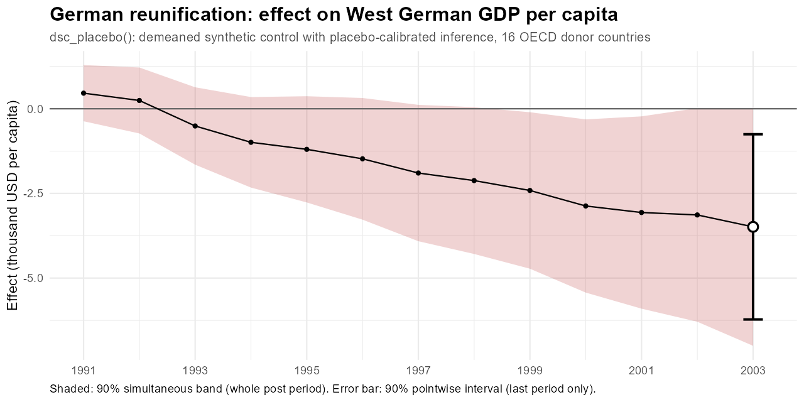
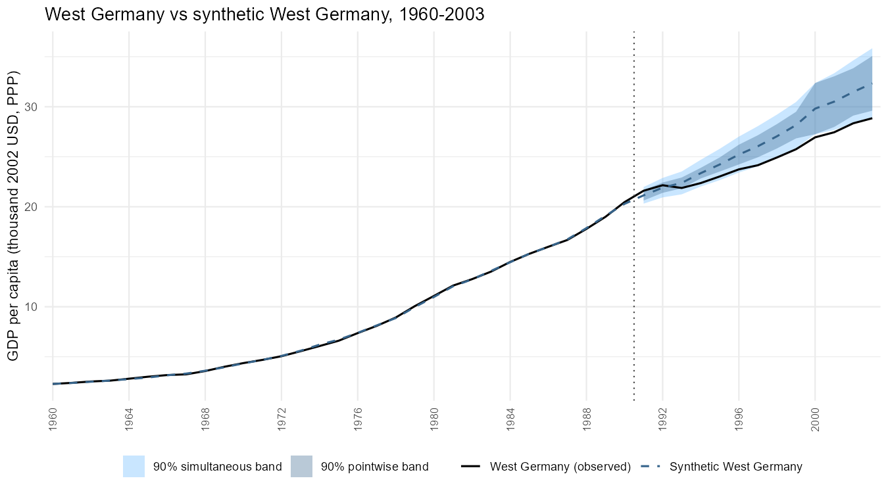
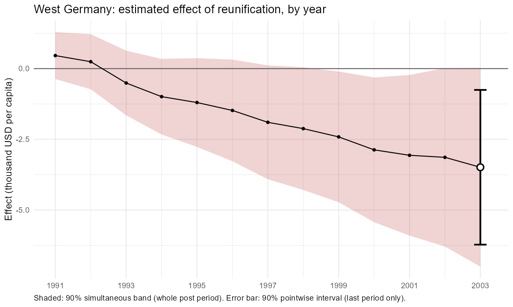
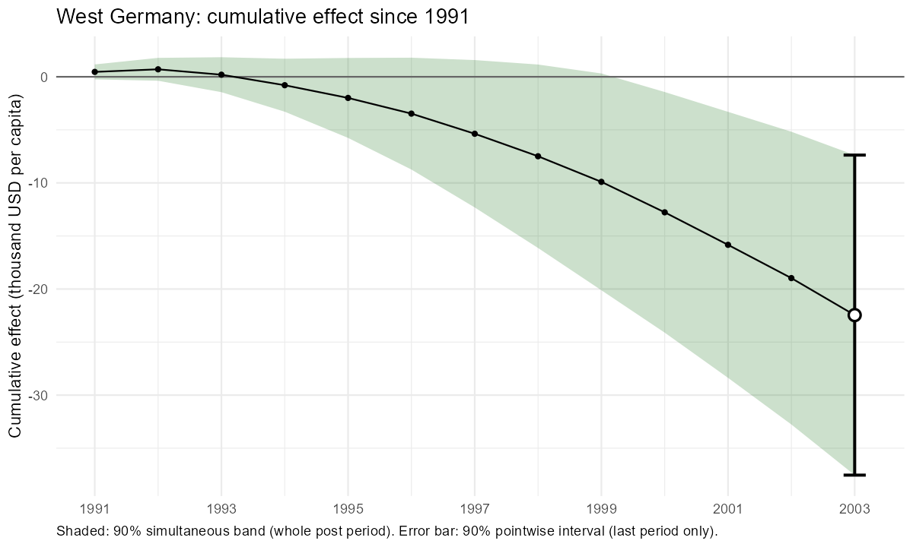
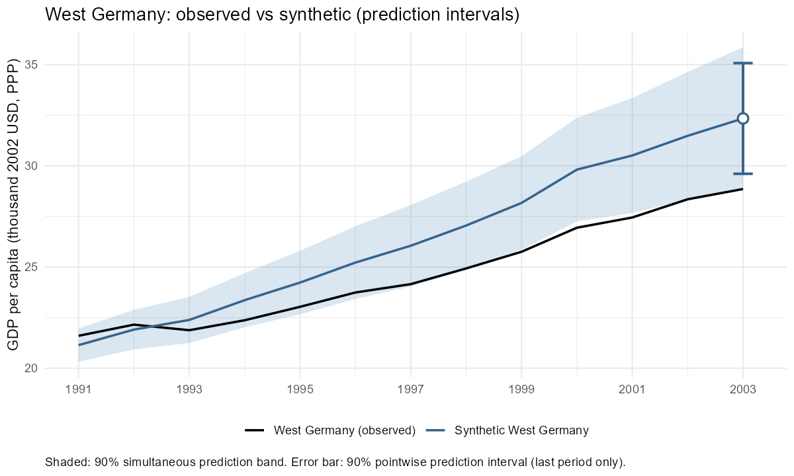

# dsc_placebo: Synthetic Control with Placebo-Calibrated Inference and Diagnostics



> **Disclaimer:** The R functions, documents and simulations in this repository were written by **Claude**, an AI model made by Anthropic, at the direction of the repository owner, as an example of using Claude to develop and validate statistical methods. They have been tested extensively by simulation but have not been independently peer reviewed. Please check the results for your own data and use case before relying on them.

## Overview

`dsc_placebo()` estimates the effect of an intervention on a **single treated unit** (a state that adopts a policy, say) and puts honest uncertainty around it. In one call it:

1. **Builds the counterfactual** with a **demeaned synthetic control**: an intercept plus non-negative donor weights that sum to one, fitted on the pre-treatment period. The intercept absorbs level differences; the weights must reproduce the treated unit's movements over time.
2. **Calibrates the inference against placebos**: every untreated unit is analysed as if it had been treated, and the treated unit's gap is ranked among theirs. This gives
   - **pointwise intervals** and p-values for a period chosen in advance (per-period and cumulative effects),
   - **simultaneous bands** that cover the whole post-treatment path at once (was there an effect at any point, and when?),
   - **prediction intervals** for the treated unit's untreated outcome, and
   - the classic **post/pre RMSPE-ratio test** as a conventional benchmark.
3. **Checks whether the method can be trusted** for this treated unit: **diagnostics** flag when the treated unit lies beyond what the donors can reproduce, the situation in which placebo inference fails, and recommend an alternative estimator where one was found to work. For a treated unit outside the donors' range with trending factors, that is the **ridge-augmented** synthetic control (`augment = "ridge"`), which corrects the counterfactual for the imbalance the weights leave.

## Installation

The functions are a single R script, not a package. Clone or download the repository, install the packages it uses, and source the script from the project root:

```r
install.packages(c("CVXR", "fect", "ggplot2", "dplyr", "tidyr", "forcats"))   # core and plotting
install.packages("scpi")                                                     # data for the example below

source("synthetic_control_functions/synthetic_control_functions_claude.R")
```

`CVXR` fits the synthetic control; `fect` is needed for the diagnostics, covariate adjustment with interactive fixed effects, `augment = "ife"` and the fect estimator (`augment = "ridge"` doesn't need it); the plotting functions use `ggplot2`, `dplyr`, `tidyr` and `forcats`. The other examples use `augsynth::kansas` (`remotes::install_github("ebenmichael/augsynth")`), `tidysynth::smoking`, and the Oregon panel in `data/oregon_fentanyl/`; the simulations also use `tidyverse`, `future` and `furrr`. Developed and tested with R 4.5.3, CVXR 1.9.2, fect 2.4.5 and ggplot2 4.0.3.

## Example: German reunification

A short example of what `dsc_placebo()` returns and what the plotting functions draw, using the German reunification case of Abadie, Diamond and Hainmueller (2015): did reunification in October 1990 lower West Germany's GDP per capita? The donors are 16 other OECD countries, and the data come with the `scpi` package.

```r
source("synthetic_control_functions/synthetic_control_functions_claude.R")

data("scpi_germany", package = "scpi")
germany <- as.data.frame(scpi_germany)[, c("country", "year", "gdp")]   # GDP per capita, thousand 2002 USD (PPP), 1960-2003

ge_fit <- dsc_placebo(germany, unit_col = "country", time_cols = "year", outcome_col = "gdp",
                      treated_unit = "West Germany", treatment_period = c(year = 1991),
                      conf_level = 0.90)
```

**Why 90%?** With $`N`$ donors the smallest possible p-value is $`1/(N+1)`$, and a 95% interval needs at least 19 donors. With 16, `dsc_placebo()` would return infinite 95% intervals, so this example uses 90%. The call takes about 10 seconds, most of it for the diagnostics; `diagnostics = FALSE` takes a second or two.

**The tests** (`ge_fit$test`). By default the pointwise tests are for the last post-treatment year (2003), and the scale is RMSPE:

```
                        test              measure              period estimate  lower upper p_value significant        periods_flagged
                   pointwise               effect         year = 2003    -3.49  -6.22 -0.75   0.059        TRUE                   <NA>
                   pointwise    cumulative effect through year = 2003   -22.46 -37.54 -7.38   0.059        TRUE                   <NA>
                simultaneous               effect   whole post period       NA     NA    NA   0.059        TRUE       1999; 2000; 2001
                simultaneous    cumulative effect   whole post period       NA     NA    NA   0.059        TRUE 2000; 2001; 2002; 2003
 RMSPE ratio (Abadie et al.) post/pre RMSPE ratio   whole post period    31.71     NA    NA   0.059        TRUE                   <NA>
```

Every test finds a negative effect. By 2003, West Germany's GDP per capita was about \$3,500 (11%) below synthetic West Germany's, and the cumulative loss over 1991-2003 was about \$22,500 per person (6.5%). West Germany ranks first among the 17 countries on every test, which gives p = 1/17 = 0.059, the smallest possible with 16 donors. The simultaneous bands show when the effect is distinguishable from zero over the whole path: per year in 1999-2001, and cumulatively from 2000 onwards. This matches Abadie, Diamond and Hainmueller's conclusion that reunification lowered West German income, with the gap opening up in the 1990s.

**The synthetic control** (`ge_fit$weights`, `ge_fit$intercept`, `ge_fit$pre_rmspe`): Austria 0.44, the USA 0.27, Italy 0.18, the Netherlands 0.06, Switzerland 0.04 and Japan 0.01, plus an intercept of 0.16. The pre-treatment RMSPE is 0.067 (\$67 per person), a closer fit than for 94% of the placebo countries.

**The effects by period** (`ge_fit$effects`, one row per year; the first post-treatment years shown, selected columns):

```
 year observed synthetic effect eff_low_pw eff_high_pw eff_low_sim eff_high_sim
 1991    21.60     21.14   0.46      -0.06        0.98       -0.37         1.29
 1992    22.15     21.91   0.24      -0.27        0.76       -0.73         1.22
 1993    21.88     22.39  -0.51      -1.05        0.03       -1.65         0.63
```

`eff_low_pw` and `eff_high_pw` are the pointwise interval (valid for one period chosen in advance), and `eff_low_sim` and `eff_high_sim` the simultaneous band (valid for all post-treatment periods at once). The same table holds the prediction intervals for the untreated outcome (`pred_low_pw`, `pred_high_pw`, `pred_low_sim`, `pred_high_sim`), the per-period p-values (`p_pointwise`), and the cumulative effect (`cum_effect`) with its intervals (`cum_eff_low_pw`, `cum_eff_high_pw`, `cum_eff_low_sim`, `cum_eff_high_sim`). The first two years show the short reunification boom before the effect turns negative.

**The diagnostics** (`ge_fit$diagnostics$assessment`): `"no sign that the treated unit lies beyond the donors"`. West Germany's estimated factors trend (`$persistence`), but it lies within the donors' range, so no warning is given.

**The plots.** Each takes the fitted object, a title and an axis label, and returns a `ggplot`:

```r
plot_full_path(ge_fit, "West Germany vs synthetic West Germany, 1960-2003",
               y_label = "GDP per capita (thousand 2002 USD, PPP)")
plot_post_effect(ge_fit, "effect", "West Germany: estimated effect of reunification, by year",
                 "Effect (thousand USD per capita)")
plot_post_effect(ge_fit, "cumulative", "West Germany: cumulative effect since 1991",
                 "Cumulative effect (thousand USD per capita)")
plot_prediction(ge_fit, "West Germany: observed vs synthetic (prediction intervals)",
                y_label = "GDP per capita (thousand 2002 USD, PPP)")
```

`plot_full_path()` shows the whole series, with the pointwise (dark) and simultaneous (light) prediction bands after treatment:



`plot_post_effect()` shows the post-treatment effect, per period or cumulative: the shaded area is the simultaneous band, and the error bar the pointwise interval at the last post-treatment period (the default test period):





`plot_prediction()` shows the same intervals around the synthetic control instead of the effect:



`added_effect()` is used for constructed examples in which a known effect is added to the data: it returns the added effect by period, for `plot_post_effect(..., added = )` to draw (see the placebo write-up).

## Main options

| Argument | Default | Use |
|---|---|---|
| `test_period` | last post-treatment period | the period for the pointwise tests; choose it in advance |
| `conf_level` | `0.95` | needs at least 19 donors at 95%, 9 at 90% |
| `scale` | `"rmspe"` | gaps measured against each unit's pre-treatment fit; `"relative"` (percentage gaps) or `"raw"` as alternatives |
| `rmspe_floor` | `0.25` | guard against near-perfect pre-treatment fits on the RMSPE scale (short pre-periods, many donors) |
| `adjust_covariates` | none | adjust for measured time-varying confounders, including shocks that start with the treatment |
| `augment` | `"none"` | `"ridge"` for a treated unit at or beyond the edge of the donors' range: a ridge correction for the pre-treatment imbalance the weights leave, with the same placebo calibration; works with or without `adjust_covariates`. The penalty `ridge_c` is 0.1 by default; `ridge_c = "cv"` cross-validates it |
| `estimator` | `"dsc"` | `"fect"` for an interactive fixed-effects counterfactual with the same placebo calibration |
| `diagnostics` | `TRUE` | check whether the donors can reproduce the treated unit |
| `balance_covariates` | the `adjust_covariates` | check, without adjusting, whether the synthetic control matches the treated unit on pre-treatment characteristics (any numeric columns); results in `$balance` |
| `n_cores` | `1` | fit the per-placebo covariate models in parallel (see run time below) |

Every argument and every element of the output is described in the [function reference](docs/reference/function_reference.md).

**Run time.** Without covariate adjustment, `dsc_placebo()` takes seconds. Covariate adjustment with interactive fixed effects (`adjust_model = "ife"`, the default), `augment = "ife"` and `estimator = "fect"` fit a separate `fect` model for every placebo, so they take minutes. On Kansas (48 donors, 105 quarters) with three covariates, `dsc_placebo()` took 10.9 minutes, 97% of it in `fect`: about 11 seconds per placebo model, plus 35 seconds to choose the number of factors. With `n_cores = 4` the placebo models are fitted in parallel and the same run took 3.6 minutes, with identical results (each fit sets its own seed). In interactive sessions the function reports the slow stages and shows a progress bar; `verbose = FALSE` turns this off.

## What it adds

`dsc_placebo()` combines established parts of the synthetic control literature into one procedure, and adds a few pieces that, as far as we know, the standard packages do not offer together.

**What it builds on.** The demeaned synthetic control (Doudchenko and Imbens 2016; Ferman and Pinto 2021); placebo inference and the post/pre RMSPE ratio (Abadie, Diamond and Hainmueller 2010, 2015); confidence sets by inverting placebo tests (Firpo and Possebom 2018); rescaling placebo errors by pre-treatment fit (Ferman and Pinto 2017); and interactive fixed-effects counterfactuals (Xu 2017; Liu, Wang and Xu 2024).

**What it adds.**

1. **Placebo-test inversion in closed form, per period and cumulatively.** Removing the treated unit from every placebo's donor pool makes the placebo distribution independent of the hypothesised effect, so inverting the test for each period gives a closed-form interval (the gap plus or minus a threshold), with matching cumulative and prediction intervals. Firpo and Possebom (2018) invert the RMSPE-ratio test for effect paths of a given shape; `scpi` (Cattaneo, Feng and Titiunik 2021) and `augsynth` (Ben-Michael, Feller and Rothstein 2021) build intervals by modelling the error or by conformal inference instead.
2. **A placebo-calibrated simultaneous band for any effect path.** A single rank-based multiplier on a smoothed profile of placebo drift gives a band that covers the whole post-treatment path without assuming its shape. Other whole-path methods use parametric effect shapes (Firpo and Possebom 2018), joint confidence regions from refined placebo tests (Lei and Sudijono 2025), or model-based simultaneous prediction intervals (`scpi`).
3. **Diagnostics for when placebo inference fails, and a remedy.** Checks whether the treated unit lies outside the donors' range in estimated factor loadings and whether the common factors trend, and recommends an alternative where one was found to work; validated on 1,800 simulated panels. For the hardest case, an extreme treated unit with trending factors, the **ridge-augmented** estimator (`augment = "ridge"`, the estimator of Ben-Michael, Feller and Rothstein's ridge ASCM) put through the same placebo calibration restored coverage in simulation (91% at 90%, against 49-62% without), alone or after covariate adjustment.
4. **Covariate adjustment for confounders that arrive with the treatment.** A time-varying covariate's effect is estimated on untreated cells only (interactive or two-way fixed effects) and removed before the synthetic control and the placebo calibration; validated on the Oregon fentanyl panel.
5. **Safeguards and benchmarks.** A guard that keeps the RMSPE scale usable when short pre-periods let placebos fit exactly; a threshold ratio that gives a calibrated alternative to sensitivity bounds based on pre-treatment fit; and the option of putting `fect`'s counterfactual through the same calibration.
6. **A documented development record.** Every design choice is tied to the simulation that motivated it, including approaches that failed (bootstrap-only intervals, LASSO weights); see [`simulations/README.md`](simulations/README.md).

**What the p-values and intervals mean.** Three points matter when reading the results (Alvarez, Ferman and Wüthrich 2026 review them):

- **The tests are tests of a sharp null.** A placebo or LTO p-value tests that the treatment had *no effect at all* on the treated unit in that period (or, when inverted for an interval, a constant effect of a given size). It is not a test that the average effect is zero while effects vary. A rejection means the treated unit's gap is unusual compared with the untreated units' gaps; it doesn't by itself say how large the effect is on average, and a treatment that changes the variability of the outcome without changing its level could also be rejected.
- **The intervals can be read as prediction intervals for the realized effect.** An interval from inverting the test contains the effect sizes the data can't rule out for this treated unit in this period. Alvarez and Ferman (2025) show that such intervals remain valid as prediction intervals for the realized effect even when effects vary and are related to the untreated outcomes. They are not confidence intervals for an average effect across hypothetical treated units.
- **Validity is on average over which unit could have been treated.** Placebo tests are exact when the treated unit is like a randomly drawn unit. For a treated unit that is unusual on something that matters (much smaller, noisier, or far outside the donors' range), a test that is valid on average can still mislead for that unit. That is what the diagnostics, the RMSPE scale (each unit's gap is measured against its own pre-treatment fit) and the balance check are for.

**What it does not do.** It handles a single treated unit, not staggered adoption; a 95% interval needs at least 19 donors; its validity rests, as for any placebo method, on the treated unit's errors behaving like the donors'; and it is an R script that has not been peer reviewed.

## Documents

| Document | What it covers |
|---|---|
| [**Function reference**](docs/reference/function_reference.md) | Every argument of `dsc_placebo()` and the plotting functions, and every element of the output |
| [**Case study: the Kansas tax cuts**](docs/case_study/kansas_case_study.md) | **Start here.** A full analysis with `dsc_placebo()`: the fit, the tests, the diagnostics, choosing a test period, and sensitivity to the scale and the estimator |
| [Case study: Oregon's decriminalization and fentanyl](docs/oregon_fentanyl/oregon_fentanyl_case_study.md) | A confounder that arrives with the treatment: the unadjusted synthetic control finds a large, significant increase in overdose deaths; adjusting for the fentanyl share with `adjust_covariates` removes it, and a validation on the same panel shows the adjusted method stays valid |
| [When placebo inference fails, and how to detect it](docs/diagnostics/diagnostics_toy_cases.md) | Factor loadings, trending factors, and how the diagnostics work, through toy cases where the method works and where it fails |
| [Placebo-calibrated intervals and simultaneous bands](docs/placebo/placebo_calibrated_bands.md) | How the pointwise intervals and simultaneous bands are built (worked through on the default RMSPE scale), how they were validated, and how the scales compare |
| [Development: the calibrated bootstrap](docs/bootstrap/fixed_weight_calibrated_bootstrap.md) | The earlier approach: a fixed-weight maximum entropy bootstrap calibrated against donors |

The function reference is plain Markdown. The other links point to the GitHub-flavoured Markdown versions of the Quarto documents, produced when each `.qmd` in `docs/` is rendered (`quarto render`); the `.qmd` source is next to each, and rendering it also produces a self-contained HTML version.

## How the method was developed

The project started as an attempt to use **maximum entropy bootstrapping** (`meboot`) for inference with a LASSO synthetic control. Along the way, simulations on the Kansas and California panels and on fully simulated factor-model data showed that:

1. **The bootstrap alone does not give valid intervals** (14-82% false positives): it measures noise around the fitted model, not the synthetic control drifting away from the treated unit after treatment.
2. **Calibrating against placebo units makes it valid**, but once intervals are calibrated, **the bootstrap adds little**: the same construction without it was at least as powerful.
3. **LASSO weights summing to less than one biased the estimate**; constraining them to sum to one, with an intercept (the demeaned synthetic control), removed the bias.
4. **Placebo inference relies on the treated unit resembling the donors.** When its exposure to common trends lies beyond the donors' range, intervals can fail; the **RMSPE scale** was the most robust, so it is the default. With **trending** common factors no placebo calibration of the plain estimator was valid, so `dsc_placebo()` diagnoses this case, and recommends the **ridge-augmented** estimator (`augment = "ridge"`), which restored coverage there in simulation.
5. **A confounder that arrives with the treatment** (a shock the donors do not share) biases any synthetic control fitted on pre-treatment outcomes, however good the fit. When the confounder is measured, the **covariate adjustment** (`adjust_covariates`) removes it: in the Oregon case study, an unadjusted "effect" of decriminalization on overdose deaths largely disappears once the arrival of fentanyl is accounted for, and a validation on the same panel shows the adjusted method stays valid.

Every method tried, including those that failed, is recorded in [`experimental_methods_tracker.md`](experimental_methods_tracker.md).

## Repository structure

```
├── README.md
├── synthetic_control_functions/
│   └── synthetic_control_functions_claude.R   # all functions (below)
├── docs/                                      # the documents, each with its figures (readme_figures/: this page's)
│   └── reference/function_reference.md         # arguments and output of every function
├── data/                                      # data for the Oregon case study (with its source)
├── simulations/                               # the simulations behind the main findings, with summary results
├── experimental_methods_tracker.md            # every method tried, with results
└── archive/                                   # the previous README (synth_lasso_boot) and the earlier relative-scale write-up
```

**Functions** in `synthetic_control_functions_claude.R`:

| Function | Purpose |
|---|---|
| `dsc_placebo()` | **the main method**: demeaned synthetic control (optionally ridge-augmented, or fect), placebo-calibrated inference, covariate adjustment, diagnostics |
| `plot_full_path()`, `plot_post_effect()`, `plot_prediction()`, `added_effect()` | figures for `dsc_placebo()` and `dsc_symcal_boot()` output |
| `dsc_symcal_boot()`, `plot_dsc_symcal()` | the earlier bootstrap-calibrated version |
| `synth_lasso_boot()`, `synth_lasso_placebo()`, `meboot_multi()` | the original LASSO synthetic control with bootstrap or placebo inference (see `archive/`) |

**Simulations:** [`simulations/README.md`](simulations/README.md) lists each script, the question it answers and its run time. The many exploratory simulations run during development are not in the repository; the main ones are summarized in [`experimental_methods_tracker.md`](experimental_methods_tracker.md).

## License

The code and documents in this repository are released under the [MIT License](LICENSE).

Data from other sources keep their own terms:

- **Oregon fentanyl panel** (`data/oregon_fentanyl/`): replication data of Zoorob et al. (2024), released under CC0 1.0 on Harvard Dataverse; see [its README](data/oregon_fentanyl/README.md) for the full sources.
- **Example data loaded from R packages** (`scpi::scpi_germany`, `augsynth::kansas`, `tidysynth::smoking`): not redistributed here; they are subject to those packages' licenses.
- **Texas prison panel** (Cunningham 2021), used by `simulations/rmspe_guard_validation.R`: downloaded from the book's GitHub repository when the script runs, and not redistributed here.

## References

- Abadie, A., Diamond, A., and Hainmueller, J. (2010). Synthetic control methods for comparative case studies. *Journal of the American Statistical Association*, 105(490), 493-505.
- Abadie, A., Diamond, A., and Hainmueller, J. (2015). Comparative politics and the synthetic control method. *American Journal of Political Science*, 59(2), 495-510.
- Ben-Michael, E., Feller, A., and Rothstein, J. (2021). The augmented synthetic control method. *Journal of the American Statistical Association*, 116(536), 1789-1803.
- Cattaneo, M. D., Feng, Y., and Titiunik, R. (2021). Prediction intervals for synthetic control methods. *Journal of the American Statistical Association*, 116(536), 1865-1880.
- Cunningham, S. (2021). *Causal Inference: The Mixtape*. New Haven: Yale University Press.
- Doudchenko, N., and Imbens, G. W. (2016). Balancing, regression, difference-in-differences and synthetic control methods: A synthesis. NBER Working Paper 22791.
- Ferman, B., and Pinto, C. (2017). Placebo tests for synthetic controls. MPRA Paper 78079, Munich Personal RePEc Archive.
- Ferman, B., and Pinto, C. (2021). Synthetic controls with imperfect pretreatment fit. *Quantitative Economics*, 12(4), 1197-1221.
- Firpo, S., and Possebom, V. (2018). Synthetic control method: Inference, sensitivity analysis and confidence sets. *Journal of Causal Inference*, 6(2).
- Lei, L., and Sudijono, T. (2025). Inference for synthetic controls via refined placebo tests. arXiv:2401.07152.
- Liu, L., Wang, Y., and Xu, Y. (2024). A practical guide to counterfactual estimators for causal inference with time-series cross-sectional data. *American Journal of Political Science*, 68(1), 160-176.
- Vinod, H. D., and López-de-Lacalle, J. (2009). Maximum entropy bootstrap for time series: The meboot R package. *Journal of Statistical Software*, 29(5), 1-19.
- Xu, Y. (2017). Generalized synthetic control method: Causal inference with interactive fixed effects models. *Political Analysis*, 25(1), 57-76.
- Zoorob, M. J., Park, J. N., Kral, A. H., Lambdin, B. H., and del Pozo, B. (2024). Drug decriminalization, fentanyl, and fatal overdoses in Oregon. *JAMA Network Open*, 7(9), e2431612.

