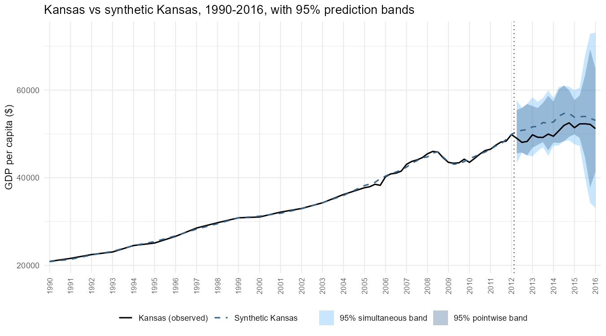
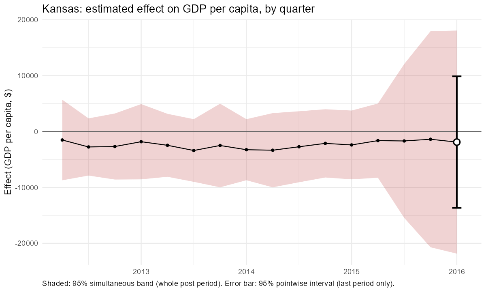
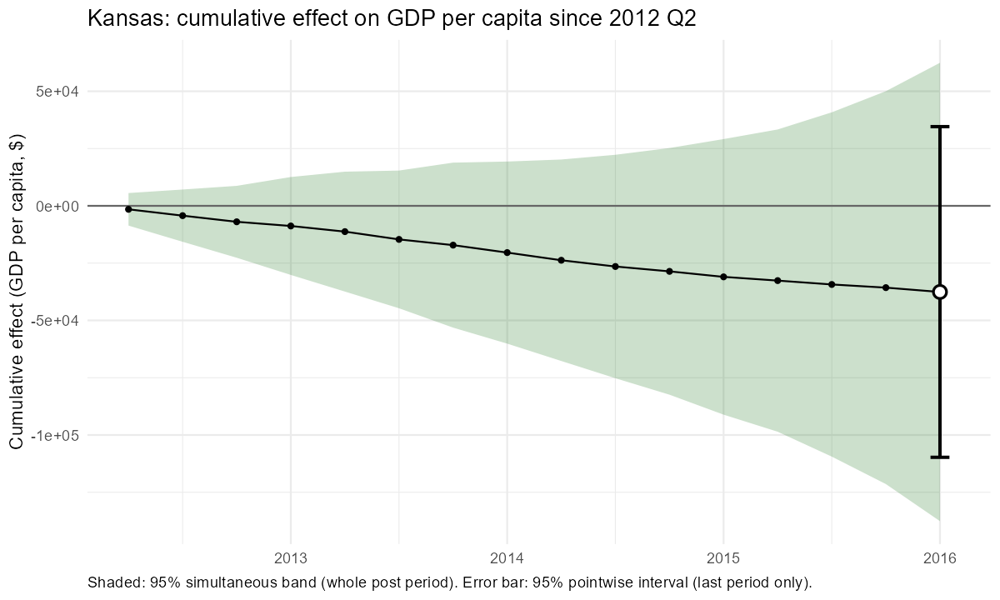
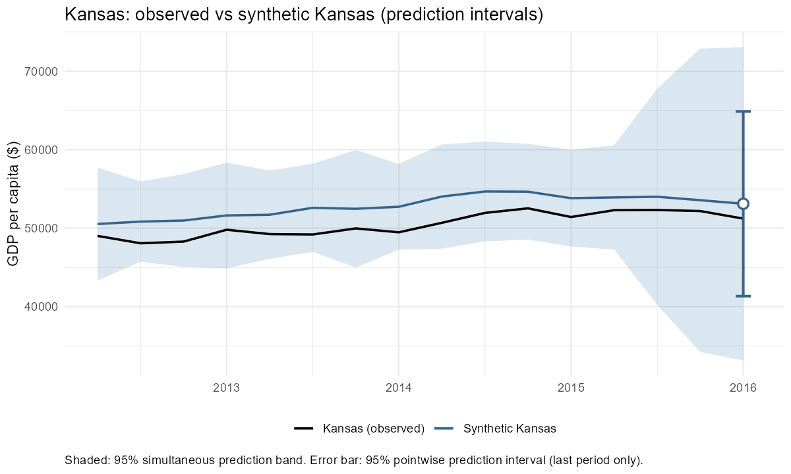
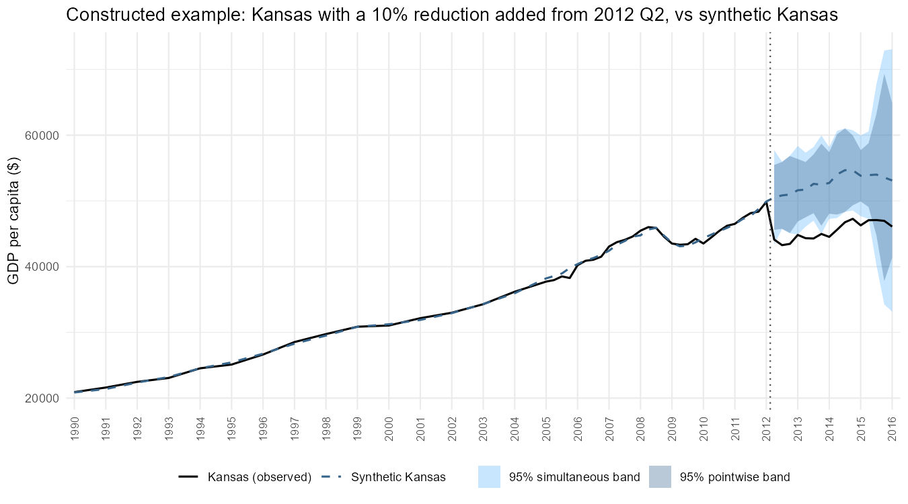
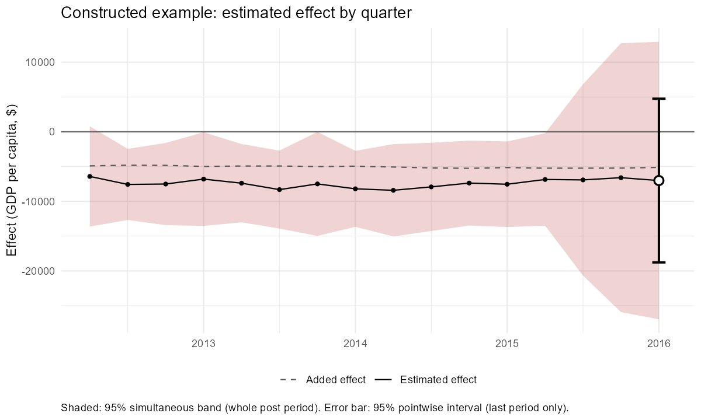
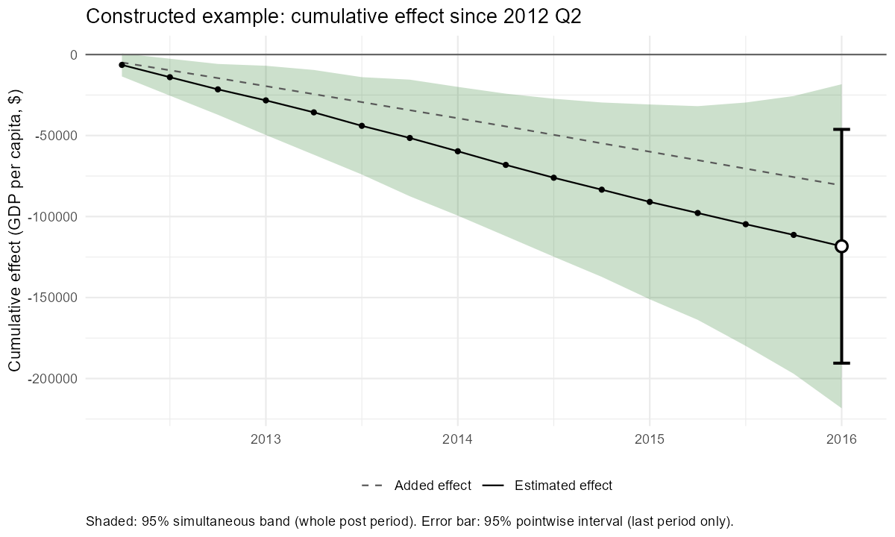

*This document was written by Claude, an AI model made by Anthropic, at the direction of Jeffrey Milliman. The methods have been tested by simulation but not independently peer reviewed; see the disclaimer in the [main README](../../README.md).*

# Overview

This document explains a method for putting uncertainty intervals around synthetic control estimates when there is a **single treated unit**, such as one state that adopts a policy. The method combines three ingredients:

1. a **demeaned synthetic control** to estimate the counterfactual;
2. a **fixed-weight maximum entropy bootstrap** to measure how uncertain each unit's estimate is, period by period; and
3. a **donor calibration** step that uses the untreated units as placebos to scale those intervals so that they have the intended coverage.

The method produces two kinds of interval, which answer different questions:

- a **pointwise interval** for the effect in a period chosen in advance (by default the last post-treatment period), for both the per-period and the cumulative effect, with a matching p-value. It answers: *was there an effect in this period?*
- a **simultaneous band** that covers the whole post-treatment path at once, with a p-value for the whole period. It answers: *was there an effect at any point, when, and what did the effect path look like?*

Both come with matching **prediction intervals** for the treated unit's untreated outcome.

The method is implemented in `dsc_symcal_boot()` in `synthetic_control_functions/synthetic_control_functions_claude.R`. It was developed and tested through simulations on two panels, the Kansas tax experiment (quarterly GDP per capita) and the California tobacco program (annual cigarette sales). The goal throughout was to find out whether maximum entropy bootstrapping can provide valid inference for synthetic control.

**The short answer:** the bootstrap on its own does *not* give valid intervals, but once it is calibrated against placebo units it does, and the resulting intervals perform about as well as simpler placebo-based alternatives.

# Background: why inference is hard with one treated unit

A synthetic control estimates what would have happened to a treated unit without the treatment by combining untreated units (the **donors**) so that the combination tracks the treated unit closely before treatment. After treatment, the gap between the treated unit and its synthetic control is the estimated effect.

Putting an interval around that gap is difficult for two reasons:

- **There is only one treated unit.** Standard errors that rely on many treated units, or on many independent observations, do not apply.
- **Most of the error comes from drift.** A synthetic control that fits well before treatment will not track the treated unit perfectly afterwards; the further from the fitting period, the more it drifts. This drift is the main source of error, and it is not visible in the pre-treatment fit.

The standard solution is a **placebo test**: pretend each donor was treated, estimate its "effect" (which should be zero), and see whether the treated unit's effect is unusual compared with these placebo effects. Placebo tests capture drift directly, because the placebos drift too. Their weakness is that they treat every unit's gap on the same scale, even though some units are much harder to predict than others.

The bootstrap offers a way to measure each unit's own uncertainty. This document explains how the two ideas are combined.

# The estimator: the demeaned synthetic control

The counterfactual is estimated with a **demeaned synthetic control**. For the treated unit's outcome $y_t$ and donor outcomes $x_{jt}$, the pre-treatment fit chooses an intercept $b_0$ and weights $w_j$ to solve

$$
\min_{b_0,\, w} \sum_{t \in \text{pre}} \Big( y_t - b_0 - \sum_j w_j x_{jt} \Big)^2
\quad \text{subject to} \quad w_j \ge 0,\ \ \sum_j w_j = 1 .
$$

- The **intercept** absorbs permanent level differences, so the treated unit does not have to lie within the range of its donors' levels.
- The **weights are non-negative and sum to one**, so the synthetic control follows its donors' full movements over time.

This estimator has no tuning parameter. In simulations it was essentially unbiased, including with short pre-treatment periods, and it was more accurate than a LASSO synthetic control whose weights were not required to sum to one. (When weights summed to less than one, the synthetic control followed only part of its donors' movements, which produced a systematic bias.)

# Why the bootstrap alone is not enough

The **maximum entropy bootstrap** (`meboot`; Vinod and López-de-Lacalle 2009) creates many plausible alternative versions of a time series that preserve its overall shape and time dependence. The natural idea is to resample the data, recompute the effect many times, and use the spread of those effects as the interval.

Every version of this tried in the project produced intervals that were **far too narrow**:

| Bootstrap version | False positives at a nominal 5% |
|---|---|
| Stacked (all units resampled as one series) | 57-65% |
| By unit, refitting the weights in each replicate | 14-18% |
| By unit, fixed weights | 66-82% |

The reason is the same in every case: the bootstrap measures **noise around the fitted model**, but not the synthetic control **drifting away** from the treated unit after treatment. So the bootstrap's intervals have a useful *shape* (they show which units and periods are more uncertain than others) but the wrong *size*. The calibration step fixes the size.

# The method, step by step

## Step 1: fit once and fix the weights

Fit the demeaned synthetic control to the observed data and keep the intercept $b_0$ and weights $w$ fixed from here on. Refitting the weights in every bootstrap replicate was tried first, but with short pre-treatment periods (for example 19 annual observations and 38 donors) the refitted weights changed a lot from replicate to replicate and made the intervals unstable. Fixing the weights removes that problem.

## Step 2: bootstrap the donors

Resample every unit's series separately with the maximum entropy bootstrap (500 replicates by default). In each replicate $r$, rebuild the synthetic control with the **same** weights, using the replicate's donor values after treatment, and compute a replicate effect:

$$
e^{(r)}_t = y_t - \Big( b_0 + \sum_j w_j\, x^{(r)}_{jt} \Big), \qquad t \in \text{post}.
$$

The cumulative replicate effect is the running total of $e^{(r)}_t$.

## Step 3: a symmetric, mean-centred half-width

For each post-treatment period, measure how spread out the 500 replicate effects are. The **half-width** $h_t$ is the $(1-\alpha)$ quantile (for example the 95th percentile) of the replicates' distances from their own average:

$$
h_t = Q_{1-\alpha}\Big( \big| e^{(r)}_t - \bar{e}_t \big| \Big).
$$

This interval is **symmetric**: it extends equally above and below the estimate. An earlier version used ordinary percentile intervals, which were lopsided. With downward-trending data and a lower limit in the bootstrap, the replicates could move up more easily than down, and the resulting intervals detected negative effects much less often than positive ones (in the California simulation, 5% versus 24% at $\pm 25\%$). Symmetric intervals removed that asymmetry.

## Step 4: a standardized gap

Divide the estimated effect by its half-width:

$$
k_t = \frac{|\text{effect}_t|}{h_t}.
$$

This is a standardized effect, like a $t$-statistic: how many of its own half-widths the effect is from zero.

## Step 5: donors as placebos

Remove the treated unit. Then treat each donor in turn as if it had been treated, and repeat Steps 1 to 4 for it (using the remaining donors). Each donor's true effect is zero, so its $k_t$ shows how large a standardized gap can become by chance, **including the effect of drift**.

## Step 6: calibrate

The donors' standardized gaps $k_{p,t}$ show how far from zero an *untreated* unit's estimate can land, measured in its own bootstrap half-widths. Calibration asks: **how many half-widths does an estimate have to be from zero before it is unusual compared with these untreated units?** That threshold is the **calibration factor** $k^*_t$.

**The rank rule.** If the treated unit had not been treated, its own $k_t$ would be just one more draw from the same distribution as the donors'. Together with the $N$ donors there would be $N + 1$ values, and the treated unit's value would be equally likely to fall anywhere in their ranking. With

$$
m = \lfloor \alpha (N + 1) \rfloor, \qquad
k^*_t = \text{the } m\text{-th largest of } \{ k_{p,t} : p = 1, \dots, N \},
$$

the chance that an untreated unit's $k_t$ exceeds $k^*_t$ is at most $\alpha$. That is what makes the test exact: a 5% test flags an untreated unit at most 5% of the time.

**How the rank depends on the number of donors:**

| Donors $N$ | $m$ at 95% | $m$ at 90% | Smallest possible p-value |
|---|---|---|---|
| 49 (Kansas) | 2 (2nd largest) | 5 (5th largest) | 0.020 |
| 37 (California) | 1 (largest) | 3 (3rd largest) | 0.026 |
| 18 or fewer | 0 (interval infinite) | 1 (largest) | $\ge$ 0.053 |

**Why it is called a stretch factor.** The interval in Step 7 is the bootstrap half-width $h_t$ multiplied by $k^*_t$. So $k^*_t$ says how much the bootstrap interval has to be **stretched** to reach the intended coverage. Values well above 1 confirm that the bootstrap alone gives intervals that are far too narrow.

**Example: Kansas, 2016 Q1** (the last post-treatment quarter; 49 donors; 95%, so $m = 2$)

| Rank | Unit | Standardized gap $k$ | |
|---|---|---|---|
| 1 | California | 7.77 | |
| **2** | **Tennessee** | **6.27** | **$k^*$ (the 2nd largest donor value)** |
| 3 | Hawaii | 4.47 | |
| 4 | New York | 4.03 | |
| 5 | North Dakota | 3.72 | |
| 6 | Nevada | 3.70 | |
| ... | (median donor) | 1.46 | |
| 33 of 50 | **Kansas** | **1.01** | the treated unit |

Reading the table:

- Kansas's estimated effect in 2016 Q1 is $-1{,}891$, with bootstrap half-width $h = 1{,}878$, so $k = 1{,}891 / 1{,}878 = 1.01$: the estimate is about one half-width from zero.
- Untreated states routinely land several half-widths from zero (the median donor is at 1.46, and the most extreme at 7.77), so Kansas is not unusual.
- The calibration factor is $k^* = 6.27$: the bootstrap half-width has to be stretched about **six-fold**.
- The interval is $-1{,}891 \pm 6.27 \times 1{,}878 = -1{,}891 \pm 11{,}775$, or about $-13{,}660$ to $9{,}880$.
- 32 donors have $k \ge 1.01$, so $p = (1 + 32) / 50 = 0.66$.

## Step 7: the pointwise interval, p-value, and prediction interval

For the pre-specified test period $t$:

$$
\text{effect interval: } \ \text{effect}_t \pm k^*_t \, h_t,
\qquad
p_t = \frac{1 + \#\{ p : k_{p,t} \ge k_t \}}{N + 1}.
$$

The interval excludes zero exactly when the treated unit's own $k_t$ is larger than $k^*_t$, which happens exactly when $p_t \le \alpha$. The **prediction interval** for the treated unit's untreated outcome is the same interval centred on the synthetic control instead of the effect: $\text{synthetic}_t \pm k^*_t \, h_t$. The **cumulative** effect is handled the same way, using the cumulative replicate effects.

## In one sentence

The bootstrap provides each unit's own scale of uncertainty in each period, and the donors, acting as placebos, determine how much that scale has to be stretched to achieve the intended coverage.

# Why the interval is "pointwise"

A pointwise interval is valid for **one period chosen in advance**. If an analyst looks at intervals for every post-treatment period and reports whichever one excludes zero, the chance of a false positive is much higher than 5%. In the California simulations, a pointwise 90% interval contained the true effect in *every* year for only 74% of states.

So the test period should be decided before looking at the results. By default `dsc_symcal_boot()` uses the **last post-treatment period** (`test_period = NULL`), for both the per-period effect and the cumulative effect through that period. A different period can be specified, for example `test_period = c(year = 2014, qtr = 4)`.

For statements about the whole post-treatment path ("was there an effect at any point?"), use the **simultaneous band** described in the next section.

# The simultaneous band

## Why a second kind of interval is needed

Effects are usually shown as a figure of the whole post-treatment path, and readers naturally scan it for years where the interval excludes zero. Pointwise intervals do not protect against that. Each one has a 95% chance of covering the truth *on its own*, but over 12 to 16 post-treatment periods, the chance that at least one misses is much higher:

- In the California simulations, a pointwise **90%** interval contained the true effect in *every* year for only **74%** of states. With no effect at all, about one state in four would show at least one "significant" year.
- When pre-treatment periods were shortened, pointwise whole-path coverage was **78-95%**.

A **simultaneous band** is built so that, with 95% confidence, it contains the true effect in **every** post-treatment period at once. That makes statements about the whole path valid: "the effect was significant in 1996", "the effect stayed below zero throughout", "the effect never exceeded 10%".

## How it is built

The ingredients are the same as for the pointwise intervals: the half-widths $h_{u,t}$ and standardized gaps $k_{u,t} = |\text{gap}_{u,t}| / h_{u,t}$ for the treated unit and every donor, in every post-treatment period. Three further steps follow.

**Step A: a smooth time profile.** In each period, take the **median** standardized gap across donors, and smooth it over time (loess on the log scale, span 0.75):

$$
q_t = \text{median}_p \; k_{p,t}, \qquad \tilde{q}_t = \text{smoothed } q_t .
$$

$\tilde{q}_t$ describes how much a *typical* untreated unit's error exceeds its bootstrap half-width in each period. It corrects the bootstrap's time profile, which does not track drift accurately on its own. The median keeps a single unusual donor from shaping the profile, and smoothing removes year-to-year noise.

**Step B: score each donor on its worst period.** For every donor, divide its standardized gaps by the profile and keep the largest value across all post-treatment periods:

$$
R_p = \max_t \frac{k_{p,t}}{\tilde{q}_t}.
$$

**Step C: one multiplier for the whole path.** The multiplier $\lambda$ is the $m$-th largest donor score (with $m = \lfloor \alpha(N+1) \rfloor$, as before), and the band in every period is

$$
\text{effect}_t \pm \lambda\, \tilde{q}_t\, h_t .
$$

The prediction band is the same, centred on the synthetic control. The cumulative effect gets its own band, built the same way from the cumulative gaps.

**The test.** The treated unit's score is $R_T = \max_t k_t / \tilde{q}_t$, with simultaneous p-value

$$
p_{\text{sim}} = \frac{1 + \#\{p : R_p \ge R_T\}}{N + 1}.
$$

If $R_T > \lambda$, the band excludes zero in at least one period. The function reports the p-value and **which periods** the band flags.

## How the pieces divide the work

| Piece | Role |
|---|---|
| $h_t$ | the treated unit's own uncertainty in each period, from its bootstrap |
| $\tilde{q}_t$ | the time profile: corrects the bootstrap's shape using how typical donors actually behave |
| $\lambda$ | one multiplier, large enough that the whole path is covered for all but the $m$ most extreme donors |

## Why this version

Several simultaneous bands were tested on the California panel before settling on this one:

| Band | What sets its shape | Result |
|---|---|---|
| One factor times $h_t$ | the bootstrap alone | valid, but too wide where the bootstrap's profile was off (half-width 125 vs 16 pointwise in 1989) |
| Leave-one-out pointwise profile | the most extreme donors each year | valid, but jagged and widest on average |
| Median profile, unsmoothed | typical donors | valid, but noisy from year to year |
| **Median profile, smoothed** | **typical donors, smoothed** | **valid and narrowest** |
| Donor-gap spread (no bootstrap) | spread of donors' raw gaps | valid, but very conservative at 95% |

The smoothed median gave the narrowest valid band in every combination tested, and its results barely changed across loess spans of 0.5, 0.75 and 1.0.

## Pointwise or simultaneous?

| Question | Use |
|---|---|
| Was there an effect in a period chosen in advance (e.g. the last year, or the cumulative total)? | pointwise interval |
| Was there an effect at any point, and when? | simultaneous band |
| What did the effect path look like, with honest uncertainty? | simultaneous band (pointwise as a dashed outline for reading single periods) |

The simultaneous band is wider than the pointwise interval at any single period, because it has to cover every period at once. That is the price of being able to read the whole figure.

# Worked example: Kansas

In 2012, Kansas cut income taxes sharply. Using quarterly GDP per capita, treatment from 2012 Q2, and the other 49 states as donors:

```{r}
source("synthetic_control_functions/synthetic_control_functions_claude.R")

kansas_fit <- dsc_symcal_boot(
  data             = augsynth::kansas,
  unit_col         = "state",
  time_cols        = c("year", "qtr"),
  outcome_col      = "gdpcapita",
  treated_unit     = "Kansas",
  treatment_period = c(year = 2012, qtr = 2)    # test_period defaults to the last quarter (2016 Q1)
)

kansas_fit$test        # pointwise tests at the test period, plus the simultaneous tests
kansas_fit$weights     # donor weights
```

The synthetic Kansas is built mainly from South Carolina (0.26), Texas (0.23), Washington (0.15), North Dakota (0.14) and Mississippi (0.13). The pointwise results at 2016 Q1 (95%) are:

| Measure | Estimate | 95% interval | p-value |
|---|---|---|---|
| Effect in 2016 Q1 | -1,891 | -13,660 to 9,878 | 0.66 |
| Cumulative effect, 2012 Q2 to 2016 Q1 | -37,582 | -109,730 to 34,567 | 0.18 |

Neither interval excludes zero: the data are consistent with no effect, and also with sizeable negative or positive effects.

The simultaneous tests over the whole post-treatment period agree: p = 0.24 for the per-period effect and p = 0.22 for the cumulative effect, and the band excludes zero in no quarter.

The figures below are drawn with the plotting functions in `synthetic_control_functions_claude.R` (`plot_full_path()`, `plot_post_effect()`, `plot_prediction()` and `added_effect()`), which work with any output of `dsc_symcal_boot()` or `dsc_placebo()`. Each figure has its own code block (click to show).

The first figure shows the whole series, 1990 to 2016. Before the tax cuts, synthetic Kansas tracks observed Kansas closely. After them, two prediction bands are shaded around synthetic Kansas: the **pointwise band** (darker), which is valid for any one quarter chosen in advance, and the wider **simultaneous band** (lighter), which is valid for all post-treatment quarters at once. Observed Kansas stays inside both bands throughout.



```{r}
#| code-fold: true
#| code-summary: "Show code for this figure"
plot_full_path(kansas_fit, "Kansas vs synthetic Kansas, 1990-2016, with 95% prediction bands",
               y_label = "GDP per capita ($)")
```

The next figures show only the post-treatment period. The **shaded area is the simultaneous band**, valid for the whole path at once. The **error bar is the pointwise interval at the pre-specified test period** (2016 Q1), valid for that quarter only.



```{r}
#| code-fold: true
#| code-summary: "Show code for this figure"
plot_post_effect(kansas_fit, "effect", "Kansas: estimated effect on GDP per capita, by quarter",
                 "Effect (GDP per capita, $)")
```



```{r}
#| code-fold: true
#| code-summary: "Show code for this figure"
plot_post_effect(kansas_fit, "cumulative", "Kansas: cumulative effect on GDP per capita since 2012 Q2",
                 "Cumulative effect (GDP per capita, $)")
```



```{r}
#| code-fold: true
#| code-summary: "Show code for this figure"
plot_prediction(kansas_fit, "Kansas: observed vs synthetic Kansas (prediction intervals)",
                y_label = "GDP per capita ($)")
```

A few things to notice:

- At 2016 Q1 the **pointwise interval is narrower** than the simultaneous band (half-width about 11,800 vs 20,000), because it only has to cover one quarter.
- The **per-quarter band** stays fairly level (half-width about 5,100-7,500) for the first 13 quarters, then **widens sharply in the last three** (to about 14,000-20,000). Uncertainty is not constant over time, and the band adapts to it.
- The **cumulative band widens in every quarter** (half-width from about 7,100 to 100,000), as errors accumulate.
- In the prediction figure, observed Kansas stays inside the band throughout, which is the same conclusion as "no effect detected".

## Why the bands widen in 2015-16

Both bands widen sharply in the last three quarters because the **bootstrap half-width** $h_t$ jumps (from about 730 in 2015 Q2 to 1,400-1,900), not because of the calibration factors, which change smoothly. The jump comes from the **oil-producing states** in synthetic Kansas:

| Donor | Weight | Bootstrap spread, 2015 Q2 | Bootstrap spread, 2016 Q1 |
|---|---|---|---|
| South Carolina | 0.26 | 792 | 481 |
| Texas | 0.23 | 535 | **1,714** |
| Washington | 0.15 | 1,253 | 695 |
| North Dakota | 0.14 | 1,720 | **6,363** |
| Mississippi | 0.13 | 313 | 231 |
| West Virginia | 0.07 | 315 | 372 |
| Wyoming | 0.02 | 1,585 | **3,636** |

The mechanism comes from how `meboot` works. It resamples each value from an interval around its position in the series' *sorted* values, and those intervals are wide where the sorted values are far apart. During the oil boom, North Dakota's and Texas's GDP per capita rose quickly through each level, so their sorted values are sparse in that range. When oil prices collapsed from late 2014, these states fell back into those sparse ranges, so their resampled values spread out much more. North Dakota and Texas carry about 37% of synthetic Kansas's weight, so its bootstrap spread more than doubled.

This is **partly real** (the counterfactual leans on donors whose economies became volatile, so it genuinely is less certain) and **partly mechanical** (the size of the widening follows `meboot`'s rule about sparse values, not a model of volatility at that time).

**Placebo methods respond differently.** The absolute placebo test does not use the bootstrap, and its interval does not jump in 2015-16 (half-width about 4,700-6,600, against 9,200-15,800 for the bootstrap interval). Its threshold is set by the most volatile *untreated* states (North Dakota is the most extreme placebo in every post-treatment quarter), and it is the same for any treated unit, whatever its synthetic control is made of. The calibrated bootstrap therefore reflects the **treated unit's own** vulnerability to volatile donors; the placebo test reflects how much untreated units drift **in general**.


# A constructed example with a detectable effect

Neither real case analysed in this project (Kansas, California) shows a statistically significant effect with valid methods. To show what a detected effect looks like, this example uses the real Kansas data **with a known effect added**: Kansas's GDP per capita is reduced by **10%** in every quarter from 2012 Q2 onwards, and everything else is unchanged.

::: {.callout-note}
This is an **illustration**, not a finding about Kansas. The estimated effect here is Kansas's real estimate plus the added 10% reduction, so the "true" effect in this example is the added effect plus whatever Kansas's actual effect was.
:::

```{r}
kansas_constructed <- augsynth::kansas
post_rows <- kansas_constructed$state == "Kansas" &
  (kansas_constructed$year > 2012 | (kansas_constructed$year == 2012 & kansas_constructed$qtr >= 2))
kansas_constructed$gdpcapita[post_rows] <- kansas_constructed$gdpcapita[post_rows] * 0.90   # -10% from 2012 Q2

constructed_fit <- dsc_symcal_boot(kansas_constructed, "state", c("year", "qtr"), "gdpcapita", "Kansas",
                                   treatment_period = c(year = 2012, qtr = 2))
constructed_fit$test
```

**Results (95%)**

| Test | Estimate | 95% interval | p-value | Significant? |
|---|---|---|---|---|
| Pointwise: effect in 2016 Q1 | -7,013 | -18,782 to 4,756 | 0.10 | no |
| Pointwise: cumulative effect through 2016 Q1 | -118,347 | -190,495 to -46,199 | 0.04 | **yes** |
| Simultaneous: effect by quarter, whole post period | | flags 2012 Q3 - 2015 Q2 | 0.04 | **yes** |
| Simultaneous: cumulative effect, whole post period | | flags every quarter from 2012 Q3 | 0.04 | **yes** |

The estimates shift exactly by the added effect: the 2016 Q1 estimate of $-7{,}013$ is Kansas's real estimate ($-1{,}891$) plus the added reduction ($-5{,}122$), and the cumulative estimate of $-118{,}347$ is $-37{,}582$ plus $-80{,}765$.



```{r}
#| code-fold: true
#| code-summary: "Show code for this figure"
plot_full_path(constructed_fit, "Constructed example: Kansas with a 10% reduction added from 2012 Q2, vs synthetic Kansas",
               y_label = "GDP per capita ($)")
```



```{r}
#| code-fold: true
#| code-summary: "Show code for this figure"
added <- added_effect(kansas_fit, constructed_fit)     # the added -10%, by post-treatment quarter
plot_post_effect(constructed_fit, "effect", "Constructed example: estimated effect by quarter",
                 "Effect (GDP per capita, $)", added = added)
```



```{r}
#| code-fold: true
#| code-summary: "Show code for this figure"
plot_post_effect(constructed_fit, "cumulative", "Constructed example: cumulative effect since 2012 Q2",
                 "Cumulative effect (GDP per capita, $)", added = added)
```

**What this example shows**

- **The same effect can be detected by one test and missed by another.** The cumulative effect and the simultaneous tests are significant, but the effect in the final quarter alone is not, because the per-quarter band widens sharply in the last three quarters (driven by the oil-state donors; see *Why the bands widen in 2015-16*). Pre-specifying the cumulative effect as the main result would have found it; relying only on the final quarter would not. The absolute placebo test, whose interval does not widen there, would narrowly flag the final quarter.
- **The simultaneous band shows when the effect is visible:** from 2012 Q3 to 2015 Q2 for the per-quarter effect, and from 2012 Q3 onwards for the cumulative effect.
- **The bands contain the added effect in every quarter,** both per quarter and cumulatively.
- **Significance comes at the edge.** With p = 0.04, an effect of this size (about 10% of GDP per capita) is close to the smallest the Kansas design can reliably detect, consistent with the simulations.

# What the simulations showed

The method was tested by treating each untreated state in turn as a fake treated unit, injecting known effects, and checking how often the intervals contained the true effect (**coverage**) and how often they detected it (**power**).

## Pointwise intervals

**Validity**

- In the California panel (38 states, 95% level), the symmetric calibrated intervals had **3% false positives** and **97% coverage** for the final-year effect.
- When the pre-treatment period was shortened (Kansas: 80 down to 8 quarters; California: 19 down to 5 years), pointwise coverage in the final period stayed at **94-100%**.

**Power**

| Comparison | Calibrated bootstrap | Absolute placebo test |
|---|---|---|
| California, final-year effect, -25% / +25% (95%) | 21-24% / 34-39% | 21% / 29% |
| California, cumulative effect, -25% / +25% (95%) | 13-18% / 21-26% | 61% / 66% |
| Kansas (80 pre-quarters), cumulative effect, -10% / +10% (95%) | 53% / 47% | 65% / 55% |

The calibrated bootstrap matched or slightly beat the simpler absolute placebo test for single-year effects in the short California panel, but was **less powerful for cumulative effects**, often by a wide margin.

## Simultaneous bands

**Validity: whole-path coverage** (the share of states whose band contains the true effect in every post-treatment period)

| Setting | Per-period band | Cumulative band |
|---|---|---|
| California, 95% | 100% | 97% |
| California, 90% | 95% | 95% |
| Shorter pre-periods (Kansas 80-8 quarters; California 19-5 years), 95% | 95-97% | 95-97% |

**Width and power** (California, 95%; half-width in % of the outcome; power = band excludes zero in at least one period)

| Band | Median half-width | Power at -25% / +25% |
|---|---|---|
| Pointwise (for reference; not valid for the whole path) | 38.9 | n/a |
| **Smoothed-median simultaneous** | **58.0** | **39% / 47%** |
| Simultaneous, bootstrap profile only | 64.6 | 18% / 29% |
| Donor-gap spread (no bootstrap) | 94.2 | 3% / 5% |

At the 90% level, the smoothed-median band detected 92-100% of $\pm 25\%$ effects.

**A caution about comparing power.** The simultaneous band's power counts detection in *any* of the 12-16 post-treatment periods, while a pointwise test asks about *one* period. These are different questions, so the numbers are not directly comparable. Asked the same single-period question, the simultaneous band is **less** powerful than the pointwise interval or the absolute placebo test, because it has to be wide enough to cover every period.

**The bootstrap's clearest contribution.** For simultaneous bands at 95%, the bootstrap-based band was far more powerful than the band built from the donors' gaps alone (39-47% vs 3-5% at $\pm 25\%$), with both valid. This is the one place in the simulations where the maximum entropy bootstrap added a large, clear benefit over simpler placebo constructions.

# Strengths

- **Valid intervals for a single treated unit.** Coverage was at or near the nominal level in every design tested, including short pre-treatment periods.
- **Unit- and period-specific intervals.** The bootstrap scale lets intervals be wider for units and periods that are harder to predict, rather than treating every unit alike.
- **No direction bias.** The symmetric construction treats increases and decreases equally.
- **Prediction intervals come for free.** The same factor gives an interval for the treated unit's counterfactual outcome, which is natural to plot.
- **Stable with short panels.** Fixing the weights avoids the instability of refitting the synthetic control on short, resampled series.
- **A tuning-free estimator underneath.** The demeaned synthetic control needs no penalty parameter.
- **Honest whole-path statements.** The simultaneous band supports claims about the entire post-treatment period, and kept whole-path coverage at 95-97% in every design tested.
- **Efficient simultaneous bands.** Here the bootstrap earns its place: the bootstrap-based simultaneous band was much more powerful at 95% than one built from donor gaps alone.

# Weaknesses and limitations

- **The bootstrap does not provide validity on its own.** Validity comes entirely from the donor calibration; without it, the intervals are far too narrow. The bootstrap only supplies the shape.
- **Modest and design-dependent gains.** For pre-specified effects, simpler placebo tests performed as well or better, especially for cumulative effects. Whether the bootstrap is worth its extra machinery is an open question.
- **Many moving parts.** Bootstrap replicates, trim limits, mean-centring, stretch factors and rank rules each add something to explain, test and maintain.
- **Dependence on the number of donors.** With $N$ donors the smallest possible p-value is $1/(N+1)$, and a 95% interval needs at least 19 donors; with fewer, the interval is infinite. With about 40 donors, the 95% factor is set by the **single most extreme donor**, so intervals can be noticeably affected by one unusual unit.
- **Pointwise intervals are valid only at one pre-specified period.** Reading significance off several periods requires the simultaneous band.
- **The simultaneous band is wider at any single period** than the pointwise interval, so it is weaker for a single pre-specified question.
- **The simultaneous band has a smoothing choice** (the loess span). Results were insensitive to it in testing, but it is one more setting to justify.
- **An unexplained pattern in very short panels.** In the California panel, the simultaneous band's "detected anywhere" power *rose* as the pre-treatment period shortened (from 39% to 82-89% at $\pm 25\%$), with coverage unchanged, while its final-period power stayed near zero. The detections came from intermediate years; the cause has not been pinned down.
- **Computational cost.** Every donor is refitted and bootstrapped as a placebo, so an analysis takes about a minute rather than seconds.
- **Sensitivity to volatile donors.** Interval width follows the bootstrap behaviour of the donors in the synthetic control. A heavily weighted donor that moves into a sparse part of its own history (as North Dakota and Texas did after the 2014 oil collapse) can widen the intervals for the whole synthetic control, partly for mechanical reasons specific to `meboot`.
- **Assumes the donors are a fair comparison.** As with any placebo method, validity relies on the treated unit's errors behaving like the donors' errors in the absence of treatment.

# Practical guidance

1. **Decide the test period in advance** (the default is the last post-treatment period) and report both the per-period and the cumulative result.
2. **Check the number of donors.** Use at least 19 for 95% intervals; otherwise report 90% intervals.
3. **Report the pre-treatment fit and the donor weights**, so readers can judge the synthetic control.
4. **Compare with the absolute placebo test**, which is simpler and was often as powerful.
5. **Use the simultaneous band**, not the pointwise intervals, for statements about the whole post-treatment period, and report which periods it flags.
6. **Plot both:** the simultaneous band shaded, with the pointwise band as a dashed outline for reading individual periods (the default in `plot_dsc_symcal()`).
7. **Name the question each result answers** when reporting power or significance: a pre-specified period (pointwise) or anywhere in the post period (simultaneous).
8. **If the bands widen abruptly, look at the donors.** Check the weights alongside the bootstrap spread of the main donors, and compare with the absolute placebo test, which is not affected by the bootstrap.

# References

- Abadie, A., Diamond, A., and Hainmueller, J. (2010). Synthetic control methods for comparative case studies. *Journal of the American Statistical Association*, 105(490), 493-505.
- Doudchenko, N., and Imbens, G. W. (2016). Balancing, regression, difference-in-differences and synthetic control methods: A synthesis. NBER Working Paper 22791.
- Ferman, B., and Pinto, C. (2021). Synthetic controls with imperfect pretreatment fit. *Quantitative Economics*, 12(4), 1197-1221.
- Vinod, H. D., and López-de-Lacalle, J. (2009). Maximum entropy bootstrap for time series: The meboot R package. *Journal of Statistical Software*, 29(5), 1-19.
