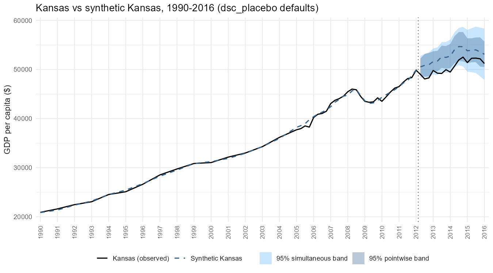
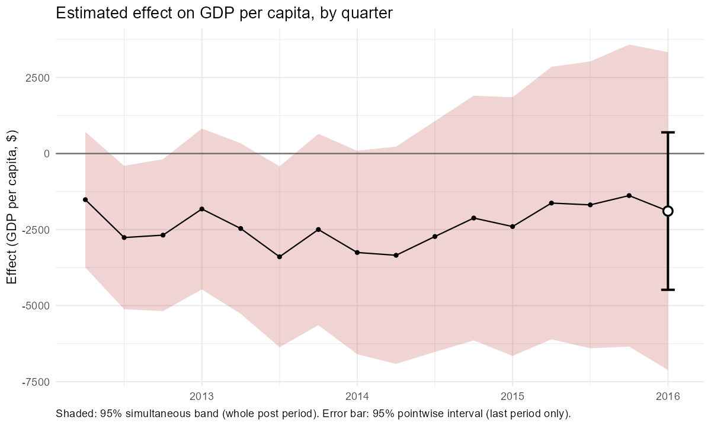
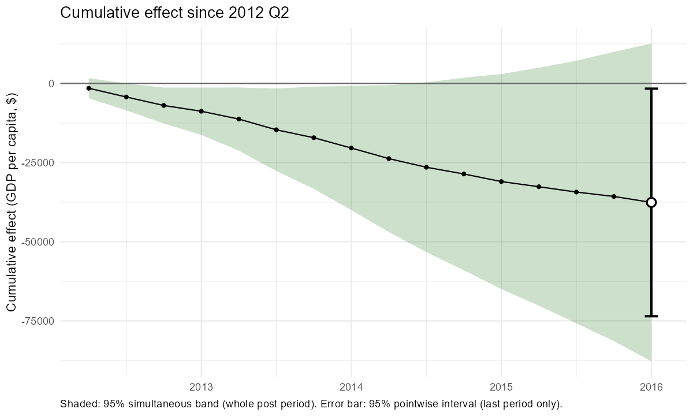
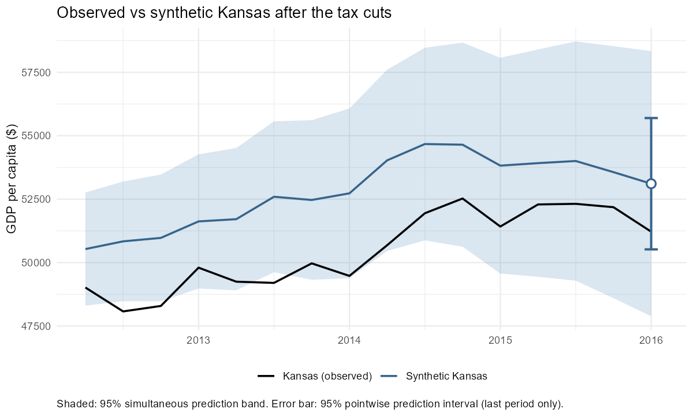
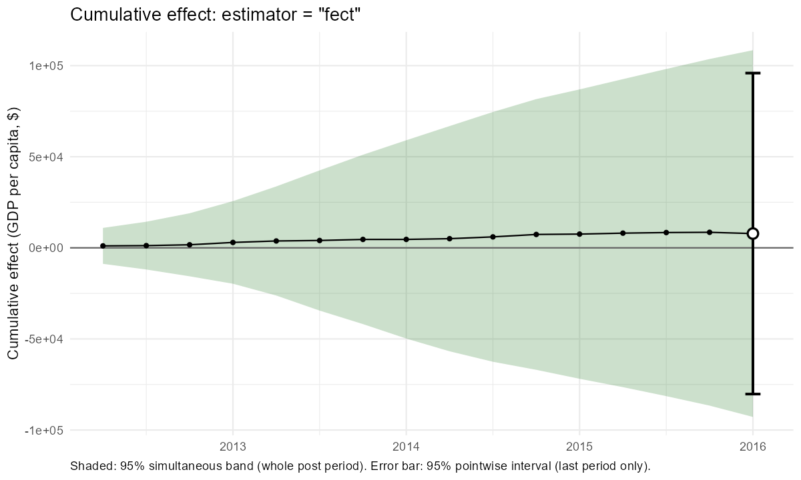
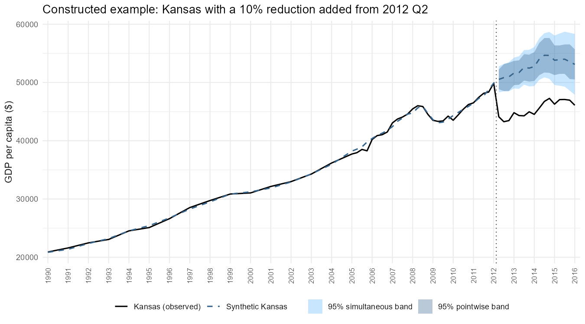
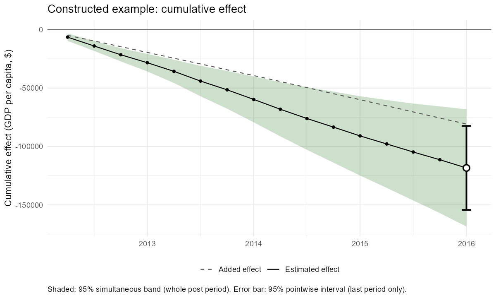

*This document was written by Claude, an AI model made by Anthropic, at the direction of Jeffrey Milliman. The methods have been tested by simulation but not independently peer reviewed; see the disclaimer in the [main README](../../README.md).*

# Overview

In 2012, Kansas cut its income taxes sharply. This case study uses that episode, with quarterly GDP per capita from `augsynth::kansas`, to walk through what `dsc_placebo()` does: estimating the counterfactual, testing for an effect, checking whether the method can be trusted for this treated unit, and examining how sensitive the conclusions are to the analysis choices.

`dsc_placebo()` combines:

- a **demeaned synthetic control**: an intercept plus non-negative donor weights that sum to one;
- **placebo-calibrated inference**: every untreated state is analysed as if it had been treated, and Kansas's gap is judged against theirs, giving pointwise intervals, simultaneous bands, prediction intervals and p-values; and
- **diagnostics** that flag when the treated unit lies beyond what the donors can reproduce.

How the method was developed and validated is described in the companion documents: [placebo-calibrated intervals](../placebo/placebo_calibrated_bands.qmd), [diagnostics](../diagnostics/diagnostics_toy_cases.qmd), and the earlier [bootstrap approach](../bootstrap/fixed_weight_calibrated_bootstrap.qmd).

**Files this document depends on:** its figures are in `figures/` (next to this document); the code chunks (shown, not run) load `synthetic_control_functions/synthetic_control_functions_claude.R`, relative to the project root.

# Setting up

```{r}
library(tidyverse)
source("synthetic_control_functions/synthetic_control_functions_claude.R")

kansas <- augsynth::kansas |> select(state, year, qtr, gdpcapita)

fit <- dsc_placebo(
  data             = kansas,
  unit_col         = "state",
  time_cols        = c("year", "qtr"),
  outcome_col      = "gdpcapita",
  treated_unit     = "Kansas",
  treatment_period = c(year = 2012, qtr = 2)
)
```

That is the whole analysis. Every other setting has a default: the 95% level, the **RMSPE scale**, the last post-treatment quarter (2016 Q1) as the test period, and diagnostics switched on. With 49 donor states it takes about 30 seconds, most of it for the diagnostics.

| Element | Contents |
|---|---|
| `fit$effects` | one row per quarter: observed, counterfactual, effect, and pointwise and simultaneous intervals for the effect, the cumulative effect and the counterfactual |
| `fit$test` | the pointwise tests at the test period, the simultaneous tests, and the classic RMSPE-ratio test |
| `fit$weights`, `fit$intercept` | the synthetic control |
| `fit$diagnostics` | checks on whether the donors can reproduce Kansas, with an assessment |
| `fit$placebo` | every placebo state's gaps and counterfactuals |
| `fit$settings` | the settings used |

# The synthetic control

```{r}
fit$weights
fit$intercept
fit$pre_rmspe
```

Synthetic Kansas is built from seven states: South Carolina (0.260), Texas (0.231), Washington (0.150), North Dakota (0.139), Mississippi (0.132), West Virginia (0.067) and Wyoming (0.021), plus an intercept of 1,140 that absorbs the permanent level difference. The pre-treatment fit error (RMSPE) is 295, against GDP per capita of about 40,000-50,000.

```{r}
#| code-fold: true
#| code-summary: "Show code for this figure"
plot_full_path(fit, "Kansas vs synthetic Kansas, 1990-2016 (dsc_placebo defaults)", y_label = "GDP per capita ($)")
```



# Testing for an effect

```{r}
fit$test
```

| Test | Estimate | 95% interval | p-value |
|---|---|---|---|
| Pointwise: effect in 2016 Q1 | -1,891 | -4,480 to 697 | 0.20 |
| Pointwise: cumulative effect, 2012 Q2 to 2016 Q1 | -37,582 | -73,524 to -1,639 | **0.04** |
| Simultaneous: effect by quarter | flags 2012 Q3, 2012 Q4, 2013 Q3 | | **0.02** |
| Simultaneous: cumulative effect | flags 2012 Q3 to 2014 Q2 | | **0.02** |
| Classic RMSPE ratio (Abadie et al.) | 8.25 | | **0.04** |

The tests answer different questions:

- **The pointwise effect in 2016 Q1** is not significant: by the final quarter, Kansas is close to its synthetic control.
- **The cumulative effect** through 2016 Q1 is -37,582 (about -4.4% of synthetic Kansas's cumulative GDP per capita), with an interval that excludes zero.
- **The simultaneous bands** show *when*: the per-quarter effect stands out in the first year and a half after the tax cuts, and the cumulative effect is distinguishable from zero from 2012 Q3 to 2014 Q2.
- With 49 donors, the smallest possible p-value is 1/50 = 0.02, so the simultaneous tests are as small as the design allows.

```{r}
#| code-fold: true
#| code-summary: "Show code for these figures"
plot_post_effect(fit, "effect", "Estimated effect on GDP per capita, by quarter", "Effect (GDP per capita, $)")
plot_post_effect(fit, "cumulative", "Cumulative effect since 2012 Q2", "Cumulative effect (GDP per capita, $)")
plot_prediction(fit, "Observed vs synthetic Kansas after the tax cuts", y_label = "GDP per capita ($)")
```







# Can the method be trusted here? The diagnostics

```{r}
fit$diagnostics$assessment
fit$diagnostics$fit_rank
fit$diagnostics$hull
fit$diagnostics$persistence
```

| Diagnostic | Kansas | Concern if |
|---|---|---|
| Placebos fitting worse than Kansas before treatment | 78% | below 10% |
| Donors lying further outside the others' loading range than Kansas | 96% | below 10% |
| Implied drift from any loading mismatch | 2.7% of the level | large |
| Persistence of the estimated common factor | AR(1) = 1.00 (trending) | trending, together with an extreme treated unit |

**Assessment: no sign that the treated unit lies beyond the donors.** Kansas fits better than most placebo states and sits well inside the donors' range of exposures to common trends. The common factor is trending, which would matter if Kansas were extreme, but it is not. This is the situation in which, in simulation, the demeaned synthetic control with the RMSPE scale was both valid and the most powerful option, so no change of method is recommended (`fit$diagnostics$recommendation` is `NULL`).

# Choosing the test period

The pointwise test is valid for **one period chosen in advance**. If the question were the effect over the first two and a half years:

```{r}
fit_2014 <- dsc_placebo(kansas, "state", c("year", "qtr"), "gdpcapita", "Kansas",
                        treatment_period = c(year = 2012, qtr = 2), test_period = c(year = 2014, qtr = 4))
fit_2014$test[1:2, ]
```

| Test at 2014 Q4 | Estimate | 95% interval | p-value |
|---|---|---|---|
| Effect in 2014 Q4 | -2,121 | -5,120 to 878 | 0.20 |
| Cumulative effect through 2014 Q4 | -28,591 | -52,551 to -4,631 | **0.02** |

The period has to be chosen before looking at the results: picking whichever quarter looks most significant would inflate false positives. For statements about the whole path, use the simultaneous bands.

# How sensitive are the conclusions?

Three choices could change the answer: the scale, the confidence level, and the estimator.

```{r}
fit_rel  <- dsc_placebo(..., scale = "relative")
fit_raw  <- dsc_placebo(..., scale = "raw")
fit_90   <- dsc_placebo(..., conf_level = 0.90)
fit_fect <- dsc_placebo(..., estimator = "fect")
```

(`...` stands for the same arguments as the main call.)

| Analysis | Cumulative effect | Interval | Cumulative p | Simultaneous p (effect / cumulative) | RMSPE-ratio p |
|---|---|---|---|---|---|
| **Default (DSC, RMSPE scale)** | -37,582 | -73,524 to -1,639 | **0.04** | **0.02 / 0.02** | **0.04** |
| Relative scale | -37,582 | -108,634 to 33,471 | 0.22 | 0.18 / 0.16 | 0.04 |
| Raw scale | -37,582 | -113,243 to 38,080 | 0.22 | 0.24 / 0.18 | 0.04 |
| 90% level | -37,582 | -67,982 to -7,181 | 0.04 | 0.02 / 0.02 | 0.04 |
| fect estimator (RMSPE scale) | +7,828 | -80,259 to 95,914 | 0.74 | 0.82 / 0.82 | 0.88 |

```{r}
#| code-fold: true
#| code-summary: "Show code for this figure"
plot_post_effect(fit_fect, "cumulative", "Cumulative effect: estimator = \"fect\"", "Cumulative effect (GDP per capita, $)")
```



**The scale.** The estimate is the same on every scale; only the intervals change. Kansas fits unusually well before treatment, so measured against its own pre-treatment fit (the RMSPE scale, and the classic RMSPE-ratio test), its post-treatment gap stands out; measured in percentages or dollars, it does not. RMSPE is the default because it was the most robust scale in simulation when the treated unit is unlike the donors; the relative scale is more powerful only when the treated unit resembles them.

**The estimator.** fect's interactive fixed-effects model puts the cumulative effect near zero (slightly positive). The two estimators build the counterfactual differently: DSC interpolates among real donors, fect extrapolates from estimated factors. In simulation, for a treated unit inside the donors' range with trending factors (Kansas's situation, according to the diagnostics), fect's estimates were three to four times noisier than DSC's, which is why the diagnostics do not recommend it here. Still, the disagreement is worth reporting.

# What does a clearly detected effect look like?

For comparison, the same analysis on Kansas's data **with a 10% reduction added** to its GDP per capita from 2012 Q2 onwards (an illustration, not a finding):

```{r}
kansas_constructed <- kansas |>
  mutate(gdpcapita = if_else(state == "Kansas" & (year > 2012 | (year == 2012 & qtr >= 2)), gdpcapita * 0.90, gdpcapita))
fit_constructed <- dsc_placebo(kansas_constructed, "state", c("year", "qtr"), "gdpcapita", "Kansas",
                               treatment_period = c(year = 2012, qtr = 2))
added <- added_effect(fit, fit_constructed)
plot_full_path(fit_constructed, "Constructed example: Kansas with a 10% reduction added from 2012 Q2", y_label = "GDP per capita ($)")
plot_post_effect(fit_constructed, "cumulative", "Constructed example: cumulative effect", "Cumulative effect (GDP per capita, $)", added = added)
```

| Test | Estimate | 95% interval | p-value |
|---|---|---|---|
| Effect in 2016 Q1 | -7,013 | -9,602 to -4,425 | 0.02 |
| Cumulative effect | -118,347 | -154,290 to -82,405 | 0.02 |
| Simultaneous (effect and cumulative) | every post-treatment quarter flagged | | 0.02 |





Every test detects the added effect, in every quarter.

# Other features

These are not needed for Kansas, but are available:

| Argument | What it does |
|---|---|
| `adjust_covariates = "x"` | adjusts for a time-varying covariate, including one that changes at the same time as the treatment (e.g. the arrival of fentanyl), with its effect estimated on untreated observations only; `adjust_model = "ife"` (default) or `"twfe"` |
| `estimator = "fect"` | fect's interactive fixed-effects counterfactual with the same placebo calibration; recommended by the diagnostics when the treated unit is extreme and the factors are not trending |
| `augment = "ife"` | augmented demeaned synthetic control (reduces bias for extreme treated units, but its intervals were too narrow in simulation; not recommended for inference) |
| `span` | smoothing of the simultaneous band's time profile |
| `diagnostics = FALSE` | skips the diagnostics (saves about 10-20 seconds) |
| `ife_seed` | fixes fect's random cross-validation, so results are reproducible |

# What to conclude about Kansas

With the pre-specified default analysis, **Kansas's GDP per capita fell short of its synthetic control by about 4.4% in total from 2012 Q2 to 2016 Q1**, a statistically significant shortfall concentrated in the first two years after the tax cuts. The diagnostics give no sign that the method is unreliable for Kansas.

The evidence is not unanimous: on the relative and raw scales the cumulative effect is not significant, and the fect estimator finds no effect. A careful report would present the default analysis as the main result, with these as sensitivity checks. Synthetic control estimates the gap between Kansas and a weighted average of other states; attributing that gap to the tax cuts rather than to anything else that happened to Kansas at the same time rests on the usual assumptions of the design.

# Reproducing this document

The analyses use the current `dsc_placebo()` (October 2026) and `augsynth::kansas`. The figures in `figures/` were produced by the calls shown, with the plotting functions in the functions file.

