# When Placebo Inference for Synthetic Control Fails, and How to Detect It
Claude (Anthropic), at the direction of Jeffrey Milliman
October 2026

*This document was written by Claude, an AI model made by Anthropic, at the direction of Jeffrey Milliman. The methods have been tested by simulation but not independently peer reviewed; see the disclaimer in the [main README](../../README.md).*

# Overview

Synthetic control builds a counterfactual for a treated unit from a weighted average of untreated units (the **donors**). Placebo-based inference then judges the treated unit’s estimated effect against the “effects” estimated for donors, each treated as if it had been treated.

Both steps rest on an assumption that is easy to state and hard to check: **the treated unit must be reproducible by the donors, and no more unusual than they are.** When it is not, the counterfactual can be badly biased, and the placebo intervals may not reveal it.

This document explains:

1.  why that assumption can fail, in terms of the **factor loadings** that drive units’ outcomes;
2.  why the failure is serious mainly when the common **factors are trending**, and much less so when they are **stationary**;
3.  how the diagnostics built into `dsc_placebo()` detect these situations; and
4.  what happens in each case, through **six toy examples** (stationary and trending factors, each with an exchangeable, edge, and outside treated unit) plus one illustration of outright failure.

The diagnostics and the methods are in `synthetic_control_functions/synthetic_control_functions_claude.R`; the toy-case helpers are in `simulations/diagnostics_toy_cases.R`.

<details class="code-fold">
<summary>Show setup code</summary>

``` r
source("synthetic_control_functions/synthetic_control_functions_claude.R")
source("simulations/diagnostics_toy_cases.R")     # toy_panel(), run_toy_case(), plot_true_loadings(), diagnostics_table()
```

</details>

# The model: factors and loadings

The justification for synthetic control is a **factor model** for each unit’s untreated outcome:

``` math

Y_{it}(0) = \alpha_i + \delta_t + \lambda_{i1} f_{1t} + \lambda_{i2} f_{2t} + \varepsilon_{it}.
```

- The **factors** $`f_{kt}`$ are common shocks or trends that every unit experiences, changing over time: a business cycle, energy prices, a long-run shift in an industry.
- The **loadings** $`\lambda_{ik}`$ are each unit’s sensitivity to those factors, fixed over time. An oil-producing state has a high loading on an “energy” factor; a service-based state a low one.
- $`\alpha_i`$ is a permanent level difference and $`\delta_t`$ a shock common to all units equally.

The demeaned synthetic control (an intercept plus non-negative donor weights that sum to one) absorbs $`\alpha_i`$ through the intercept and $`\delta_t`$ through the sum-to-one constraint. What the weights must reproduce is the **factor part**: the treated unit’s counterfactual tracks it only if

``` math

\lambda_T \approx \sum_j w_j \lambda_j ,
```

that is, if the treated unit’s loadings can be written as a weighted average of the donors’ loadings.

# Stationary versus trending factors

|  | Stationary | Trending (random walk) |
|----|----|----|
| Behaviour | fluctuates around a stable level; shocks fade | shocks accumulate; no level it returns to |
| In the toy examples | each period keeps 80% of the previous deviation (AR(1) = 0.8) | each period’s shock is permanent (AR(1) = 1), with a small upward drift |
| Spread over time | stays about the same | grows with time |
| Real-world examples | business cycles, cyclical swings | secular industrial decline, a spreading epidemic, long commodity-price swings |

# What “extreme relative to the donors” means

A weighted average with non-negative weights summing to one can only reach the region the donors span: the **convex hull** of their loadings. If the treated unit’s loadings lie inside it, some mix of donors matches the treated unit’s exposure exactly. If they lie outside, a **loading mismatch** remains:

``` math

\delta = \lambda_T - \sum_j w_j \lambda_j \ne 0 ,
```

and the counterfactual carries an error of about

``` math

\text{error}_t \approx \delta \times \big(f_t - \bar f_{\text{pre}}\big),
```

where the intercept absorbs the pre-treatment average $`\bar f_{\text{pre}}`$. “Extreme” therefore refers to the treated unit’s **exposure to common factors**, not its level, which the intercept handles.

How serious the error is depends on the factors:

|  | Inside the hull ($`\delta \approx 0`$) | Outside the hull ($`\delta \ne 0`$) |
|----|----|----|
| **Stationary factors** | no problem | error of similar size before and after treatment, so it **shows in the pre-treatment fit** and RMSPE-scaled intervals widen to cover it |
| **Trending factors** | no problem | error **grows after treatment**, beyond anything visible beforehand, and the placebos (mostly inside the hull) never experience it: **the dangerous case** |

# How the diagnostics work

`dsc_placebo()` reports four diagnostics in `$diagnostics`, an overall assessment, and a warning when the treated unit is flagged.

| Diagnostic | What it measures | Flag |
|----|----|----|
| **Fit rank** | the treated unit’s pre-treatment RMSPE relative to its level, against the placebos’ | fewer than 10% of placebos fit worse |
| **Hull distance** | the distance of the treated unit’s **estimated** loadings (interactive fixed effects via `fect`, untreated cells only) from the donors’ convex hull, against each donor’s distance from the other donors’ hull | fewer than 10% of donors lie further out |
| **Implied drift** | the post-treatment error implied by the loading mismatch, $`\hat\delta \times (\hat f_t - \bar{\hat f}_{\text{pre}})`$, as % of the level | reported, not flagged |
| **Persistence** | the first-order autocorrelation of each estimated factor | trending if above 0.95 |

The **assessment** combines them:

- **no flag:** “no sign that the treated unit lies beyond the donors”;
- **flag, factors not trending:** the treated unit appears extreme, but the error should show in the pre-treatment fit; fect with placebo calibration (RMSPE scale) was the better-performing method in this situation;
- **flag and trending:** “treat results as unreliable”.

Two design choices matter. First, the hull flag compares the treated unit with **how extreme donors themselves typically are**, because even an exchangeable treated unit lies slightly outside the donors’ hull fairly often by chance (about 19% of the time with 40 donors and two factors). Second, the warning requires **both** an extreme-unit flag and trending factors, because extremeness alone did not predict failure in simulation.

# How the toy cases were chosen

Each toy case is a **typical** panel for its scenario, not a hand-picked one. The panels come from the 1,800 simulated panels used to validate the diagnostics (40 donors, 40 pre-treatment periods, 12 post-treatment periods, **no true effect**). For each scenario, the chosen panel is the one whose implied drift is closest to the scenario’s median, among panels with the scenario’s most common flag and trend classification.

| Scenario | Treated unit’s true loadings |
|----|----|
| **Exchangeable** | drawn from the same distribution as the donors’ |
| **Edge** | set to the donors’ maximum on each factor (a corner no donor occupies) |
| **Outside** | the donors’ maximum plus 1 on each factor |

The figure below shows the true loadings in all six cases: the donors (grey) and their convex hull, and the treated unit (red triangle).

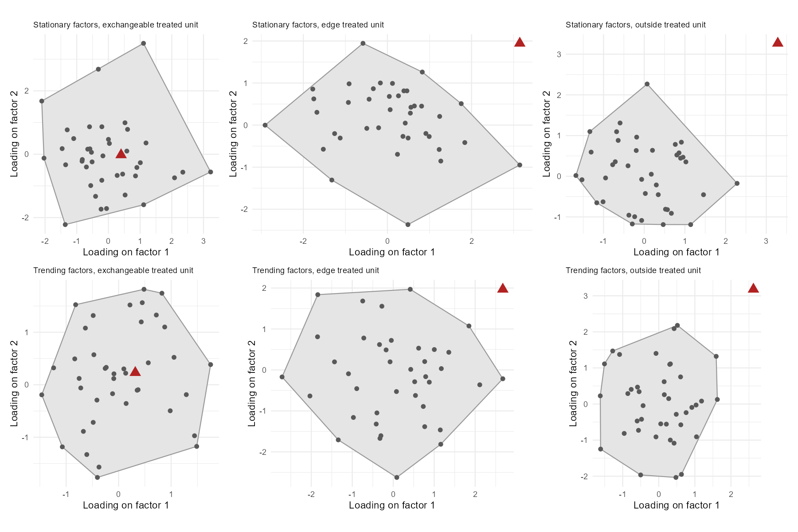

Each case below shows three figures: the **true loadings**; the **full path** (observed against synthetic, with the pointwise band in dark and the simultaneous band in light after treatment); and the **cumulative effect** after treatment (the simultaneous band shaded, the pointwise interval at the last period as an error bar). Since the true effect is zero, any gap between observed and synthetic is estimation error.

# Part A: stationary factors

## Case 1: stationary factors, exchangeable treated unit

<details class="code-fold">
<summary>Show code for this case</summary>

``` r
cs <- run_toy_case("exchangeable", "stationary", rep_seed = 20461030)
plot_true_loadings(cs)
plot_full_path(cs$fit, title = "Observed vs synthetic", unit_label = "treated unit", y_label = "Outcome")
plot_post_effect(cs$fit, "cumulative", title = "Cumulative effect (true effect 0)", y_label = "Cumulative effect")
diagnostics_table(cs)
```

</details>

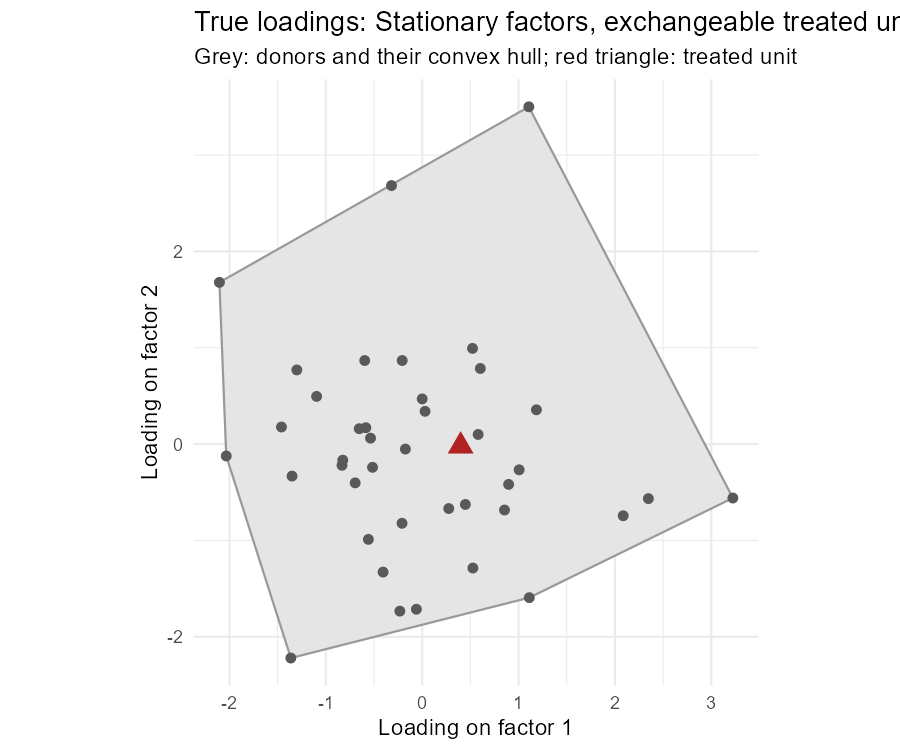

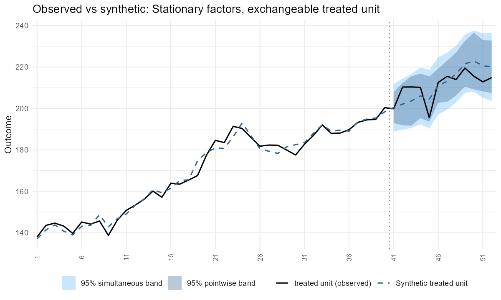

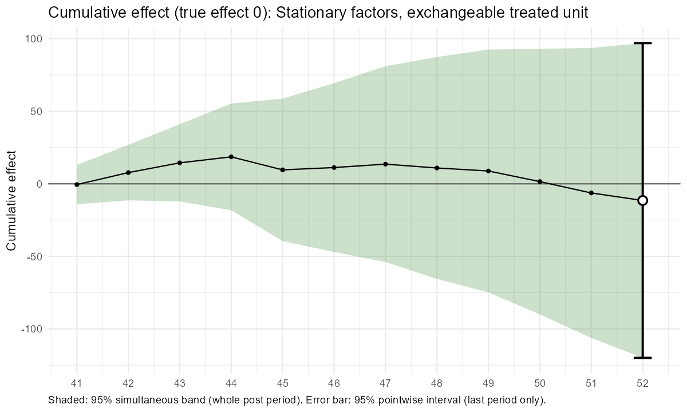

| Fit: placebos fitting worse | Hull: donors further out | Implied drift | Factor AR(1) | Cumulative error | Interval covers 0 |
|----|----|----|----|----|----|
| 90% | 78% | 0.7% | 0.85 (not trending) | −0.5% | yes |

**What the diagnostics say.** Nothing is flagged: 90% of placebos fit worse than the treated unit, 78% of donors lie further from the others’ hull than it does, and the implied drift is negligible. Assessment: *no sign that the treated unit lies beyond the donors*.

**What happened.** The treated unit sits well inside the donors’ loadings, the synthetic control tracks it closely, and the cumulative error is −0.5%, well inside the interval. This is the setting synthetic control is designed for.

## Case 2: stationary factors, edge treated unit

<details class="code-fold">
<summary>Show code for this case</summary>

``` r
cs <- run_toy_case("edge", "stationary", rep_seed = 21061048)
plot_true_loadings(cs)
plot_full_path(cs$fit, title = "Observed vs synthetic", unit_label = "treated unit", y_label = "Outcome")
plot_post_effect(cs$fit, "cumulative", title = "Cumulative effect (true effect 0)", y_label = "Cumulative effect")
diagnostics_table(cs)
```

</details>

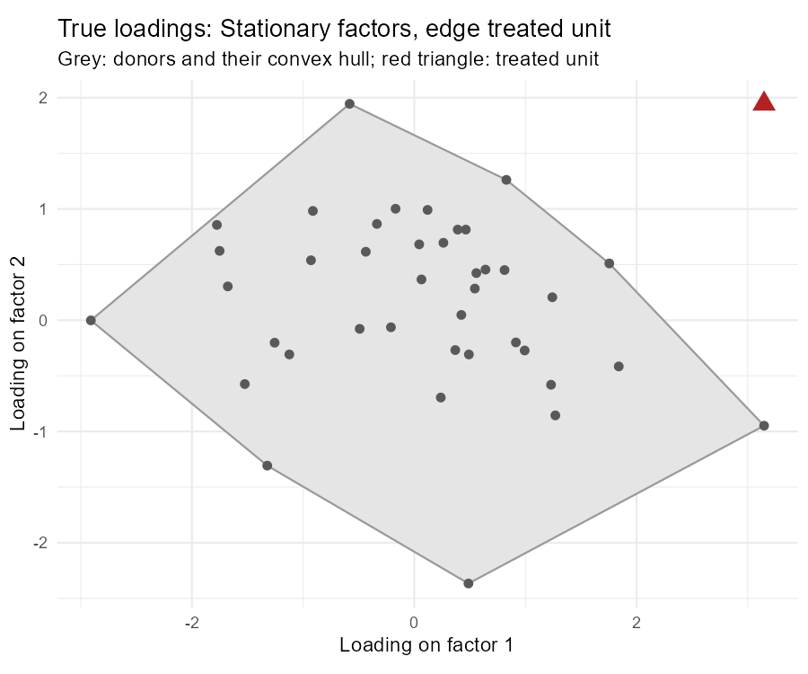

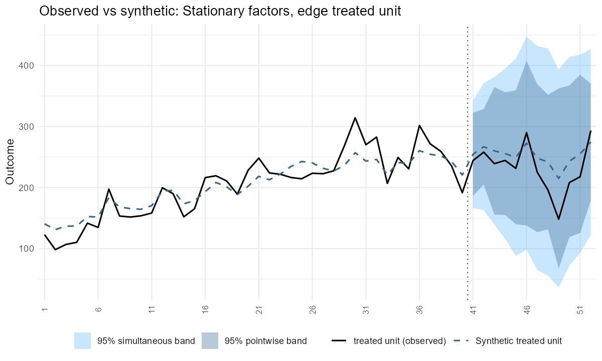

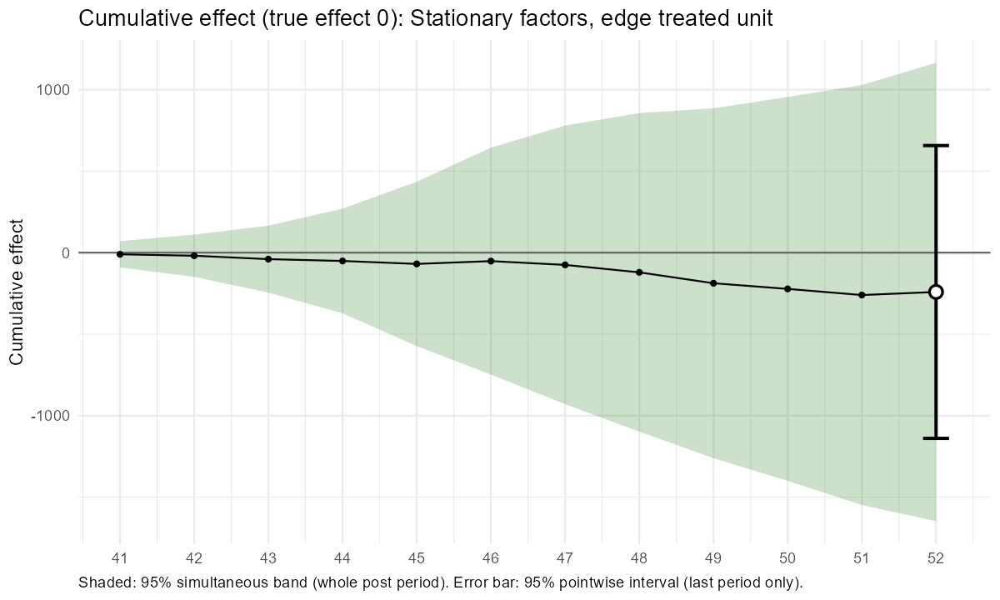

| Fit: placebos fitting worse | Hull: donors further out | Implied drift | Factor AR(1) | Cumulative error | Interval covers 0 |
|----|----|----|----|----|----|
| 2% | 0% | 39.2% | 0.86 (not trending) | −8.6% | yes |

**What the diagnostics say.** Both flags fire: only 2% of placebos fit worse, and no donor lies further outside the hull. The factors are not trending. Assessment: *the treated unit appears beyond the donors’ range (factors not trending): consider fect with placebo calibration (RMSPE scale)*.

**What happened.** The treated unit sits at the corner of the donors’ loadings, so the weights cannot match it. Because the factors are stationary, the mismatch shows up **before** treatment as a poor fit, which widens the RMSPE-scaled interval. The estimate is off by −8.6%, but the interval still contains zero: the method is **valid but imprecise** here.

## Case 3: stationary factors, outside treated unit

<details class="code-fold">
<summary>Show code for this case</summary>

``` r
cs <- run_toy_case("outside", "stationary", rep_seed = 21661113)
plot_true_loadings(cs)
plot_full_path(cs$fit, title = "Observed vs synthetic", unit_label = "treated unit", y_label = "Outcome")
plot_post_effect(cs$fit, "cumulative", title = "Cumulative effect (true effect 0)", y_label = "Cumulative effect")
diagnostics_table(cs)
```

</details>

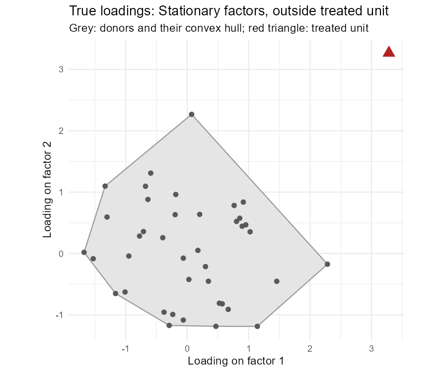

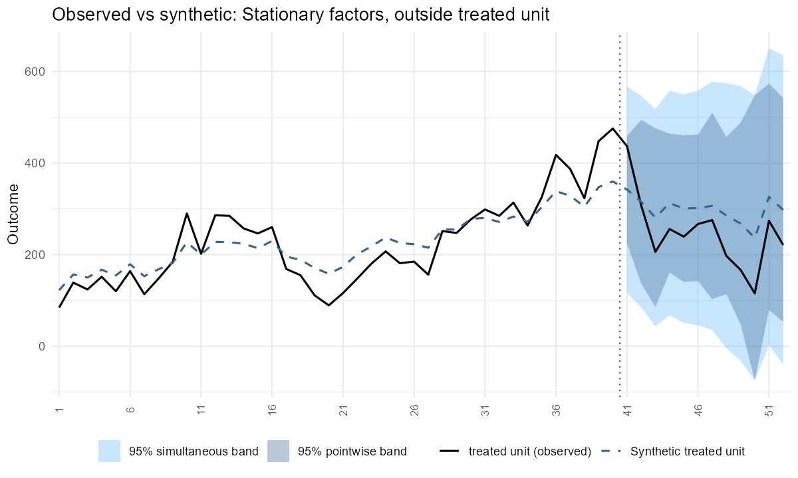

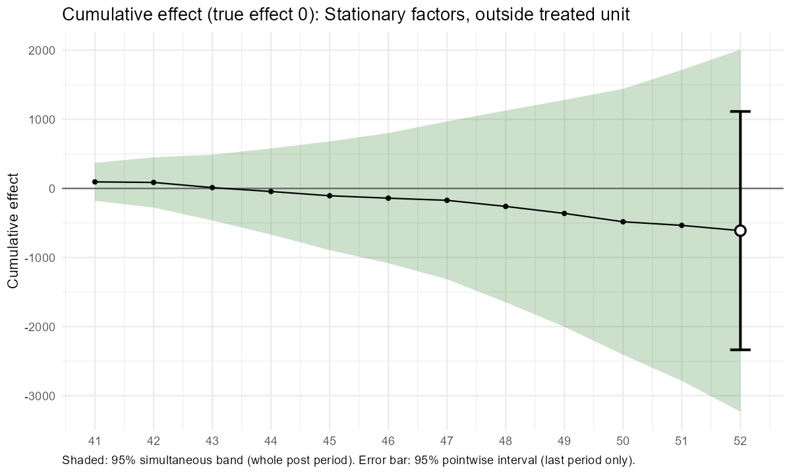

| Fit: placebos fitting worse | Hull: donors further out | Implied drift | Factor AR(1) | Cumulative error | Interval covers 0 |
|----|----|----|----|----|----|
| 0% | 0% | 28.3% | 0.88 (not trending) | −20.6% | yes |

**What the diagnostics say.** Both flags fire (no placebo fits worse; no donor lies further out); the factors are not trending. The assessment is the same as in Case 2.

**What happened.** The treated unit is clearly beyond the donors, and the estimate is off by −20.6%. But because the factors are stationary, the mismatch error is about as large before treatment as after, and the poor pre-treatment fit makes the interval wide enough to contain zero. This is why, with stationary factors, DSC with the RMSPE scale stayed valid in simulation even for treated units outside the donors’ range, at the cost of very low power.

# Part B: trending factors

## Case 4: trending factors, exchangeable treated unit

<details class="code-fold">
<summary>Show code for this case</summary>

``` r
cs <- run_toy_case("exchangeable", "random_walk", rep_seed = 20761047)
plot_true_loadings(cs)
plot_full_path(cs$fit, title = "Observed vs synthetic", unit_label = "treated unit", y_label = "Outcome")
plot_post_effect(cs$fit, "cumulative", title = "Cumulative effect (true effect 0)", y_label = "Cumulative effect")
diagnostics_table(cs)
```

</details>

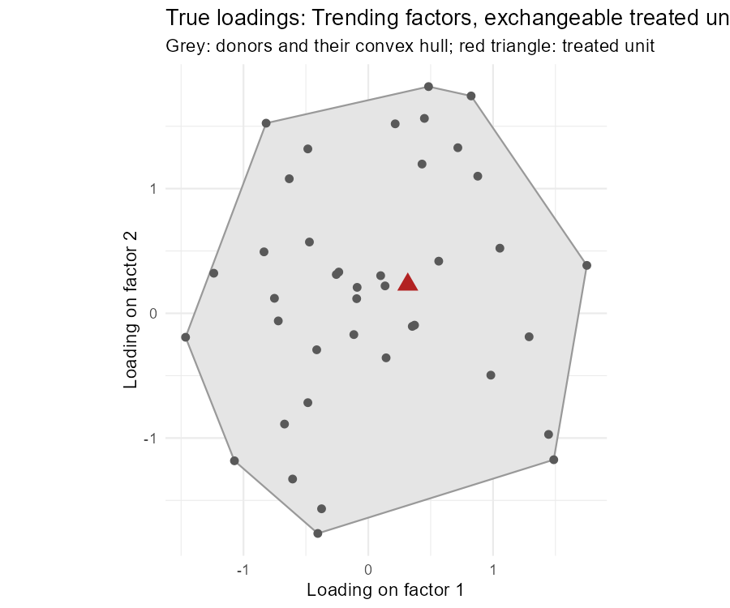

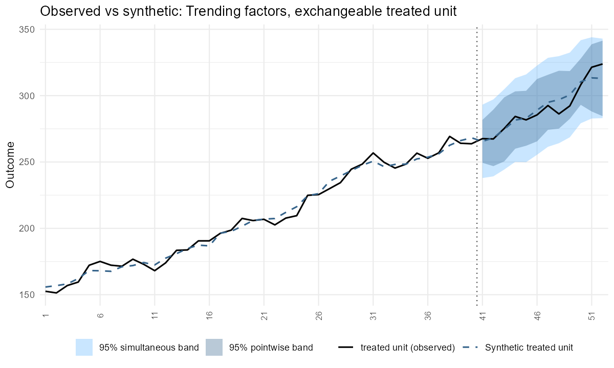

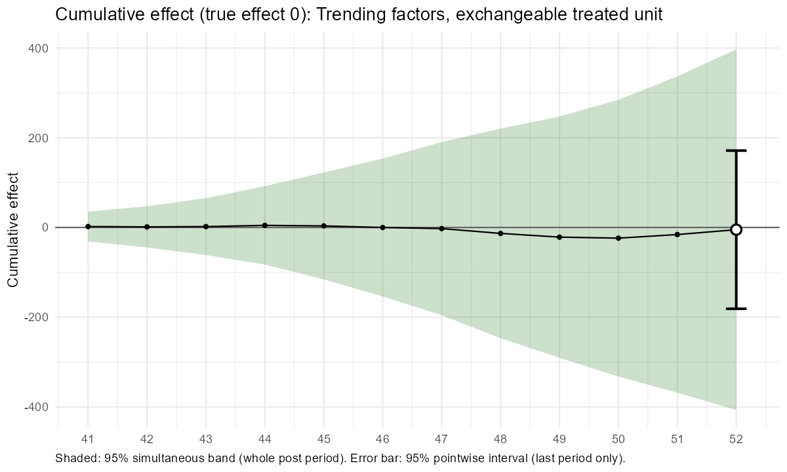

| Fit: placebos fitting worse | Hull: donors further out | Implied drift | Factor AR(1) | Cumulative error | Interval covers 0 |
|----|----|----|----|----|----|
| 45% | 98% | 3.0% | 0.99 (trending) | −0.1% | yes |

**What the diagnostics say.** The factors are correctly identified as trending, but the treated unit is not flagged as extreme: its fit is in the middle of the placebos’, and 98% of donors lie further out than it does. Because the warning requires **both** conditions, none is issued. Assessment: *no sign that the treated unit lies beyond the donors*.

**What happened.** The cumulative error is −0.1%. Trending factors are not a problem in themselves: when the weights can match the treated unit’s loadings, the factors cancel out of the gap, however much they move.

## Case 5: trending factors, edge treated unit

<details class="code-fold">
<summary>Show code for this case</summary>

``` r
cs <- run_toy_case("edge", "random_walk", rep_seed = 21361034)
plot_true_loadings(cs)
plot_full_path(cs$fit, title = "Observed vs synthetic", unit_label = "treated unit", y_label = "Outcome")
plot_post_effect(cs$fit, "cumulative", title = "Cumulative effect (true effect 0)", y_label = "Cumulative effect")
diagnostics_table(cs)
```

</details>

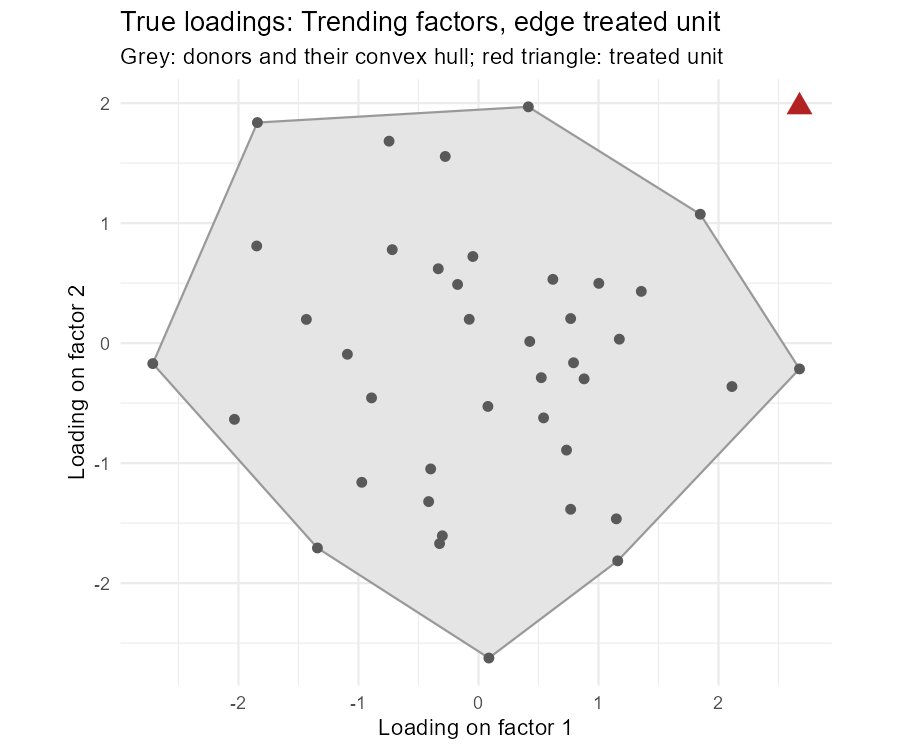

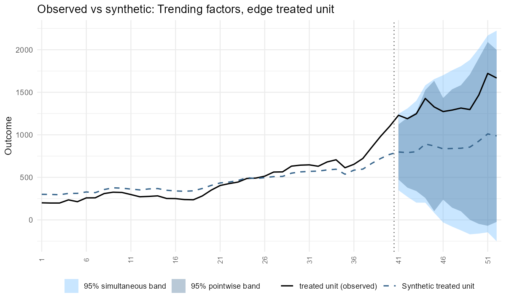

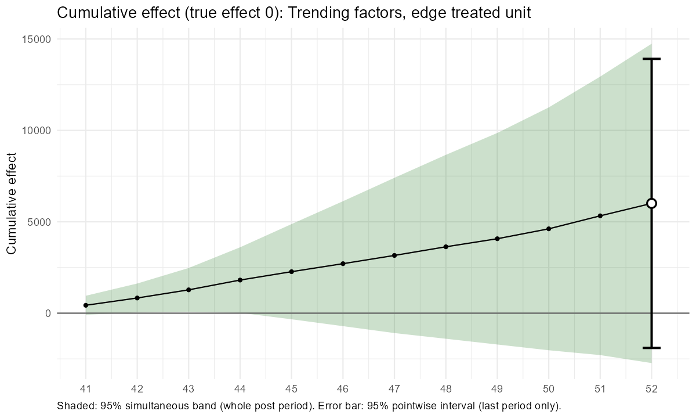

| Fit: placebos fitting worse | Hull: donors further out | Implied drift | Factor AR(1) | Cumulative error | Interval covers 0 |
|----|----|----|----|----|----|
| 0% | 0% | 66.5% | 0.98 (trending) | +36.5% | yes (very wide) |

**What the diagnostics say.** Both extreme-unit flags fire, and the factors are trending. Assessment: *the treated unit appears beyond the donors’ range and the factors are trending … treat results as unreliable*. A warning is issued.

**What happened.** The mismatch error grows after treatment, and the estimate is off by +36.5%. In this particular panel the interval is wide enough to contain zero, but only because the poor pre-treatment fit inflated it a great deal; the interval is too wide to say anything useful. Across all such panels in simulation, the interval contained the truth only 78% of the time. The warning is right to call the result unreliable even when, as here, the interval happens to cover.

## Case 6: trending factors, outside treated unit

<details class="code-fold">
<summary>Show code for this case</summary>

``` r
cs <- run_toy_case("outside", "random_walk", rep_seed = 21961039)
plot_true_loadings(cs)
plot_full_path(cs$fit, title = "Observed vs synthetic", unit_label = "treated unit", y_label = "Outcome")
plot_post_effect(cs$fit, "cumulative", title = "Cumulative effect (true effect 0)", y_label = "Cumulative effect")
diagnostics_table(cs)
```

</details>

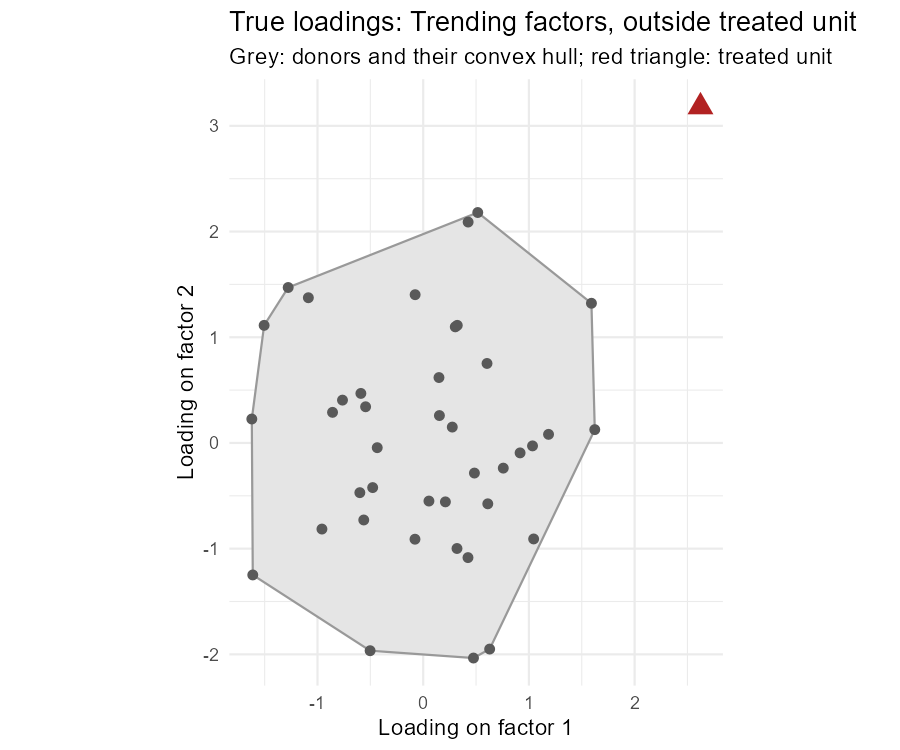

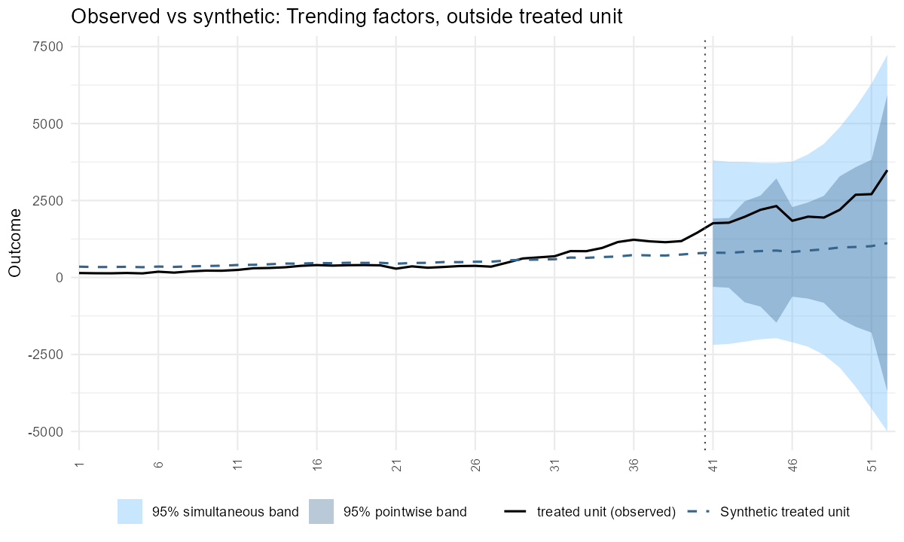

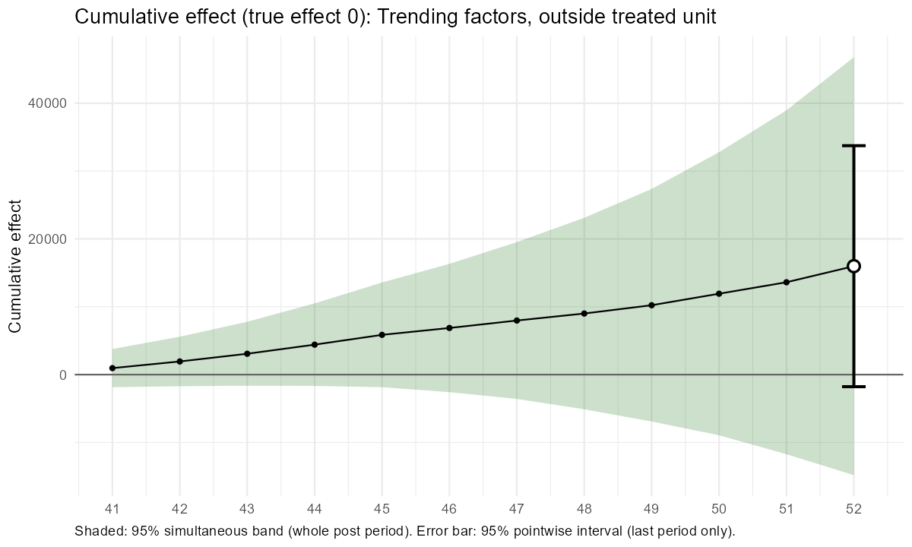

| Fit: placebos fitting worse | Hull: donors further out | Implied drift | Factor AR(1) | Cumulative error | Interval covers 0 |
|----|----|----|----|----|----|
| 0% | 0% | 190.7% | 1.35 (trending) | +59.5% | yes (very wide) |

**What the diagnostics say.** Every check points the same way: no placebo fits worse, no donor lies further out, the implied drift is very large, and the factors are trending. Assessment: *treat results as unreliable*.

**What happened.** The synthetic control cannot follow the treated unit, and the cumulative error reaches +59.5%. As in Case 5, the interval happens to contain zero only because it is enormous; across such panels in simulation it covered the truth 68% of the time, and no method tested was valid in this setting.

# A failure illustration

The typical trending cases above happened to produce intervals that contain zero, because their poor pre-treatment fit made them very wide. This last example, a more extreme draw of the same scenario (trending factors, outside treated unit), shows the failure the warning protects against: a **large, statistically significant effect that does not exist**.

<details class="code-fold">
<summary>Show code for this case</summary>

``` r
cs <- run_toy_case("outside", "random_walk", rep_seed = 424242)
plot_true_loadings(cs)
plot_full_path(cs$fit, title = "Observed vs synthetic", unit_label = "treated unit", y_label = "Outcome")
plot_post_effect(cs$fit, "cumulative", title = "Cumulative effect (true effect 0)", y_label = "Cumulative effect")
diagnostics_table(cs)
```

</details>

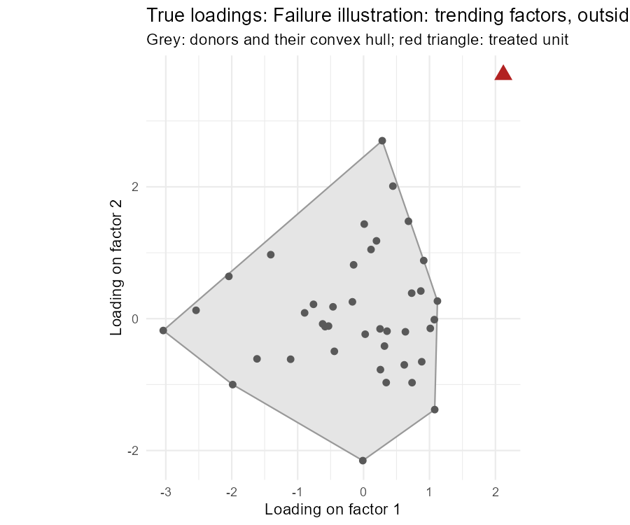

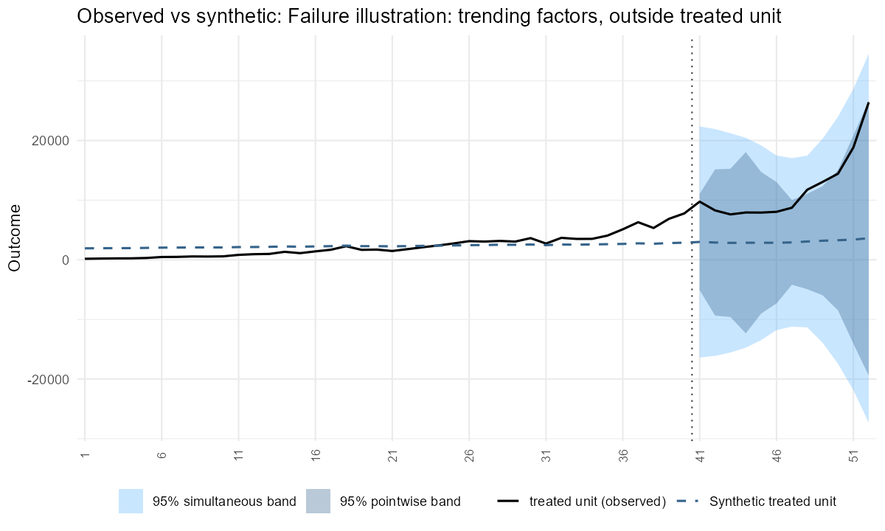

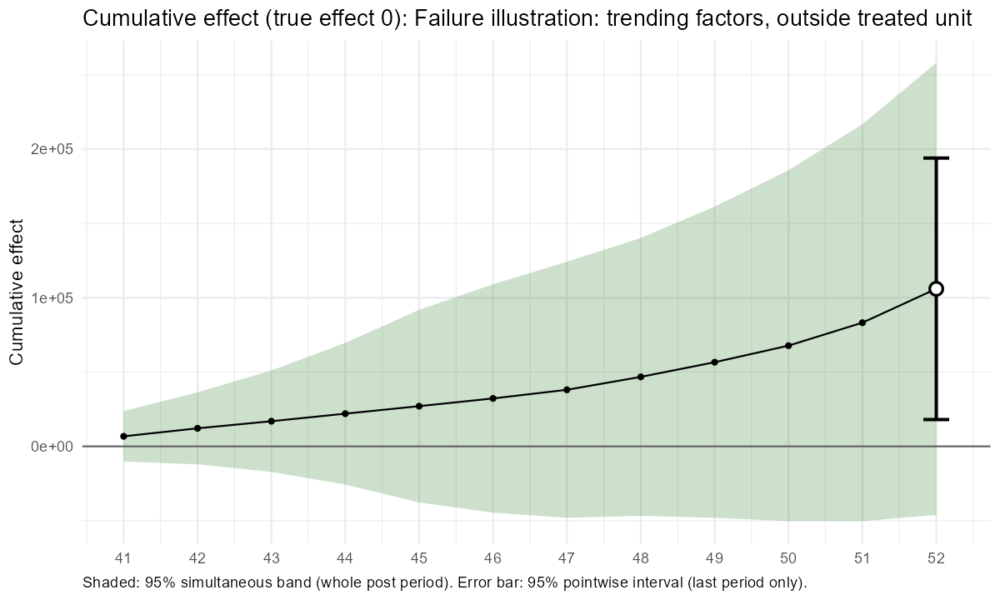

| Fit: placebos fitting worse | Hull: donors further out | Implied drift | Factor AR(1) | Cumulative error | Interval covers 0 |
|----|----|----|----|----|----|
| 0% | 0% | 270.8% | 1.06 (trending) | +74.2% | **no** |

The treated unit’s true loadings are (2.12, 3.70), one unit beyond the donors’ maximum (1.12, 2.70) on both factors. The synthetic control puts all of its weight on a single donor, and the treated unit’s outcome pulls away from every donor even before treatment, then diverges further. With no true effect, the method estimates +74% cumulatively, with an interval that excludes zero. Every diagnostic fires, and the assessment says to treat the result as unreliable.

# Summary of the cases

| Case | Factors | Treated unit | Extreme flag | Trending | Assessment | Cumulative error | Covers 0 |
|----|----|----|----|----|----|----|----|
| 1 | stationary | exchangeable | no | no | no concern | −0.5% | yes |
| 2 | stationary | edge | yes | no | extreme; consider fect with placebo calibration | −8.6% | yes |
| 3 | stationary | outside | yes | no | extreme; consider fect with placebo calibration | −20.6% | yes |
| 4 | trending | exchangeable | no | yes | no concern | −0.1% | yes |
| 5 | trending | edge | yes | yes | **unreliable** | +36.5% | yes (very wide) |
| 6 | trending | outside | yes | yes | **unreliable** | +59.5% | yes (very wide) |
| Failure | trending | outside (extreme draw) | yes | yes | **unreliable** | +74.2% | **no** |

# What the simulations show

The toy cases are single panels. The diagnostics were validated on all 1,800 panels of the simulation (100 per scenario, pre-treatment periods of 20, 40, and 80), linked to whether each panel’s interval (DSC, RMSPE scale, cumulative effect) contained the true effect.

**Detection.**

| Scenario                 | Flagged as extreme | Coverage of DSC (RMSPE scale) |
|--------------------------|--------------------|-------------------------------|
| Exchangeable, stationary | 10%                | 97%                           |
| Exchangeable, trending   | 12%                | 94%                           |
| Edge, stationary         | 81%                | 97%                           |
| Edge, trending           | 81%                | 78%                           |
| Outside, stationary      | 100%               | 98%                           |
| Outside, trending        | 100%               | 68%                           |

The extreme-unit flag caught every outside treated unit and 81% of edge ones. Among exchangeable treated units truly inside the donors’ hull, only 4-5% were flagged; among those that lay outside it by chance, 38-43%.

**The warning.** Extremeness alone did not predict failure: flagged treated units with stationary factors still had 98% coverage. The combined warning (flag **and** trending) did:

|                            | Runs           | Coverage |
|----------------------------|----------------|----------|
| Warned (flag and trending) | 603 of 1,800   | 74%      |
| Not warned                 | 1,197 of 1,800 | 96%      |

The persistence threshold matters: at 0.9, 26-65% of stationary panels were wrongly called trending (more with long pre-periods); at 0.95, 12-20%.

# Limitations

- **One design.** The thresholds were calibrated on one factor-model design (two factors, 40 donors). Other designs may need different thresholds.
- **The persistence check is imperfect.** Estimated factors come out more persistent than the true ones, so stationary factors are sometimes called trending, especially with long pre-periods. That makes the warning over-cautious rather than missing problems.
- **Single panels vary.** In a single application, an interval can cover the truth even when the warning fires (Cases 5 and 6), or miss it (the failure illustration). The warning describes the risk, not the outcome of one analysis.
- **No remedy yet for the trending case.** With an extreme treated unit and trending factors, none of the methods tested (demeaned synthetic control, its augmented version, fect, augmented synthetic control) gave valid intervals.
- **Reproducibility.** The loading-based checks use `fect`, whose cross-validation is random; `dsc_placebo()` fixes it with `ife_seed` (default 12112025), so the same data give the same diagnostics.

# Practical guidance

1.  **Always look at `$diagnostics`**, not just the estimate and intervals.
2.  **If nothing is flagged,** the treated unit looks reproducible by the donors, and the usual intervals can be read as intended.
3.  **If the treated unit is flagged but the factors are not trending,** the intervals from DSC with the RMSPE scale remain valid but wide; fect with placebo calibration (RMSPE scale) was both valid and much more powerful in this situation in simulation.
4.  **If the treated unit is flagged and the factors are trending,** treat the results as unreliable. Report that the donors cannot reproduce the treated unit’s exposure to common trends, rather than presenting the estimate and interval as evidence.
5.  **Look at the figures:** a treated unit whose pre-treatment path pulls away from every donor is a warning sign in itself.

# Reproducing this document

The panels are generated by `toy_panel()` with the seeds shown in each case’s code; the figures in `diagnostics_figures/` were produced by the same calls. The validation results come from `simulations/diagnostics_validation.R` and `simulations/augmented_comparison_simulation.R`.
