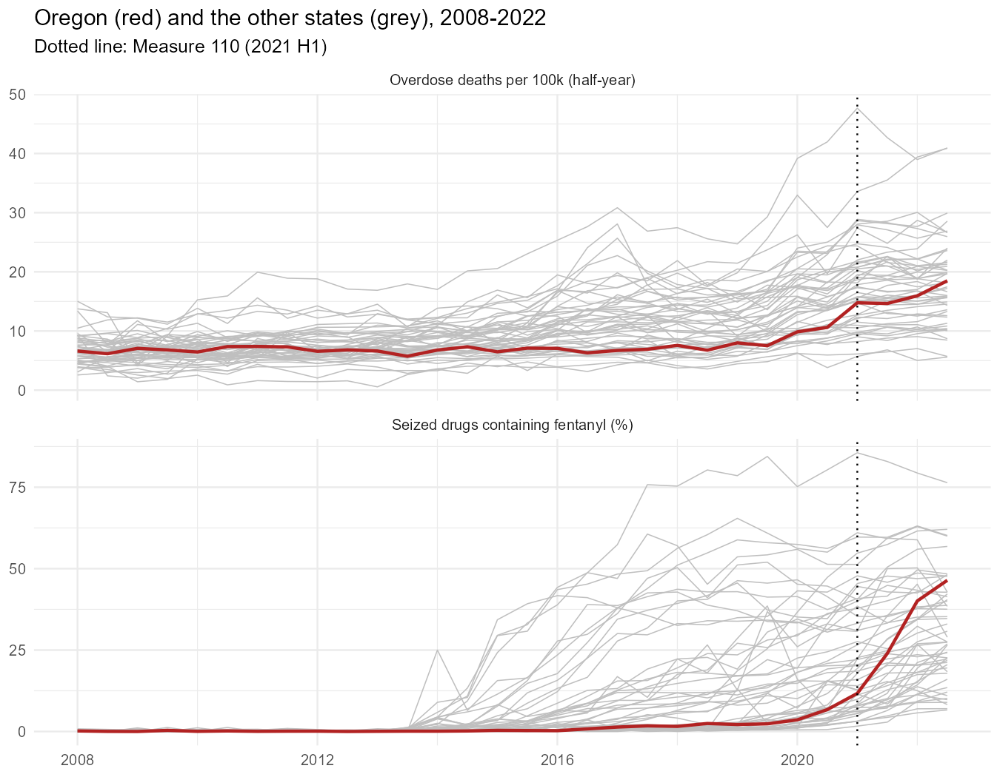
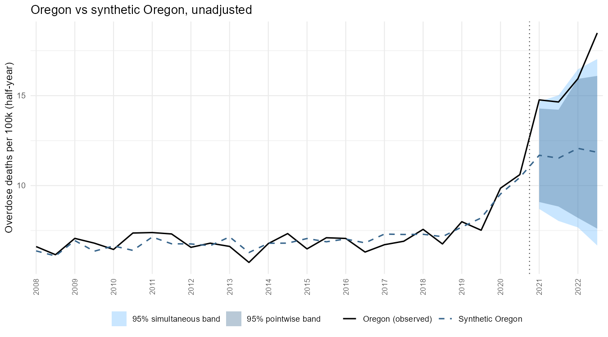
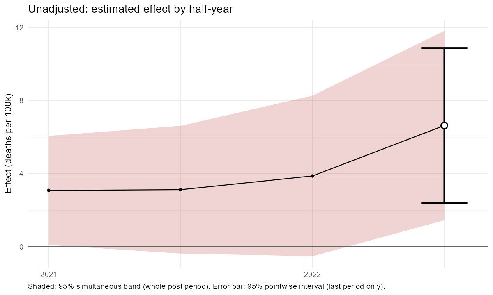
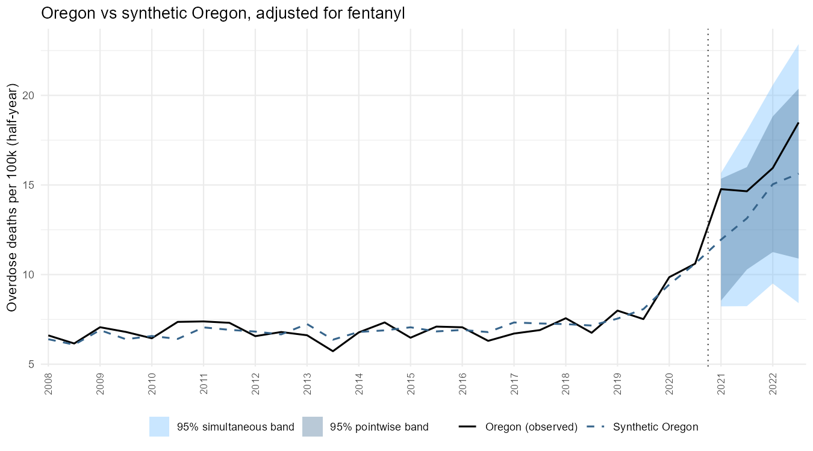
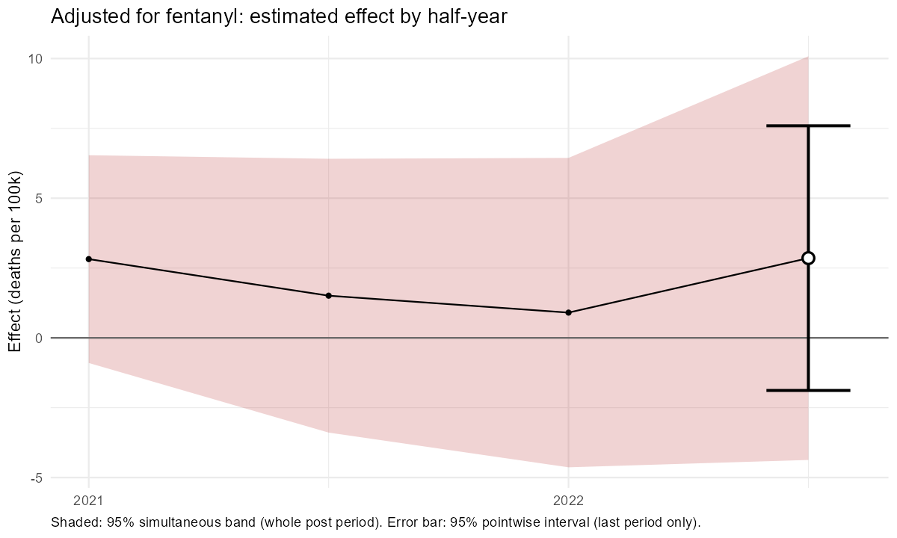
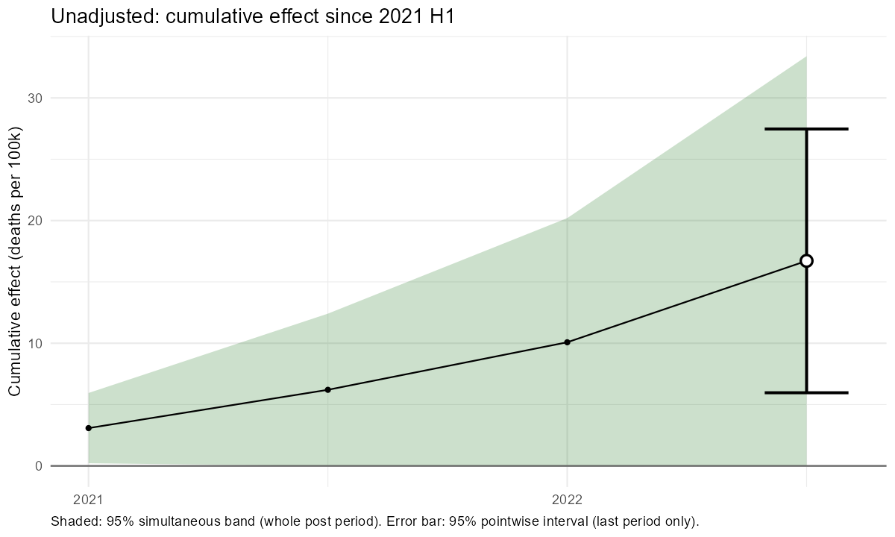
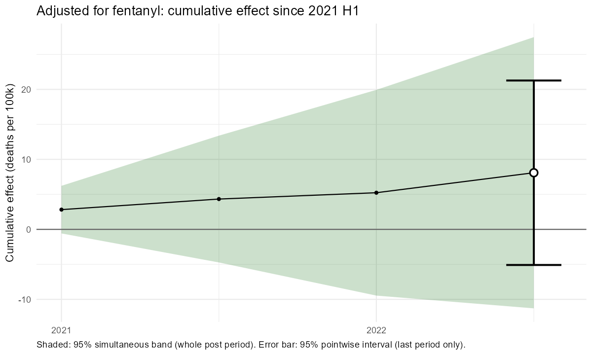
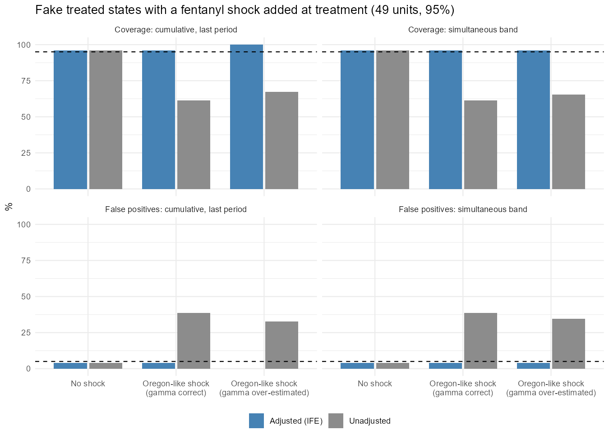

*This document was written by Claude, an AI model made by Anthropic, at the direction of Jeffrey Milliman. The methods have been tested by simulation but not independently peer reviewed; see the disclaimer in the [main README](../../README.md).*

# Overview

In February 2021, Oregon's Measure 110 decriminalized possession of small amounts of drugs. Overdose deaths in Oregon rose sharply in the following years, and a synthetic control analysis by Spencer (2023) estimated that the law caused a 23% increase in overdose deaths over the rest of 2021. Zoorob et al. (2024) pointed out that the rise coincided with the arrival of **fentanyl** in Oregon's illicit drug supply, which reached the western states years after the eastern ones. Controlling for the share of seized drugs containing fentanyl, they found no association between decriminalization and overdose deaths: their estimate fell from 1.83 (SE 0.47) to -0.51 (SE 0.61) deaths per 100,000 per half-year.

This is a textbook case of a **time-varying confounder that arrives with the treatment**. A synthetic control fitted only on pre-treatment outcomes cannot anticipate it: before 2021 there was little fentanyl in Oregon or in the states that best reproduce Oregon's overdose history, so nothing in the pre-treatment fit warns that Oregon's counterfactual is about to change. An earlier write-up by the author (a LASSO synthetic control, following Wheeler 2019, 2023) showed the same problem: the unadjusted LASSO found a large positive effect, and forcing the fentanyl share into the model reversed it.

`dsc_placebo()` has a covariate adjustment designed for exactly this situation (`adjust_covariates`; see the simulations README, simulation 3). This document:

1. reproduces the problem: the **unadjusted** demeaned synthetic control finds a significant increase in overdose deaths;
2. applies the **adjustment** for the fentanyl share, which removes most of the estimated effect and all of its significance; and
3. **validates** the adjustment on the same panel, by giving each other state an Oregon-like fentanyl shock at a fake treatment date and checking whether the adjusted method still gets the right answer.

::: {.callout-note}
## Files this document needs

The code uses the `synthplacebo` package (`library(synthplacebo)`) and reads the data from `data/oregon_fentanyl/data_final.csv`, relative to the **project root**, so run it from there. The figures are read from `figures/` next to this file, and the validation results from `simulations/results_oregon_fentanyl/` (produced by `simulations/oregon_fentanyl_validation.R`). The code chunks are not evaluated when the document is rendered (`eval: false`); the numbers come from `oregon_results.rds` in this folder.
:::

# The data

The panel comes from the replication materials of Zoorob et al. (2024) (see `data/oregon_fentanyl/README.md`): half-yearly drug overdose deaths per 100,000 residents (CDC WONDER) and the percentage of seized drug items containing fentanyl (NFLIS), for 50 states and DC, 2008 H1 to 2022 H2. Following Zoorob et al., Washington is dropped (its supreme court struck down the state's drug possession law in 2021, effectively decriminalizing possession for about four months), leaving Oregon and **49 donors** (48 states and DC). Treatment starts in 2021 H1, so there are 26 pre-treatment and 4 post-treatment half-years.



The two panels tell the story. Fentanyl spread through the eastern states from about 2014 and reached most western states only around 2020. In Oregon, the fentanyl share of seized drugs was 6.7% in 2020 H2 and rose to 46.4% by 2022 H2, one of the steepest increases in the panel, right as Measure 110 took effect. Oregon's overdose death rate rose with it.

# The problem: an unadjusted synthetic control

```{r}
library(synthplacebo)   # remotes::install_github("jpmilliman/Synth_Placebo", subdir = "synthplacebo")
library(tidyverse)

oregon <- read_csv("data/oregon_fentanyl/data_final.csv") |>
  filter(Year <= 2022, ST != "WA") |>
  as.data.frame()

unadjusted <- dsc_placebo(oregon, unit_col = "State", time_cols = c("Year", "half"),
                          outcome_col = "od_death_rate_half", treated_unit = "Oregon",
                          treatment_period = c(Year = 2021, half = 1))
unadjusted$test
```

Synthetic Oregon is built from Texas (0.37), Nebraska (0.24), California (0.20), Montana (0.13) and small weights on Nevada, New Mexico and Mississippi, and it tracks Oregon closely before 2021 (pre-treatment RMSPE 0.42 deaths per 100k, about 6% of Oregon's level). The results at 95% (RMSPE scale; the pointwise tests are for the last half-year, 2022 H2):

| Test | Estimate | 95% interval | p-value |
|---|---|---|---|
| Pointwise: effect in 2022 H2 | +6.64 | 2.39 to 10.88 | **0.02** |
| Pointwise: cumulative effect, 2021 H1 to 2022 H2 | +16.71 | 5.96 to 27.46 | **0.02** |
| Simultaneous: effect by half-year | | flags 2021 H1, 2022 H2 | **0.02** |
| Simultaneous: cumulative effect | | flags 2021 H1, 2022 H2 | **0.02** |
| Classic post/pre RMSPE ratio | 10.52 | | **0.02** |

Every test finds a large increase: Oregon's death rate in 2022 H2 was 56% above synthetic Oregon's, and cumulatively 36% above. Oregon ranks first among the 50 units on every test, the smallest p-value possible (1/50 = 0.02). The diagnostics raise no warning: Oregon's pre-treatment fit is ordinary among the placebos (61% of them fit worse), and it lies within the donors' range.





**Why this is misleading.** The donors that reproduce Oregon's pre-2021 history saw much less fentanyl after 2021: weighted by synthetic Oregon's weights, their fentanyl share in 2022 H2 was about 14%, against Oregon's 46%. Synthetic Oregon therefore predicts what Oregon's death rate would have been with *their* drug supply, not with the fentanyl-saturated supply Oregon actually had. Nothing in the pre-treatment fit reveals this: the fit is good because before 2020 neither Oregon nor its donors had much fentanyl. The placebo inference cannot help either: it is calibrated against donors whose own post-2021 gaps were not driven by a fentanyl surge of this size, so it correctly reports that Oregon's gap is unusual, without saying why.

# The adjustment

`dsc_placebo(adjust_covariates = ...)` removes the part of the outcome that a time-varying covariate explains before fitting the synthetic control:

1. **Estimate the covariate's effect** ($\gamma$) on **untreated cells only**: every donor in every period, plus Oregon before 2021. The default model is an interactive fixed-effects (IFE) model from the `fect` package (unit and time effects, latent factors chosen by cross-validation, and the covariate); `adjust_model = "twfe"` uses two-way fixed effects instead. Because fentanyl reached different states at different times, $\gamma$ is identified from the donors' own fentanyl surges, without using Oregon's post-treatment data.
2. **Adjust every unit's outcome**: $\tilde{y}_{it} = y_{it} - \hat\gamma \times \text{fentanyl}_{it}$.
3. **Run the method on the adjusted outcomes**: the demeaned synthetic control and the placebo calibration, with every placebo re-estimating $\gamma$ without its own post-treatment period.

The estimated effect is then Oregon's death rate minus a counterfactual that **includes the deaths Oregon's actual fentanyl share would have caused**. This relies on two assumptions: the fentanyl share is not itself affected by decriminalization, and its effect on deaths is roughly the same across states.

```{r}
adjusted <- dsc_placebo(oregon, unit_col = "State", time_cols = c("Year", "half"),
                        outcome_col = "od_death_rate_half", treated_unit = "Oregon",
                        treatment_period = c(Year = 2021, half = 1),
                        adjust_covariates = "nflis_fentanyl_percent_total")   # adjust_model = "ife" by default
adjusted$adjustment$gamma   # deaths per 100k per percentage point of fentanyl share
adjusted$test
```

The IFE model (one factor) estimates $\hat\gamma = 0.120$: each additional percentage point of seized drugs containing fentanyl adds about 0.12 overdose deaths per 100,000 residents per half-year. Two-way fixed effects give 0.157 (clustered SE 0.029), and Zoorob et al.'s matrix-completion specification, re-estimated here, 0.152. By 2022 H2 Oregon's fentanyl share was about 32 points higher than synthetic Oregon's donors', so the adjustment removes 3.8 (IFE) to 5.2 (TWFE) deaths per 100k from that half-year's gap.

The weights barely change (Texas 0.34, Nebraska 0.28, California 0.19, Montana 0.13, Vermont 0.04), and the pre-treatment fit is the same (RMSPE 0.42). What changes is the counterfactual after 2021: adjusted synthetic Oregon rises from 12.0 to 15.6 deaths per 100k, instead of staying near 12.

| Test (95%) | Unadjusted | Adjusted (IFE, default) |
|---|---|---|
| Pointwise: effect in 2022 H2 | +6.64 (2.39 to 10.88), p = **0.02** | +2.85 (-1.88 to 7.59), p = 0.22 |
| Pointwise: cumulative effect | +16.71 (5.96 to 27.46), p = **0.02** | +8.09 (-5.09 to 21.27), p = 0.12 |
| Simultaneous: effect by half-year | p = **0.02** (flags 2021 H1, 2022 H2) | p = 0.08 (flags none) |
| Simultaneous: cumulative effect | p = **0.02** (flags 2021 H1, 2022 H2) | p = 0.06 (flags none) |
| Classic post/pre RMSPE ratio | p = **0.02** | p = 0.22 |

Adjusting for fentanyl cuts the estimated effect by more than half (2022 H2: +6.6 to +2.9; cumulative: +16.7 to +8.1, or from +36% to +15% of synthetic Oregon's cumulative death rate) and **no test remains significant at 95%**. The adjusted intervals are also slightly wider (2022 H2 half-width 4.7 vs 4.2).









## Sensitivity

| Specification | Effect in 2022 H2 | p | Cumulative effect | p | Simultaneous p (per period / cumulative) |
|---|---|---|---|---|---|
| Unadjusted (RMSPE scale) | +6.64 | **0.02** | +16.71 | **0.02** | **0.02** / **0.02** |
| Unadjusted, relative scale | +6.64 | **0.02** | +16.71 | **0.02** | 0.06 / 0.06 |
| **Adjusted, IFE (default)** | **+2.85** | **0.22** | **+8.09** | **0.12** | **0.08 / 0.06** |
| Adjusted, TWFE ($\hat\gamma$ = 0.157) | +1.46 | 0.44 | +4.77 | 0.50 | 0.12 / 0.10 |
| Adjusted, relative scale | +2.85 | 0.28 | +8.09 | 0.28 | 0.08 / 0.08 |
| Adjusted, raw scale | +2.85 | 0.36 | +8.09 | 0.38 | 0.26 / 0.26 |
| Adjusted, `estimator = "fect"` (placebo-calibrated) | +3.71 | 0.10 | +11.73 | 0.06 | 0.08 / 0.08 |
| Zoorob et al. specification (fect matrix completion), no control | average +2.31 per half-year | | | | |
| Zoorob et al. specification, with fentanyl control | average +0.32 per half-year | | | | |

Every adjusted specification gives a smaller effect than the unadjusted one, and none is significant at 95%. The size of the remaining effect depends mainly on $\hat\gamma$: the TWFE estimate (0.157) removes more of the increase than the IFE estimate (0.120). The fect matrix-completion model of Zoorob et al., re-estimated here, shows the same pattern: its average effect falls from +2.3 to +0.3 deaths per 100k per half-year when the fentanyl share is controlled for (their published estimates, with their own settings, are 1.83 and -0.51). (Their matrix-completion counterfactual is different from a synthetic control, so its point estimates are not directly comparable with the demeaned synthetic control's.)

**Conclusion for Oregon.** With the fentanyl adjustment, the data are consistent with no effect of decriminalization on overdose deaths, and also with a moderate increase: the adjusted cumulative interval runs from -5.1 to +21.3 deaths per 100k over two years. The significant increase found without the adjustment is what the arrival of fentanyl alone would produce. The adjustment cannot rule out that some of the remaining gap is a real effect, and it rests on the assumption that decriminalization did not itself change the fentanyl share of seized drugs (for example, by changing which drugs police seized).

# Validation: does the adjustment work on this panel?

The Oregon results show that the adjustment changes the answer, but not that it gives the right one, since Oregon's true effect is unknown. To check the method, `simulations/oregon_fentanyl_validation.R` builds cases with a **known** answer from the same data.

## Design

- **Fake treated units.** Oregon is removed, and each of the other 49 units (48 states and DC) in turn is treated as if it had adopted a policy in 2021 H1, with the remaining 48 as donors. These units adopted no policy, so their true effect is zero (or a known effect is added).
- **An Oregon-like shock.** After 2021 H1, the fake treated unit's fentanyl share is raised by Oregon's actual increase since 2020 H2 (+5.0, +17.2, +33.4 and +39.7 points, capped at 100%), and its overdose death rate by $\gamma_{\text{true}} \times$ the added fentanyl share. This reproduces Oregon's situation: a fentanyl surge that arrives with the treatment, in a unit whose synthetic control does not share it.
- **Scenarios.** No shock; a shock with $\gamma_{\text{true}} = 0.155$, about the $\hat\gamma$ the adjustment estimates on this panel (the adjustment model is right); and a shock with $\gamma_{\text{true}} = 0.12$, so that $\gamma$ is over-estimated by about 0.035 (the adjustment over-corrects). True effects of 0 and $\pm 25\%$ of the unit's recent death rate.
- **Methods.** `dsc_placebo()` unadjusted and adjusted (IFE, the default; TWFE gave the same results, because cross-validation chose no factors for 48 of the 49 fake treated units, which reduces IFE to TWFE). RMSPE scale, 95%.

Because the weights, $\hat\gamma$ and the interval widths all depend only on the pre-treatment data and the donors, the shock and the effect shift the fake treated unit's gap by exactly $\gamma_{\text{true}} \times \text{added}$ (unadjusted) or $(\gamma_{\text{true}} - \hat\gamma) \times \text{added}$ (adjusted), plus the effect. Each unit is therefore fitted once on the real data, and every scenario is evaluated exactly from that fit.

## Results



True effect zero (49 fake treated units, 95%):

| Scenario | Method | Cumulative bias (% of base level) | Coverage: cumulative, last period | Coverage: simultaneous | False positives: cumulative | False positives: simultaneous |
|---|---|---|---|---|---|---|
| No shock | Unadjusted | -1.9% | 96% | 96% | 4% | 4% |
| No shock | Adjusted | -1.8% | 96% | 96% | 4% | 4% |
| Oregon-like shock, $\gamma$ correct | Unadjusted | **+26.3%** | **61%** | **61%** | **39%** | **39%** |
| Oregon-like shock, $\gamma$ correct | Adjusted | -1.7% | 96% | 96% | 4% | 4% |
| Oregon-like shock, $\gamma$ over-estimated | Unadjusted | **+19.9%** | **67%** | **65%** | **33%** | **35%** |
| Oregon-like shock, $\gamma$ over-estimated | Adjusted | -8.1% | 100% | 96% | 0% | 4% |

Bias is the average error in the cumulative effect over the four post-treatment half-years, as a percentage of the unit's cumulative death rate at its 2020 level.

- **Without a shock, the adjustment costs nothing in validity**: both methods are unbiased and keep 96% coverage and 4% false positives.
- **With an Oregon-like shock, the unadjusted method fails badly.** It overstates the cumulative effect by about 20-26% of the unit's death rate and finds an "effect" of a policy that does not exist in a third or more of the fake treated units. This is the failure behind the unadjusted Oregon result.
- **The adjusted method stays valid**: 96% coverage and 4% false positives when $\gamma$ is estimated correctly, and still 96-100% coverage when $\gamma$ is over-estimated, although the estimate is then biased downwards (-8%).

Power to detect a real effect of $\pm 25\%$ (cumulative, last period, 95%):

| Scenario | Effect | Unadjusted | Adjusted |
|---|---|---|---|
| No shock | -25% / +25% | 55% / 41% | 29% / 27% |
| Oregon-like shock, $\gamma$ correct | -25% / +25% | 8% / 80% | 29% / 29% |

The adjustment's price is power. Without a shock, the adjusted method detects a 25% effect about half as often as the unadjusted one: estimating and removing the covariate's contribution adds noise to every unit's gap. With a shock, the unadjusted method's "power" is an artefact of its bias: it detects increases far more often (80%) and decreases far less often (8%), whatever the true effect. The adjusted method's power is the same in both directions and does not depend on the shock.

Results for the 22 units whose fentanyl share was still below 15% in 2020 H2 (like Oregon's 6.7%) are similar: unadjusted false positives 50% with the shock, adjusted 0-9%. The full table is in `simulations/results_oregon_fentanyl/summary.csv`.

## What the validation does and does not show

It shows that, on this panel and with a shock of Oregon's size and timing, the adjustment removes the confounding when the shock acts through the covariate in the way the adjustment model assumes (a common linear effect), keeps the inference valid, and degrades gracefully when $\gamma$ is somewhat mis-estimated. It does not test a shock whose effect differs across states, a covariate that is itself affected by the treatment, or a confounder that is not measured. Those assumptions have to be argued on substantive grounds; for Oregon, the most important is whether decriminalization changed the composition of seized drugs.

# Takeaways

1. **A good pre-treatment fit does not protect against a confounder that arrives with the treatment.** Oregon's unadjusted synthetic control fits well, passes the diagnostics, and finds a highly significant effect that is mostly the arrival of fentanyl.
2. **Placebo inference cannot detect this either**: the placebos tell you that the treated unit's gap is unusual, not why.
3. **`adjust_covariates` handles it**, provided the confounder is measured and its effect can be estimated from the donors (here, because fentanyl reached different states at different times). On this panel it removed the confounding and kept the inference valid; the cost is wider intervals and less power.
4. **Report both.** The unadjusted and adjusted results, and the estimate of $\gamma$ under IFE and TWFE, show readers how much of the estimated effect the covariate explains.

# References

- Abadie, A., Diamond, A., and Hainmueller, J. (2010). Synthetic control methods for comparative case studies. *Journal of the American Statistical Association*, 105(490), 493-505.
- Liu, L., Wang, Y., and Xu, Y. (2024). A practical guide to counterfactual estimators for causal inference with time-series cross-sectional data. *American Journal of Political Science*, 68(1), 160-176.
- Spencer, N. (2023). Does drug decriminalization increase unintentional drug overdose deaths? Early evidence from Oregon Measure 110. *Journal of Health Economics*, 91, 102798.
- Wheeler, A. (2019, December 6). Using regularization to generate synthetic controls and conformal prediction for significance tests. *Andrew Wheeler* (blog). https://andrewpwheeler.com/2019/12/06/using-regularization-to-generate-synthetic-controls-and-conformal-prediction-for-significance-tests/
- Wheeler, A. (2023, October 4). Synthetic control in python: Opioid death increases in Oregon and Washington. *Andrew Wheeler* (blog). https://andrewpwheeler.com/2023/10/04/synthetic-control-in-python-opioid-death-increases-in-oregon-and-washington/
- Zoorob, M. J., Park, J. N., Kral, A. H., Lambdin, B. H., and del Pozo, B. (2024). Drug decriminalization, fentanyl, and fatal overdoses in Oregon. *JAMA Network Open*, 7(9), e2431612. Replication data: https://doi.org/10.7910/DVN/JT4CDS.
