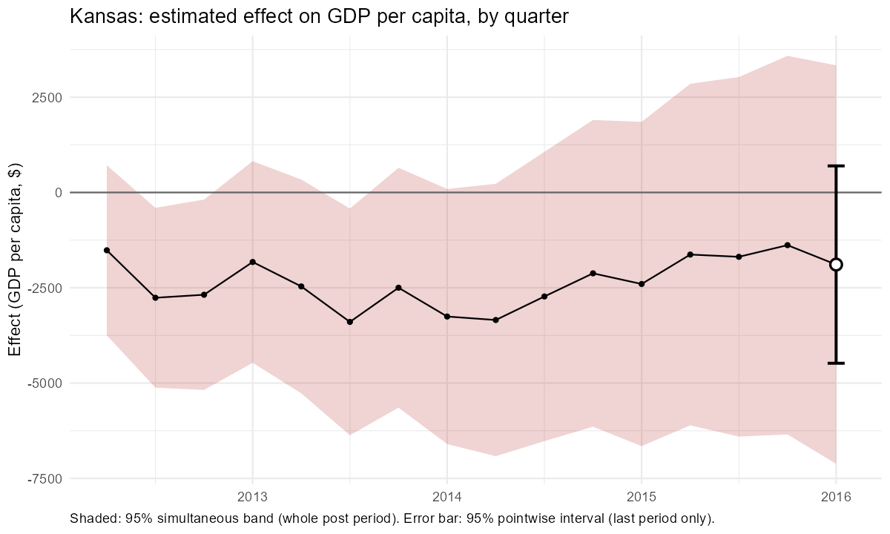
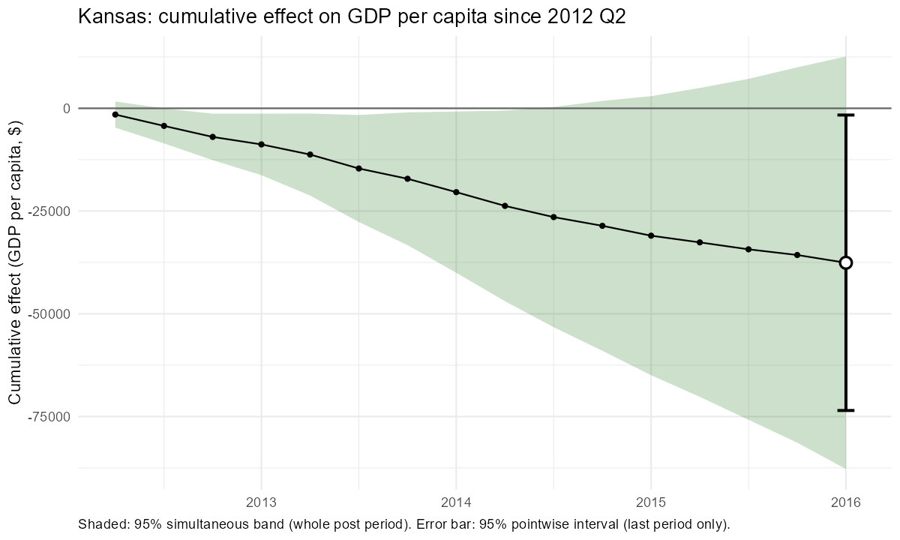
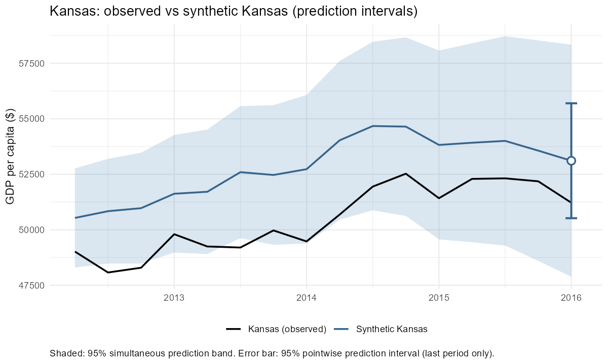
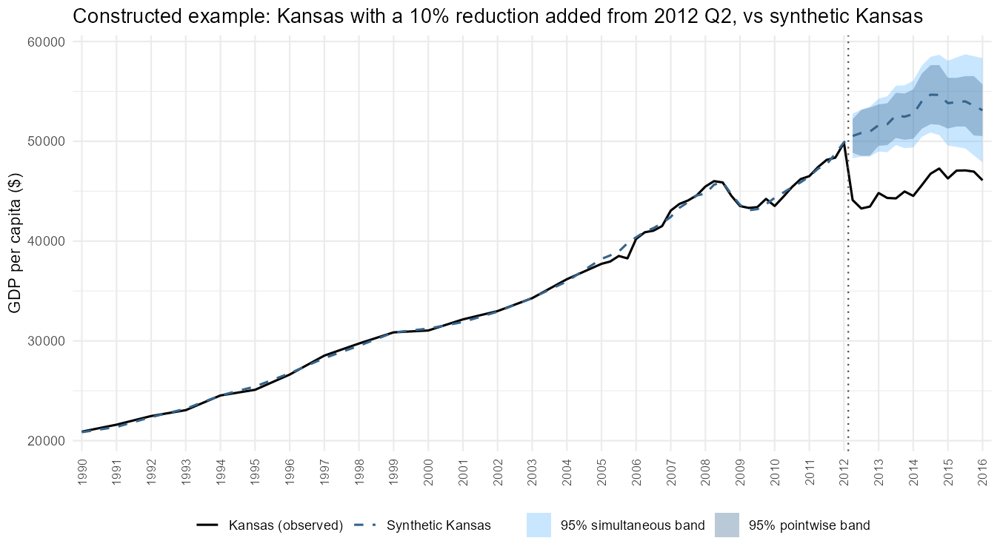
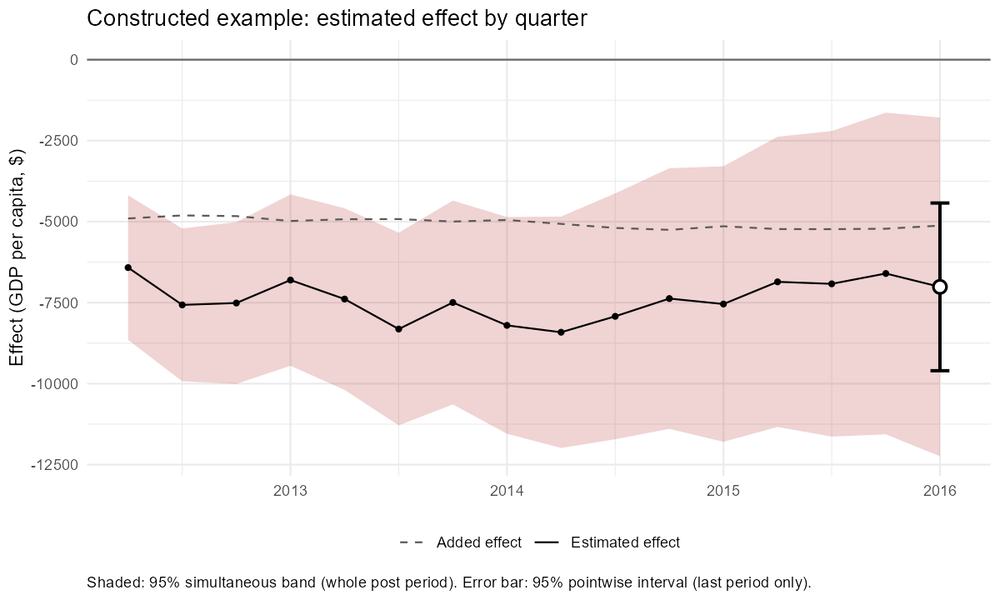
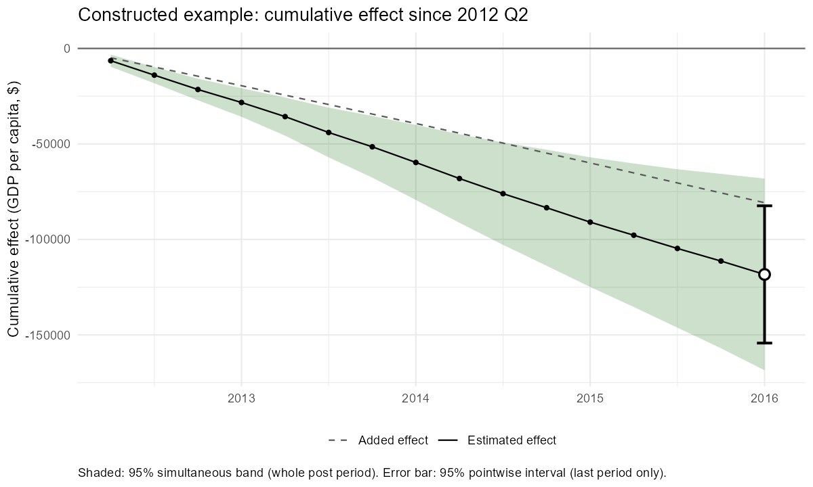

# Inference for a Single Treated Unit: Placebo-Calibrated Intervals and Simultaneous Bands
Claude (Anthropic), at the direction of Jeffrey Milliman
October 2026

*This document was written by Claude, an AI model made by Anthropic, at the direction of Jeffrey Milliman. The methods have been tested by simulation but not independently peer reviewed; see the disclaimer in the [main README](../../README.md).*

# Overview

This document explains a simple method for putting uncertainty intervals around synthetic control estimates when there is a **single treated unit**, such as one state that adopts a policy. It combines two ingredients:

1.  a **demeaned synthetic control** to estimate the counterfactual; and
2.  **placebo calibration**: every untreated unit is analysed as if it had been treated, each unit’s gap is measured against its own pre-treatment fit (its **RMSPE**), and the treated unit’s standardized gap is compared with the placebos’.

There is **no bootstrap**. The method produces two kinds of interval, which answer different questions:

- a **pointwise interval** for the effect in a period chosen in advance (by default the last post-treatment period), for both the per-period and the cumulative effect, with a matching p-value. It answers: *was there an effect in this period?*
- a **simultaneous band** that covers the whole post-treatment path at once, with a p-value for the whole period. It answers: *was there an effect at any point, when, and what did the effect path look like?*

Both come with matching **prediction intervals** for the treated unit’s counterfactual outcome: the range in which its outcome would plausibly have fallen without the treatment.

The method is implemented in `dsc_placebo()` in `synthetic_control_functions/synthetic_control_functions_claude.R`, and runs in a few seconds. It grew out of a project testing whether the maximum entropy bootstrap could provide inference for synthetic control (see the companion document on the fixed-weight bootstrap). An ablation study found that once intervals are calibrated against placebos, **the bootstrap adds little**: the same construction with no bootstrap was valid and at least as powerful in almost every setting tested.

> [!NOTE]
>
> ### How the default scale was chosen
>
> The calibration can measure gaps on three **scales**: against each unit’s pre-treatment RMSPE (`"rmspe"`, the default), as a percentage of its synthetic control (`"relative"`), or in the outcome’s own units (`"raw"`). The method was first developed on the relative scale, which was the most powerful in simulations built from real state panels, where every treated unit is **exchangeable** with the donors. Later, fully simulated tests in which the treated unit could be made **unlike** the donors showed that the relative scale is not robust: cumulative coverage fell to 68% when the treated unit sat at the edge of the donors’ range and 37% outside it, against 91% and 89% for the RMSPE scale. The default was therefore changed to RMSPE in October 2026. This document uses the RMSPE scale throughout and describes the relative scale as an alternative (see *Alternative scales*).

# Background: why inference is hard with one treated unit

A synthetic control estimates what would have happened to a treated unit without the treatment by combining untreated units (the **donors**) so that the combination tracks the treated unit closely before treatment. After treatment, the gap between the treated unit and its synthetic control is the estimated effect.

Putting an interval around that gap is difficult for two reasons:

- **There is only one treated unit.** Standard errors that rely on many treated units, or on many independent observations, do not apply.
- **Most of the error comes from drift.** A synthetic control that fits well before treatment will not track the treated unit perfectly afterwards; the further from the fitting period, the more it drifts. This drift is the main source of error, and it is not visible in the pre-treatment fit.

The standard solution is a **placebo test**: pretend each donor was treated, estimate its “effect” (which should be zero), and see whether the treated unit’s effect is unusual compared with these placebo effects. Because the placebos drift too, placebo tests capture drift directly. This method builds both its pointwise intervals and its simultaneous band on that idea.

# The estimator: the demeaned synthetic control

The counterfactual is estimated with a **demeaned synthetic control**. For the treated unit’s outcome $`y_t`$ and donor outcomes $`x_{jt}`$, the pre-treatment fit chooses an intercept $`b_0`$ and weights $`w_j`$ to solve

``` math

\min_{b_0,\, w} \sum_{t \in \text{pre}} \Big( y_t - b_0 - \sum_j w_j x_{jt} \Big)^2
\quad \text{subject to} \quad w_j \ge 0,\ \ \sum_j w_j = 1 .
```

- The **intercept** absorbs permanent level differences, so the treated unit does not have to lie within the range of its donors’ levels.
- The **weights are non-negative and sum to one**, so the synthetic control follows its donors’ full movements over time.

This estimator has no tuning parameter. In simulations it was essentially unbiased, including with short pre-treatment periods, as long as the treated unit lay within the range of what the donors could reproduce (see the diagnostics write-up for what happens when it does not).

# The method, step by step

## Step 1: fit the treated unit and every placebo

Fit the demeaned synthetic control for the treated unit, using all donors. Then remove the treated unit, and fit each donor in turn as if it had been treated, using the remaining donors. Each donor’s true effect is zero, so its gaps show how far a synthetic control can miss by chance, **drift included**.

## Step 2: standardize each gap by its unit’s pre-treatment fit

For every unit $`u`$ (the treated unit and each placebo), compute the root mean squared prediction error of its synthetic control over the pre-treatment period,

``` math

s_u = \text{RMSPE}_u = \sqrt{\frac{1}{T_0} \sum_{t \in \text{pre}} \text{gap}_{u,t}^2 } ,
```

and divide each post-treatment gap by it:

``` math

k_{u,t} = \frac{|\text{gap}_{u,t}|}{s_u} .
```

$`k_{u,t}`$ says how many “typical pre-treatment misses” the gap amounts to. For example, $`k = 6`$ means the unit’s post-treatment gap is six times as large as its synthetic control’s typical miss before treatment. A unit that was fitted closely before treatment has a small $`s_u`$, so even a modest gap afterwards stands out; a unit that was fitted poorly has a large $`s_u`$, and only a large gap will.

For the **cumulative** effect, the cumulative gap through $`t`$ is divided by the same $`s_u`$: $`k^c_{u,t} = |\text{cumulative gap}_{u,t}| / s_u`$.

This is the logic of the familiar post/pre RMSPE ratio of Abadie, Diamond and Hainmueller, applied period by period so that it can produce intervals as well as a test.

**A guard against perfect pre-treatment fits.** With a short pre-treatment period and many donors, the demeaned synthetic control can reproduce some units exactly before treatment, because there are more donor weights than pre-treatment periods to fit. Such a unit’s $`s_u`$ is essentially zero, so its standardized gaps, and with them the thresholds, become near-infinite. In the Texas prison panel of Cunningham (2021) (8 pre-treatment years, 49 donors), four placebo states had $`s_u \approx 0`$, and the 95% interval for Texas ran to about \$\$9 billion. `dsc_placebo()` therefore floors every unit’s pre-treatment RMSPE at a fraction of the median across all units (the treated unit and every placebo):

``` math

s_u \leftarrow \max\big(s_u,\ c \times \text{median}_v\, s_v\big), \qquad c = \mathtt{rmspe\_floor} = 0.25 \text{ by default}.
```

The same rule applies to every unit, so the treated unit stays exchangeable with the placebos. With adequate pre-periods the floor rarely binds (it changes nothing for Kansas or West Germany); `$rmspe_guard` reports the floor and any units it was applied to, and `rmspe_floor = 0` switches it off (see *Short pre-periods and the guard* for its validation).

**Why standardize by the pre-treatment fit?** If the treated unit is hard for the donors to reproduce (it is more extreme than any of them, or exposed to a trend they do not share), its synthetic control will usually fit badly **before** treatment as well as drifting afterwards. Its $`s_T`$ is then large, and its intervals widen automatically. The other scales cannot do this: a percentage or a dollar threshold set by the donors is the same for every treated unit, however hard it is to fit. That is why the RMSPE scale stayed largely valid in the simulations where the others failed (see *What the simulations showed*).

## Step 3: calibrate

The donors’ standardized gaps $`k_{p,t}`$ show how large an *untreated* unit’s gap can get, relative to its own pre-treatment fit. Calibration asks: **how large does a standardized gap have to be before it is unusual compared with these untreated units?**

**The rank rule.** If the treated unit had not been treated, its $`k_{T,t}`$ would be just one more draw from the same distribution as the donors’. Together with the $`N`$ donors there would be $`N + 1`$ values, and the treated unit’s value would be equally likely to fall anywhere in their ranking. With

``` math

m = \lfloor \alpha (N + 1) \rfloor, \qquad
k^*_t = \text{the } m\text{-th largest of } \{ k_{p,t} : p = 1, \dots, N \},
```

the chance that an untreated unit’s $`k_t`$ exceeds $`k^*_t`$ is at most $`\alpha`$. That makes the test exact under exchangeability.

**How the rank depends on the number of donors:**

| Donors $`N`$ | $`m`$ at 95% | $`m`$ at 90% | Smallest possible p-value |
|----|----|----|----|
| 49 (Kansas) | 2 (2nd largest) | 5 (5th largest) | 0.020 |
| 37 (California) | 1 (largest) | 3 (3rd largest) | 0.026 |
| 18 or fewer | 0 (interval infinite) | 1 (largest) | $`\ge`$ 0.053 |

**Example: Kansas, 2016 Q1** (the last post-treatment quarter; 49 donors; 95%, so $`m = 2`$)

Kansas’s synthetic control misses by \$295 on average before treatment ($`s_T = 295`$; the median donor’s is \$375). In 2016 Q1 its gap is $`-1{,}891`$, so

``` math

k_{T} = \frac{1{,}891}{295} = 6.41 .
```

The donors’ standardized gaps in the same quarter:

| Rank | Unit | Standardized gap $`k`$ |  |
|----|----|----|----|
| 1 | California | 13.69 |  |
| **2** | **Alabama** | **8.77** | **$`k^*`$ (the 2nd largest donor value)** |
| 3 | Iowa | 8.77 |  |
| 4 | Montana | 8.73 |  |
| 5 | Tennessee | 8.67 |  |
| 6 | Virginia | 8.33 |  |
| … | (median donor) | 2.96 |  |
| 10 of 50 | **Kansas** | **6.41** | the treated unit |

Reading the table:

- Kansas’s 2016 Q1 gap is about six and a half times its typical pre-treatment miss. That is more than twice the median donor (2.96), but nine donors drift at least as far relative to their own pre-treatment fit.
- The threshold is $`k^* = 8.77`$: an effect would need to exceed about 8.8 pre-treatment RMSPEs ($`8.77 \times 295 \approx`$ \$2,590) in this quarter to be significant at 95%.
- 9 donors have $`k \ge 6.41`$, so $`p = (1 + 9) / 50 = 0.20`$.

## Step 4: the pointwise interval, p-value, and prediction interval

For the pre-specified test period $`t`$:

``` math

\text{effect interval: } \ \text{gap}_{T,t} \pm k^*_t \times s_T,
\qquad
p_t = \frac{1 + \#\{ p : k_{p,t} \ge k_{T,t} \}}{N + 1}.
```

For Kansas in 2016 Q1: $`-1{,}891 \pm 8.77 \times 295 = -1{,}891 \pm 2{,}588`$, or $`-4{,}480`$ to $`697`$. The interval excludes zero exactly when $`p_t \le \alpha`$. The same threshold also gives a **prediction interval** for the treated unit’s counterfactual outcome (Step 5). The cumulative effect is handled the same way, with the donors’ cumulative standardized gaps $`k^c_{p,t}`$ and the same $`s_T`$.

## Step 5: the prediction interval for the treated unit’s counterfactual outcome

After treatment, the treated unit has two potential outcomes: $`Y_{T,t}(1)`$, the outcome **with** treatment, which is what we observe, and $`Y_{T,t}(0)`$, the outcome it would have had **without** treatment, which is never observed. The synthetic control is an estimate of $`Y_{T,t}(0)`$. The **prediction interval** is an interval for $`Y_{T,t}(0)`$: the range in which the treated unit’s counterfactual outcome would plausibly have fallen. If the observed outcome lies outside that range, that is evidence of an effect.

The construction uses the same threshold as the effect interval:

``` math

\text{synthetic}_{T,t} = \text{observed}_{T,t} - \text{gap}_{T,t},
\qquad
\text{prediction interval: } \ \text{synthetic}_{T,t} \pm k^*_t \times s_T .
```

**Example: Kansas in 2016 Q1, step by step.**

1.  **The counterfactual estimate.** Synthetic Kansas is \$53,109: the estimate of what Kansas’s GDP per capita would have been without the tax cuts. Observed Kansas is \$51,218, so the gap is $`-\$1{,}891`$.

2.  **The treated unit’s pre-treatment fit.** Before 2012 Q2, synthetic Kansas missed actual Kansas by $`s_T = \$295`$ (root mean squared). This is the unit in which Kansas’s interval is measured.

3.  **How far untreated states drift.** Each of the 49 donor states is analysed as if it had been treated in 2012 Q2, and its 2016 Q1 gap is divided by its own pre-treatment RMSPE. The largest values are:

    | Placebo state | 2016 Q1 gap | Its pre-treatment RMSPE | Standardized gap \|gap\| / RMSPE |
    |----|----|----|----|
    | California | +6,155 | 449 | 13.69 |
    | Alabama | -1,183 | 135 | **8.77** |
    | Iowa | +2,799 | 319 | 8.77 |
    | Montana | -2,613 | 299 | 8.73 |
    | Tennessee | +2,843 | 328 | 8.67 |

    These states were not treated, so their gaps are pure noise and drift: four years out, an untreated state’s synthetic control can miss by 9 to 14 of its own pre-treatment RMSPEs by chance alone.

4.  **The threshold.** At 95% with $`N = 49`$, $`m = \lfloor 0.05 \times 50 \rfloor = 2`$, so $`k^*_t`$ is the second-largest value, **8.77** (Alabama). The RMSPE floor does not bind for any state here.

5.  **Convert it to dollars with Kansas’s own fit.** $`8.77 \times \$295 = \$2{,}588`$.

6.  **Centre it on the counterfactual.** $`\$53{,}109 \pm \$2{,}588`$ gives a 95% prediction interval of **\$50,521 to \$55,697** for what Kansas’s GDP per capita would have been without the tax cuts (`pred_low_pw`, `pred_high_pw`).

7.  **Compare the observed outcome.** Observed Kansas, \$51,218, lies **inside** the interval, so for this quarter alone the data are consistent with no effect.

**The connection to the effect interval.** The effect is the observed outcome minus the counterfactual, so subtracting the prediction interval from the observed outcome gives the effect interval:

``` math

\$51{,}218 - \$55{,}697 = -\$4{,}480, \qquad \$51{,}218 - \$50{,}521 = +\$697,
```

which is exactly the effect interval from Step 4 (`eff_low_pw`, `eff_high_pw`). The two are the same inference on two scales: the prediction interval asks whether the observed outcome is a plausible untreated outcome, and the effect interval asks whether zero is a plausible effect. So the observed outcome falls outside the prediction interval exactly when the effect interval excludes zero, which happens exactly when $`p_t \le \alpha`$. For Kansas, the standardized gap is $`1{,}891 / 295 = 6.41`$, nine placebos are at least that large, and $`p_t = (1 + 9)/50 = 0.20`$.

**What the 95% means.** If the treated unit is exchangeable with the placebos, its counterfactual outcome lands inside the interval with probability at least $`1 - m/(N + 1)`$, here $`1 - 2/50 = 0.96`$. Because each placebo’s gap includes that state’s own period-to-period shocks, the interval covers the treated unit’s *realised* counterfactual, including its own idiosyncratic noise, and not only the estimation error of the synthetic control. It is symmetric because the calibration ranks absolute standardized gaps, so the same threshold applies above and below.

**The other versions.**

- **Simultaneous prediction band:** $`\text{synthetic}_{T,t} \pm \lambda\, \tilde{q}_t \times s_T`$, with $`\lambda`$ and $`\tilde{q}_t`$ from the simultaneous band (below). It covers the whole counterfactual path at once with the same probability. For Kansas in 2016 Q1, $`\lambda \tilde{q}_t = 17.72`$, giving $`\$53{,}109 \pm \$5{,}227`$, or \$47,882 to \$58,336 (`pred_low_sim`, `pred_high_sim`).
- **Cumulative:** the cumulative synthetic control through $`t`$, plus or minus the cumulative threshold times the same $`s_T`$ (`cum_pred_low_pw`, `cum_pred_high_pw`, and the `_sim` versions).
- **Other scales:** on the relative scale the half-width is $`k^*_t \times \text{synthetic}_{T,t}`$; on the raw scale it is $`k^*_t`$ itself.
- **Covariate adjustment:** the synthetic value already includes the adjustment, so the interval is on the original outcome scale.

The prediction columns are `NA` before treatment. They are what `plot_prediction()` and `plot_full_path()` shade.

## In one sentence

Every unit’s post-treatment gap is measured in units of its own pre-treatment fit, and the treated unit’s standardized gap is compared with how large the untreated units’ standardized gaps get by chance; the threshold is converted back to the outcome’s scale with the treated unit’s own pre-treatment RMSPE.

## Reading the result as a fit-based benchmark

A common way to judge a synthetic control estimate is to ask whether the post-treatment gap is large compared with how well the synthetic control fitted before treatment. Sensitivity analyses from the difference-in-differences literature ask how large a departure from the identifying assumption would be needed to explain the estimate: bounded-variation assumptions (Manski and Pepper 2018), or bounds that scale the largest pre-treatment deviation by a factor $`M`$ (Rambachan and Roth 2023). The earlier `synth_lasso_boot()` reported bounds of the second kind for a synthetic control: the effect $`\pm M \times`$ the largest pre-treatment miss. On the RMSPE scale, `dsc_placebo()` answers the same question, but with a benchmark taken from the data rather than chosen by the analyst. Three columns of `$effects` do this:

- `std_effect` is the treated unit’s gap measured in its own pre-treatment RMSPEs, $`\text{gap}_{T,t} / s_T`$;
- `factor_pointwise` is the threshold: how many of their own pre-treatment RMSPEs the untreated units’ synthetic controls miss by in the same period (the $`m`$-th largest; `factor_simultaneous` is the corresponding threshold for the simultaneous band);
- `threshold_ratio_pw` is the absolute value of `std_effect` divided by `factor_pointwise`; `threshold_ratio_sim` divides by `factor_simultaneous` instead, and `cum_threshold_ratio_pw` and `cum_threshold_ratio_sim` do the same for the cumulative effect.

A ratio above 1 means the gap is larger, relative to the pre-treatment fit, than the untreated units’ gaps get by chance; it is above 1 exactly when the corresponding interval excludes zero. Its size says by how much: a ratio of 1.3 means the effect would still be significant if untreated drift were 30% larger than the most extreme placebo values used for calibration. It is the calibrated counterpart of the breakdown value $`M`$ of a sensitivity bound.

For Kansas, the gap in 2016 Q1 is 6.41 pre-treatment RMSPEs against a threshold of 8.77, a ratio of 0.73: untreated states drift further than this by chance. The cumulative effect has a ratio of 1.05, just past the threshold (hence p = 0.04), and the simultaneous band’s largest ratio is 1.17, in 2012 Q3, the first quarter it flags.

The difference from an uncalibrated bound is the benchmark. Kansas’s largest pre-treatment miss is 5.15 pre-treatment RMSPEs, so a bound with $`M = 1`$ would treat about 5 RMSPEs as the most that fit error can explain. The placebos show that untreated synthetic controls drift by up to 8.8 RMSPEs by 2016 Q1, and by less early on: the threshold grows with time since treatment, while a bound stays flat. Pre-treatment misses also understate post-treatment error by construction, because the weights are chosen to make them small. The threshold ratio avoids both problems, because the benchmark is what happened to untreated units fitted the same way.

Two cautions. With few donors the threshold is set by one or two placebos (with $`m = 1`$, the single most extreme one), so the ratio is coarse. And the pointwise ratio is a valid test only for the period chosen in advance; for statements about the whole path, use `threshold_ratio_sim`. On the relative and raw scales the same columns compare percentage or raw gaps, so the reading “times the pre-treatment fit” applies only to the RMSPE scale.

# Why the interval is “pointwise”

A pointwise interval is valid for **one period chosen in advance**. If an analyst looks at intervals for every post-treatment period and reports whichever one excludes zero, the chance of a false positive is much higher than 5%. In the California simulations of the closely related bootstrap-based method, pointwise 90% intervals contained the true effect in *every* year for only 74% of states; the same multiple-comparisons problem applies to any pointwise interval.

So the test period should be decided before looking at the results. By default `dsc_placebo()` uses the **last post-treatment period** (`test_period = NULL`), for both the per-period effect and the cumulative effect through that period. A different period can be specified, for example `test_period = c(year = 2014, qtr = 4)`. For statements about the whole post-treatment path, use the simultaneous band.

# The simultaneous band

## Why a second kind of interval is needed

Effects are usually shown as a figure of the whole post-treatment path, and readers naturally scan it for periods where the interval excludes zero. Pointwise intervals do not protect against that: each has a 95% chance of covering the truth *on its own*, but over 12 to 16 post-treatment periods the chance that at least one misses is much higher.

A **simultaneous band** is built so that, with 95% confidence, it contains the true effect in **every** post-treatment period at once. That makes statements about the whole path valid: “the effect was significant in 2013”, “the effect stayed below zero throughout”, “the effect never exceeded \$3,000”.

## How it is built

The simultaneous band is built from the same pieces as the pointwise interval and its prediction interval (Step 5): the same standardized gaps $`k_{u,t}`$ for the treated unit and every placebo, the same centre (the gap for the effect band, synthetic Kansas for the prediction band), and the same conversion to the outcome’s scale with the treated unit’s $`s_T`$. **Only the multiplier changes**: $`k^*_t`$, chosen period by period, is replaced by $`\lambda \tilde{q}_t`$, chosen for the whole path:

``` math

\text{pointwise: } \ \text{synthetic}_{T,t} \pm k^*_t \times s_T,
\qquad
\text{simultaneous: } \ \text{synthetic}_{T,t} \pm \lambda\, \tilde{q}_t \times s_T .
```

**Step A: a smooth time profile.** In each period, take the **median** standardized gap across donors, and smooth it over time (local linear loess on the log scale, span 0.75, explained below):

``` math

q_t = \text{median}_p \; k_{p,t}, \qquad \tilde{q}_t = \text{smoothed } q_t .
```

$`\tilde{q}_t`$ describes how large a *typical* untreated unit’s gap is in each period, in pre-treatment RMSPEs. It usually grows with time since treatment, as synthetic controls drift. The median keeps a single unusual donor from shaping the profile, and smoothing removes period-to-period noise. For Kansas, $`\tilde{q}_t`$ rises from 1.29 in 2012 Q2 to 3.02 in 2016 Q1: a typical untreated state’s synthetic control misses by about one pre-treatment RMSPE just after treatment, and by about three after four years.

**How the smoothing works.** The raw medians $`q_t`$ are bumpy, because which placebos happen to have a good or bad quarter changes from quarter to quarter, while the underlying drift is smooth. `dsc_placebo()` smooths them with a local linear loess regression on the log scale:

``` math

\log \tilde{q}_t = \text{loess}\big(\log q_t \sim t;\ \text{span} = 0.75,\ \text{degree} = 1\big).
```

For each period $`t_0`$, loess fits its own weighted straight line through the log medians and reads off its value at $`t_0`$:

1.  **Neighbourhood.** `span = 0.75` uses the nearest 75% of the post-treatment periods (12 of Kansas’s 16 quarters).
2.  **Weights.** Each neighbour gets the tricube weight $`\big(1 - (d/h)^3\big)^3`$, where $`d`$ is its distance from $`t_0`$ and $`h`$ the distance to the farthest neighbour, so nearby periods count most.
3.  **Fit.** A weighted least-squares line (`degree = 1`); its value at $`t_0`$, exponentiated, is $`\tilde{q}_{t_0}`$.

For Kansas in 2016 Q1 ($`t_0 = 16`$), the neighbourhood is quarters 5 to 16, with weights rising from 0 (quarter 5) through 0.41 (quarter 9) to 1 (quarters 15 and 16). The weighted line has a slope of 0.052 per quarter on the log scale, so the typical miss grows by about 5% a quarter, and its value at quarter 16 gives $`\tilde{q}_{16} = 3.02`$. Repeating this for every quarter gives:

| Quarter | 2012 Q2 | 2012 Q3 | 2012 Q4 | 2013 Q1 | 2013 Q2 | 2013 Q3 | 2015 Q2 | 2015 Q3 | 2015 Q4 | 2016 Q1 |
|----|----|----|----|----|----|----|----|----|----|----|
| Raw median $`q_t`$ | 1.25 | 1.32 | 1.66 | 1.56 | 1.45 | 1.64 | 2.32 | 3.03 | 2.84 | 2.96 |
| Smoothed $`\tilde{q}_t`$ | 1.29 | 1.36 | 1.44 | 1.53 | 1.62 | 1.72 | 2.59 | 2.73 | 2.87 | 3.02 |

The choices: the **log scale** because the drift grows roughly multiplicatively, and because exponentiating back keeps $`\tilde{q}_t`$ positive; a **local line** rather than a local quadratic because it does not bend sharply at the ends of the series, where the usual test period sits; and **span 0.75** to average out quarter-to-quarter noise while still following a profile that speeds up or slows down. The span is the `span` argument and should be fixed in advance.

Smoothing affects only the band’s **shape**, not its validity: $`\lambda`$ (Step C) is calibrated on the placebos’ scores *after* dividing by $`\tilde{q}_t`$, and the same profile is applied to every placebo and to the treated unit, so the coverage guarantee holds for any profile. A poor profile costs width instead: an unsmoothed dip in one quarter would make every placebo’s ratio spike there and push $`\lambda`$, and so the band, up for the whole path.

**Step B: score each donor on its worst period.**

``` math

R_p = \max_t \frac{k_{p,t}}{\tilde{q}_t}
```

is how many “typical misses” the donor’s most extreme period reaches.

**Step C: one multiplier for the whole path.** The multiplier $`\lambda`$ is the $`m`$-th largest donor score, and the band in every period is

``` math

\text{gap}_{T,t} \pm \lambda\, \tilde{q}_t \times s_T .
```

The matching prediction band for the counterfactual path is $`\text{synthetic}_{T,t} \pm \lambda\, \tilde{q}_t \times s_T`$ (see Step 5). The cumulative effect gets its own band, built the same way from the cumulative standardized gaps.

**The test.** The treated unit’s score is $`R_T = \max_t k_{T,t} / \tilde{q}_t`$, with simultaneous p-value

``` math

p_{\text{sim}} = \frac{1 + \#\{p : R_p \ge R_T\}}{N + 1}.
```

If $`R_T > \lambda`$, the band excludes zero in at least one period. The function reports the p-value and **which periods** the band flags.

**Example: Kansas, per-quarter effect.** The pointwise multiplier $`k^*_t`$ is chosen separately in each quarter, so that only 2 of the 49 placebos exceed it *in that quarter*; over 16 quarters, different placebos exceed it in different quarters, so the chance that a path leaves the pointwise band somewhere is much larger than 4%. The simultaneous band calibrates on each placebo’s whole path instead:

- **Step A.** The typical miss $`\tilde{q}_t`$ rises from 1.29 in 2012 Q2 to 1.72 in 2013 Q3 and 3.02 in 2016 Q1.
- **Step B.** The largest donor scores are South Dakota (6.07), North Dakota (5.86) and Maryland (5.66).
- **Step C.** With $`m = 2`$, $`\lambda = 5.86`$ (North Dakota). Only South Dakota and North Dakota leave their own band in *any* quarter, so if Kansas is exchangeable with the placebos, the chance its counterfactual path leaves the band anywhere is at most $`2/50 = 4\%`$.
- **Step D.** As for the pointwise interval, the multiplier is converted to dollars with Kansas’s $`s_T = \$295`$ and centred on synthetic Kansas:

| Quarter | Pointwise $`k^*_t`$ | Simultaneous $`\lambda \tilde{q}_t`$ | Simultaneous half-width | Kansas’s $`\lvert \text{gap} \rvert / s_T`$ | Outside the simultaneous band? |
|----|----|----|----|----|----|
| 2012 Q2 | 5.72 | 7.56 | \$2,230 | 5.14 | no |
| 2012 Q3 | 7.80 | 8.00 | \$2,359 | 9.36 | **yes** |
| 2012 Q4 | 8.17 | 8.46 | \$2,497 | 9.09 | **yes** |
| 2013 Q3 | 7.69 | 10.08 | \$2,973 | 11.51 | **yes** |
| 2014 Q1 | 8.37 | 11.34 | \$3,345 | 11.03 | no |
| 2016 Q1 | 8.77 | 17.72 | \$5,227 | 6.41 | no |

In 2016 Q1, for example, the simultaneous prediction band is $`\$53{,}109 \pm \$5{,}227`$, or \$47,882 to \$58,336, against $`\$53{,}109 \pm \$2{,}588`$ for the pointwise interval. Observed Kansas leaves the band in 2012 Q3, 2012 Q4 and 2013 Q3, the quarters the function flags. The test is the same comparison made once for the whole path: Kansas’s own score is $`R_T = 6.86`$ (reached in 2012 Q3), higher than every donor’s, so $`p_{\text{sim}} = 1/50 = 0.02`$; $`R_T > \lambda`$ is the same statement as “observed Kansas leaves the band somewhere”. Subtracting the band from the observed outcome gives the simultaneous effect band, just as in the pointwise case.

The band is barely wider than the pointwise interval just after treatment but twice as wide by 2016, because its shape follows the *median* placebo’s drift, which grows by a factor of about 2.3 over the 16 quarters, while the pointwise thresholds follow the *extreme* placebos in each quarter, which grow less (from 5.7 to 8.8). That is the price of statements about the whole path; a single quarter chosen in advance, such as 2016 Q1, is better judged with the pointwise interval.

## How the pieces divide the work

| Piece | Role |
|----|----|
| $`s_T`$ | the treated unit’s pre-treatment RMSPE: converts standardized gaps back to the outcome scale, and widens the intervals for a treated unit that is hard to fit |
| $`\tilde{q}_t`$ | the time profile: how large typical untreated misses are in each period, in pre-treatment RMSPEs |
| $`\lambda`$ | one multiplier, large enough that the whole path is covered for all but the $`m`$ most extreme donors |

## Pointwise or simultaneous?

| Question | Use |
|----|----|
| Was there an effect in a period chosen in advance (e.g. the last period, or the cumulative total)? | pointwise interval |
| Was there an effect at any point, and when? | simultaneous band |
| What did the effect path look like, with honest uncertainty? | simultaneous band (pointwise as a guide for single periods) |

The simultaneous band is usually wider than the pointwise interval at any single period, because it has to cover every period at once. (For Kansas in 2016 Q1 the two are \$5,227 and \$2,588 wide on each side.)

# Worked example: Kansas

In 2012, Kansas cut income taxes sharply. Using quarterly GDP per capita, treatment from 2012 Q2, and the other 49 states as donors:

``` r
source("synthetic_control_functions/synthetic_control_functions_claude.R")

kansas_fit <- dsc_placebo(
  data             = augsynth::kansas,
  unit_col         = "state",
  time_cols        = c("year", "qtr"),
  outcome_col      = "gdpcapita",
  treated_unit     = "Kansas",
  treatment_period = c(year = 2012, qtr = 2)   # test_period defaults to the last quarter (2016 Q1)
)                                              # scale defaults to "rmspe"

kansas_fit$test        # pointwise and simultaneous tests, plus the classic RMSPE-ratio test
kansas_fit$weights     # donor weights
kansas_fit$pre_rmspe   # the treated unit's pre-treatment RMSPE (s_T)
```

The synthetic Kansas is built mainly from South Carolina (0.26), Texas (0.23), Washington (0.15), North Dakota (0.14) and Mississippi (0.13). The analysis takes a few seconds. The results at 95% are:

| Test | Estimate | 95% interval | p-value |
|----|----|----|----|
| Pointwise: effect in 2016 Q1 | -1,891 | -4,480 to 697 | 0.20 |
| Pointwise: cumulative effect, 2012 Q2 to 2016 Q1 | -37,582 | -73,524 to -1,639 | **0.04** |
| Simultaneous: effect by quarter, whole post period |  | flags 2012 Q3, 2012 Q4, 2013 Q3 | **0.02** |
| Simultaneous: cumulative effect, whole post period |  | flags 2012 Q3 - 2014 Q2 | **0.02** |
| Classic post/pre RMSPE ratio (whole period) | 8.25 |  | **0.04** |

The effect in the final quarter alone is not significant, but the cumulative effect is (about $`-4.4\%`$ of synthetic Kansas’s cumulative GDP per capita), and both simultaneous tests find that Kansas fell below its synthetic control by more than untreated states typically do, mainly in 2012-2014. The diagnostics do not flag Kansas as beyond what the donors can reproduce. As the sensitivity analysis below shows, this conclusion depends on the scale, and the case study reports how it changes with other choices.

The figures below are drawn with the plotting functions in `synthetic_control_functions_claude.R` (`plot_full_path()`, `plot_post_effect()`, `plot_prediction()` and `added_effect()`), which work with any output of `dsc_placebo()` (or the older `dsc_symcal_boot()`). Each figure has its own code block (click to show).

The first figure shows the whole series, 1990 to 2016. After the tax cuts, two prediction bands are shaded around synthetic Kansas: the **pointwise band** (darker), valid for any one quarter chosen in advance, and the wider **simultaneous band** (lighter), valid for all post-treatment quarters at once.


<details class="code-fold">
<summary>Show code for this figure</summary>

``` r
plot_full_path(kansas_fit, "Kansas vs synthetic Kansas, 1990-2016, with 95% prediction bands (RMSPE scale)",
               y_label = "GDP per capita ($)")
```

</details>

The next figures show only the post-treatment period. The **shaded area is the simultaneous band**; the **error bar is the pointwise interval at the pre-specified test period** (2016 Q1).



<details class="code-fold">
<summary>Show code for this figure</summary>

``` r
plot_post_effect(kansas_fit, "effect", "Kansas: estimated effect on GDP per capita, by quarter",
                 "Effect (GDP per capita, $)")
```

</details>



<details class="code-fold">
<summary>Show code for this figure</summary>

``` r
plot_post_effect(kansas_fit, "cumulative", "Kansas: cumulative effect on GDP per capita since 2012 Q2",
                 "Cumulative effect (GDP per capita, $)")
```

</details>



<details class="code-fold">
<summary>Show code for this figure</summary>

``` r
plot_prediction(kansas_fit, "Kansas: observed vs synthetic Kansas (prediction intervals)",
                y_label = "GDP per capita ($)")
```

</details>

A few things to notice:

- At 2016 Q1 the **pointwise interval is narrower** than the simultaneous band (half-width about 2,588 vs 5,227), because it only has to cover one quarter.
- The **per-quarter band widens smoothly** over time (half-width from about 2,230 to 5,227), following how untreated synthetic controls drift relative to their own pre-treatment fit. Its width depends on how untreated units drift in general and on Kansas’s own pre-treatment fit, not on the volatility of Kansas’s particular donors.
- The **cumulative band widens in every quarter** (half-width from about 3,180 to 50,190), as errors accumulate.
- The intervals are much **narrower than on the relative scale** (2016 Q1 pointwise half-width 2,590 vs 6,620), because Kansas’s synthetic control fits unusually closely before treatment: its RMSPE of \$295 is below the median donor’s \$375.

## Sensitivity to the choice of scale

The same analysis with the other scales gives different answers (p-values, 95%):

| Test | RMSPE (default) | Relative | Raw |
|----|----|----|----|
| Pointwise: effect in 2016 Q1 | 0.20 | 0.38 | 0.44 |
| Pointwise: cumulative effect through 2016 Q1 | **0.04** | 0.22 | 0.22 |
| Simultaneous: effect by quarter | **0.02** | 0.18 | 0.24 |
| Simultaneous: cumulative effect | **0.02** | 0.16 | 0.18 |
| Classic post/pre RMSPE ratio (whole period) | **0.04** | **0.04** | **0.04** |

Measured against its own pre-treatment fit, which is unusually close compared with most donors, Kansas’s post-treatment gap stands out. Measured as a percentage or in dollars, the same gap is ordinary among the placebo states. This is the mechanism by which the RMSPE scale (and the RMSPE ratio) rewards a good pre-treatment fit: a unit whose synthetic control tracked it closely for 22 years and then drifted by six times its usual miss is more surprising than one that was never fitted well.

An honest summary is that **the evidence for an effect in Kansas depends on a choice that has to be made in advance.** The RMSPE scale is the pre-specified default because it is the most robust when the treated unit may be unlike its donors; the relative scale was more powerful in the real-panel simulations where the treated unit resembled them. Reporting the default result together with the other scales makes the dependence transparent.

# A constructed example with a detectable effect

To show what a clearly detected effect looks like, this example uses the real Kansas data **with a known effect added**: Kansas’s GDP per capita is reduced by **10%** in every quarter from 2012 Q2 onwards, and everything else is unchanged.

> [!NOTE]
>
> This is an **illustration**, not a finding about Kansas. The estimated effect here is Kansas’s real estimate plus the added 10% reduction, so the “true” effect in this example is the added effect plus whatever Kansas’s actual effect was.

``` r
kansas_constructed <- augsynth::kansas
post_rows <- kansas_constructed$state == "Kansas" &
  (kansas_constructed$year > 2012 | (kansas_constructed$year == 2012 & kansas_constructed$qtr >= 2))
kansas_constructed$gdpcapita[post_rows] <- kansas_constructed$gdpcapita[post_rows] * 0.90   # -10% from 2012 Q2

constructed_fit <- dsc_placebo(kansas_constructed, "state", c("year", "qtr"), "gdpcapita", "Kansas",
                               treatment_period = c(year = 2012, qtr = 2))
constructed_fit$test
```

**Results (95%)**

| Test | Estimate | 95% interval | p-value | Significant? |
|----|----|----|----|----|
| Pointwise: effect in 2016 Q1 | -7,013 | -9,602 to -4,425 | 0.02 | **yes** |
| Pointwise: cumulative effect through 2016 Q1 | -118,347 | -154,290 to -82,405 | 0.02 | **yes** |
| Simultaneous: effect by quarter, whole post period |  | flags every quarter | 0.02 | **yes** |
| Simultaneous: cumulative effect, whole post period |  | flags every quarter | 0.02 | **yes** |
| Classic post/pre RMSPE ratio (whole period) | 25.15 |  | 0.02 | **yes** |

The estimates shift exactly by the added effect: the 2016 Q1 estimate of $`-7{,}013`$ is Kansas’s real estimate ($`-1{,}891`$) plus the added reduction ($`-5{,}122`$). Because the treated unit’s pre-treatment data are unchanged, $`s_T`$ and the donors’ thresholds are the same as in the real analysis, so the intervals have the same widths and are simply shifted.



<details class="code-fold">
<summary>Show code for this figure</summary>

``` r
plot_full_path(constructed_fit, "Constructed example: Kansas with a 10% reduction added from 2012 Q2, vs synthetic Kansas",
               y_label = "GDP per capita ($)")
```

</details>



<details class="code-fold">
<summary>Show code for this figure</summary>

``` r
added <- added_effect(kansas_fit, constructed_fit)     # the added -10%, by post-treatment quarter
plot_post_effect(constructed_fit, "effect", "Constructed example: estimated effect by quarter",
                 "Effect (GDP per capita, $)", added = added)
```

</details>



<details class="code-fold">
<summary>Show code for this figure</summary>

``` r
plot_post_effect(constructed_fit, "cumulative", "Constructed example: cumulative effect since 2012 Q2",
                 "Cumulative effect (GDP per capita, $)", added = added)
```

</details>

**What this example shows**

- **All the tests detect the effect** at the smallest p-value possible with 49 donors (0.02), including the effect in the final quarter alone.
- **The simultaneous bands exclude zero in every quarter**, both per quarter and cumulatively: an effect of 10% is far beyond what untreated states’ synthetic controls drift by, relative to their pre-treatment fit.
- **The added effect lies inside the pointwise interval for 2016 Q1**, and inside the simultaneous bands in most quarters. It lies just outside them in exactly the quarters that the real-data analysis flags (2012 Q3, 2012 Q4 and 2013 Q3 per quarter; 2012 Q3 to 2014 Q2 cumulatively). That is what the bands should do: they cover the added effect **plus** Kansas’s real effect, and where the real analysis finds a negative effect, the added effect alone is not enough to explain the estimate.

# What the simulations showed

The method was tested in two kinds of simulation:

- **Real panels**: each untreated state in turn was treated as a fake treated unit, known effects were injected, and the intervals were checked for how often they contained the true effect (**coverage**) and detected it (**power**). Two designs were used: Kansas (49 states, 80 pre-treatment quarters) and California (38 states, 19 pre-treatment years). Here every treated unit is **exchangeable** with the donors by construction.
- **A factor model**: fully simulated panels in which outcomes are driven by common factors (stationary or random-walk trends) with unit-specific loadings, so that the treated unit could be made exchangeable, selected on its loadings, at the **edge** of the donors’ range, or **outside** it.

## Validity on real panels

All three scales, and the bootstrap half-width used by the companion bootstrap method, were valid in both designs: whole-path and final-period coverage was 94-98% at 95%. The pooled results for the method at 95% and 90%:

| Design, level | Pointwise: final-period coverage | Simultaneous: whole-path coverage |
|----|----|----|
| California, 95% | 97% | 97% |
| California, 90% | 92-95% | 92% |
| Kansas, 95% | 96% | 94-96% |
| Kansas, 90% | 92-94% | 90-94% |

## Robustness when the treated unit is unlike the donors

Cumulative coverage in the final period at 95% (factor model):

| Treated unit                     | RMSPE scale | Relative / raw scales |
|----------------------------------|-------------|-----------------------|
| Exchangeable with the donors     | valid       | valid                 |
| Selected on its loadings         | 95%         | 81%                   |
| At the edge of the donors’ range | 91%         | 68%                   |
| Outside the donors’ range        | 89%         | 37%                   |

The relative and raw scales fail because their thresholds are set by the donors and do not depend on how hard the treated unit is to fit. On the RMSPE scale, a treated unit that the donors cannot reproduce also fits badly before treatment, so its $`s_T`$ and its intervals grow. The protection is not complete: with random-walk factors and long pre-treatment periods, even the RMSPE scale under-covered edge and outside units (56-82%), and the estimator itself was biased outside the donors’ range, which no inference method can fix. `$diagnostics` in `dsc_placebo()` is designed to flag those cases (see the diagnostics write-up).

## Short pre-periods and the guard

`simulations/rmspe_guard_validation.R` re-ran the validity checks on the RMSPE scale without the guard and with floors of 0.1 and 0.25 (`rmspe_floor`), on the real panels with shortened pre-periods (Kansas 80 / 20 / 8 quarters, California 19 / 8 / 5 years), the Texas prison panel (8 years) and the factor model (T0 = 10 / 20 / 40, 40 donors).

| Design (cumulative, 95%) | Coverage, no guard | Coverage, floor 0.25 | Median half-width, no guard | Median half-width, floor 0.25 | Power (simultaneous, negative effect), no guard / floor 0.25 |
|----|----|----|----|----|----|
| Kansas, 80 quarters | 96% | 96% | 6% | 6% | 80% / 80% |
| Kansas, 8 quarters | 94% | 96% | 2,090% | 11% | 6% / 82% |
| California, 8 years | 97% | 97% | 626,550% | 53% | 3% / 50% |
| California, 5 years | 100% | 97% | ~4 million % | 86% | 0% / 47% |
| Texas prison panel, 8 years | 94% | 96% | ~4 million % | 157% | 6% / 25% |
| Factor model, exchangeable, T0 = 10 | 94-96% | 92-96% | 30-35% | 16-17% | 19-22% / 43-45% |
| Factor model, T0 = 20 or 40 (all scenarios) | identical with and without the guard |  |  |  |  |

Half-widths are for the last-period cumulative effect, as a percentage of the untreated outcome; power is for effects of -10% (Kansas, factor model) or -25% (California, Texas).

Without the guard, the RMSPE scale stayed nominally valid with short pre-periods, but only because its intervals were effectively infinite: they almost never excluded zero. With the floor at 0.25, coverage stayed at 92-98% in the real panels and for exchangeable treated units in the factor model, and the intervals became usable. For treated units at the edge of or outside the donors’ range, the guard left coverage as it was without it (it neither fixes nor worsens the failures described in the diagnostics write-up). Where the pre-period was long enough for no unit to be fitted exactly, the guard changed nothing. The lowest coverage, 92%, was for exchangeable units with random-walk factors and 10 pre-periods (100 replicates, so a standard error of about 2 percentage points).

## Power by scale

Power depends on the design. In the factor model, the RMSPE scale was the most powerful (exchangeable treated unit, cumulative effect of $`-10\%`$: 62% vs 45% for the relative scale). In the real panels, the relative scale was:

Simultaneous band (detected anywhere in the post period), 95%:

| Design, measure | Effect | RMSPE | Relative | Raw | Bootstrap |
|----|----|----|----|----|----|
| California, cumulative | -25% / +25% | 42% / 47% | **100% / 89%** | 5% / 5% | 39% / 39% |
| California, per period | -25% / +25% | 24% / 26% | **95% / 79%** | 3% / 5% | 37% / 53% |
| Kansas, cumulative | -10% / +10% | 78% / 80% | **88% / 84%** | 22% / 20% | 76% / 80% |
| Kansas, per period | -10% / +10% | 73% / 76% | **84% / 67%** | 31% / 24% | 78% / 61% |

Pointwise interval (final period), 95%:

| Design, measure | Effect | RMSPE | Relative | Raw | Bootstrap |
|----|----|----|----|----|----|
| California, cumulative | -25% / +25% | 16% / 24% | **61% / 66%** | 34% / 42% | 16% / 24% |
| Kansas, cumulative | -10% / +10% | 59% / 57% | **65% / 55%** | 24% / 14% | 53% / 47% |

In the Kansas design the RMSPE scale gave up little power; in California, with only 19 pre-treatment years and noisier pre-treatment fits, it gave up much more. Raw gaps, the conventional placebo-plot scale, were the weakest by a wide margin in both, because states with high outcome levels (Alaska and North Dakota for GDP per capita) have large gaps in absolute terms and set the thresholds for everyone.

**Why RMSPE is the default despite the power ranking.** Losing power when the treated unit resembles the donors costs wider intervals; losing validity when it does not produces false findings. The RMSPE scale is the safer default. When there are good reasons to believe the treated unit resembles the donors (and the diagnostics agree), the relative scale can be pre-specified instead for more power.

**A caution about comparing power.** The simultaneous band’s power counts detection in *any* of the 12-16 post-treatment periods, while a pointwise test asks about *one* period. These are different questions, so the two kinds of power are not directly comparable.

# Alternative scales

`dsc_placebo()` offers three scales, with the same calibration (pointwise and simultaneous) for each:

| `scale` | Each gap is divided by | Notes |
|----|----|----|
| `"rmspe"` (default) | the unit’s pre-treatment RMSPE | the logic of the RMSPE ratio; the most robust when the treated unit is unlike the donors |
| `"relative"` | the unit’s synthetic value | percentage gaps; needs positive outcome levels; the most powerful in the real-panel simulations; the original scale of this method |
| `"raw"` | nothing | the conventional placebo-plot scale; the weakest |

Whatever the scale, the function also reports the **classic post/pre RMSPE-ratio test** for the whole post-treatment period, as a conventional benchmark.

**The relative scale.** Each gap is expressed as a share of the unit’s synthetic control, $`r_{u,t} = \text{gap}_{u,t} / \text{synthetic}_{u,t}`$ (cumulative: cumulative gap / cumulative synthetic), the thresholds are percentages, and they are converted back with the treated unit’s synthetic value: $`\text{gap}_{T,t} \pm k^*_t \times \text{synthetic}_{T,t}`$. This is close to the common practice of analysing logged outcomes. For Kansas in 2016 Q1, $`r = -1{,}891 / 53{,}109 = -3.56\%`$; the 2nd largest donor value is Hawaii’s 12.47% (North Dakota’s 29.23% is the largest, after the oil collapse); 18 donors have larger percentage gaps, so $`p = 0.38`$, and the interval is $`-1{,}891 \pm 0.1247 \times 53{,}109`$, or $`-8{,}516`$ to $`4{,}733`$. Its thresholds are the same for every treated unit, which is the source of both its power when the treated unit is typical and its failure when it is not.

**The scale must be chosen in advance.** Different scales can lead to different conclusions (as they do for Kansas), so choosing the scale after seeing the results would be a form of specification searching. Report the pre-specified scale as the main result, and the others (including the RMSPE ratio) as sensitivity checks.

# Strengths

- **Simple.** One estimator, placebo fits, and a ranking. No bootstrap, no resampling settings, and only one choice beyond the level and scale (the smoothing span of the simultaneous band).
- **Fast.** A few seconds for the Kansas analysis, against about a minute for the bootstrap version.
- **Exact pointwise inference.** The pointwise test is a permutation test: under exchangeability, its false-positive rate is at most the nominal level by construction.
- **Valid in every real-panel design tested,** including short pre-treatment periods, for both pointwise intervals and simultaneous bands.
- **Adapts to the treated unit.** On the RMSPE scale the intervals widen for a treated unit that its donors fit poorly, which keeps them largely valid when the treated unit is unlike the donors, where the other scales fail.
- **At least as powerful as the bootstrap-based method** in almost every comparison, with no bootstrap.
- **Conventional alternatives built in.** Relative and raw scales and the classic RMSPE-ratio test are available for sensitivity checks.
- **Smooth, interpretable bands.** The simultaneous band widens gradually as untreated synthetic controls drift, and does not react mechanically to individual volatile donors.
- **Honest whole-path statements and prediction intervals**, as with the bootstrap version.
- **Diagnostics, covariate adjustment and an alternative estimator** (`$diagnostics`, `adjust_covariates`, `estimator = "fect"`) use the same calibration; see the case study and the diagnostics write-up.

# Weaknesses and limitations

- **Conclusions can depend on the scale.** For Kansas, the RMSPE scale and the classic RMSPE-ratio test find an effect, while the relative and raw scales do not. The scale has to be chosen before looking at results.
- **Less powerful when the treated unit resembles the donors.** In the real-panel simulations the relative scale detected effects more often, by a wide margin in California.
- **Short pre-periods need the guard.** With few pre-treatment periods and many donors, some units are fitted almost exactly before treatment; without the floor on $`s_u`$ (`rmspe_floor`), the intervals become effectively infinite. The guard keeps them usable and valid in the designs tested, but its value (0.25) is a tuning choice, and with very short pre-periods the intervals remain wide.
- **Rewards a good pre-treatment fit.** A treated unit (or donor) that happens to fit very closely before treatment has a small $`s_u`$, so ordinary post-treatment drift can look large. This is intended, but it means the result leans on how well the pre-treatment fit predicts post-treatment drift. Placebos with a very close pre-treatment fit (California for Kansas in 2016 Q1, at 13.7 RMSPEs) set the thresholds.
- **Not fully robust.** With trending (random-walk) factors and a treated unit at the edge of or outside the donors’ range, even the RMSPE scale under-covers, because the estimator itself is biased. The ridge-augmented estimator (`augment = "ridge"`) corrects most of that bias and restored coverage there in simulation (91% at 90%, against 49-62%); `$diagnostics` recommends it in this situation.
- **Dependence on the number of donors.** With $`N`$ donors the smallest possible p-value is $`1/(N+1)`$, and a 95% interval needs at least 19 donors; with fewer, the interval is infinite.
- **Dependence on extreme donors.** With about 40-50 donors, the 95% threshold is set by the most extreme one or two donors (California and Alabama for Kansas in 2016 Q1).
- **Pointwise intervals are valid only at one pre-specified period.** Reading significance off several periods requires the simultaneous band, which is wider at any single period.
- **The simultaneous band has a smoothing choice** (the loess span). This was insensitive in testing of the bootstrap version, but it is one more setting to justify.
- **Assumes the donors are a fair comparison.** As with any placebo method, validity relies on the treated unit’s standardized errors behaving like the donors’ in the absence of treatment.

# Practical guidance

1.  **Decide the test period in advance** (the default is the last post-treatment period) and report both the per-period and the cumulative result.
2.  **Check the number of donors.** Use at least 19 for 95% intervals; otherwise report 90% intervals.
3.  **Choose the scale in advance.** Use the default `"rmspe"` unless there are good reasons to believe the treated unit resembles its donors, in which case `"relative"` is more powerful (it needs positive outcomes). Report the other scales and the classic RMSPE-ratio test as sensitivity checks.
4.  **Check `$diagnostics`**, and follow its recommendation if it flags the treated unit as beyond what the donors can reproduce.
5.  **Report the pre-treatment fit and the donor weights**, so readers can judge the synthetic control; on the RMSPE scale the treated unit’s pre-treatment RMSPE directly sets the width of its intervals.
6.  **Use the simultaneous band**, not the pointwise intervals, for statements about the whole post-treatment period, and report which periods it flags.
7.  **Plot both:** the simultaneous band shaded, with the pointwise band or interval for reading individual periods.
8.  **Name the question each result answers:** a pre-specified period (pointwise) or anywhere in the post period (simultaneous).
9.  **Look at the most extreme placebos** (here California and Alabama, and South Dakota and North Dakota for the band), since they set the thresholds; consider whether any donor is an inappropriate comparison.

# References

- Abadie, A., Diamond, A., and Hainmueller, J. (2010). Synthetic control methods for comparative case studies. *Journal of the American Statistical Association*, 105(490), 493-505.
- Cunningham, S. (2021). *Causal Inference: The Mixtape*. New Haven: Yale University Press. Data: https://github.com/scunning1975/mixtape (`texas.dta`).
- Doudchenko, N., and Imbens, G. W. (2016). Balancing, regression, difference-in-differences and synthetic control methods: A synthesis. NBER Working Paper 22791.
- Ferman, B., and Pinto, C. (2021). Synthetic controls with imperfect pretreatment fit. *Quantitative Economics*, 12(4), 1197-1221.
- Firpo, S., and Possebom, V. (2018). Synthetic control method: Inference, sensitivity analysis and confidence sets. *Journal of Causal Inference*, 6(2).
- Manski, C. F., and Pepper, J. V. (2018). How do right-to-carry laws affect crime rates? Coping with ambiguity using bounded-variation assumptions. *Review of Economics and Statistics*, 100(2), 232-244.
- Rambachan, A., and Roth, J. (2023). A more credible approach to parallel trends. *Review of Economic Studies*, 90(5), 2555-2591.
