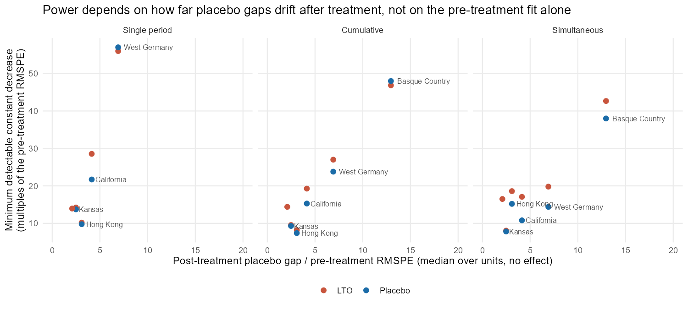
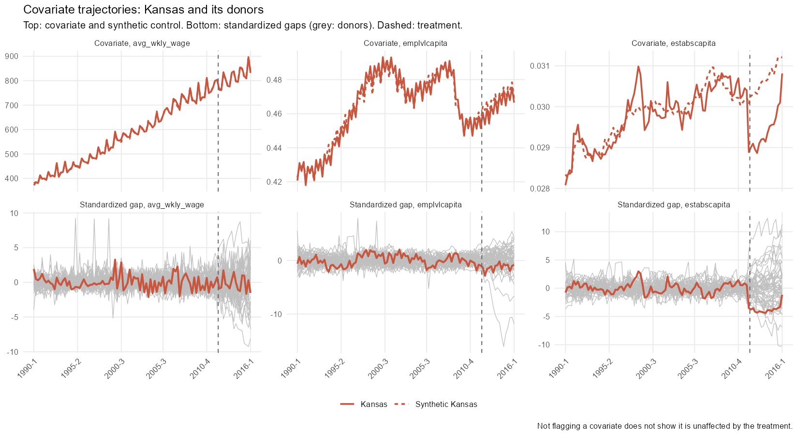

# Validation Summary for the Experimental Functions

*Written by Claude, an AI model made by Anthropic, at the direction of Jeffrey Milliman.*

`dsc_placebo_lto()`, `synth_power()` and `covariate_trajectory_check()` are experimental. This page summarizes the simulations that check them. They are tested by simulation in this project, not by independent peer review. The leave-two-out (LTO) test follows Lei and Sudijono (2025), a working paper; its adaptation to the demeaned synthetic control, the simultaneous band, the sensitivity analysis and the ridge option were written for this package. The simulation scripts and full write-ups are not yet in the repository.

## `dsc_placebo_lto()`: tests with small donor pools

**Why it exists.** `dsc_placebo()` ranks the treated unit's gap among its donors' placebo gaps, so with $N_d$ donors its smallest p-value is $1/(N_d + 1)$. A 95% test needs at least 19 donors; with fewer, the intervals and bands are infinite. The LTO test compares the treated unit with every pair of donors, which allows a 5% test with as few as about 9 donors.

**Design.**

- **Real panels:** subsamples of 10 to 20 units from Kansas (quarterly GDP per capita, 49 states), California's Proposition 99 panel (cigarette sales, 38 states) and West Germany's OECD panel (GDP per capita, 16 countries), with the real treated unit removed and every unit treated in turn; 200 subsamples per panel and size. A further check used 1,200 subsamples of 8, 10 and 15 units that also include the Basque regions.
- **Factor model:** simulated panels with 10, 15 and 20 units, the treated unit assigned at random, selected on its factor loadings, or extreme; AR(1) errors, unequal noise, short pre-periods and trending factors; 1,800 replications per cell.

**Results.**

| | Standard placebo (`dsc_placebo()`) | LTO (naive version) |
|---|---|---|
| Pointwise test at 95%, 9-14 donors | cannot reject; infinite intervals | false-positive rate 4.5-7.5%; intervals cover the true effect 91-96% |
| Pointwise test at 90% | over-rejects with 9 donors (14%) | 4.5-9.3% in every case |
| Simultaneous band at 95%, 9-14 donors | infinite | covers the whole effect path 91-96% |
| Simultaneous band at 90%, 9 donors | covers 84-85% | covers 90-91% |
| Factor model, random assignment, 10% level | 8.5-13.6% | 6.4-8.4% |

- **Power** is close to the standard placebo test's where both can be used. With 19 or more donors the LTO test is somewhat conservative.
- **The sensitivity analysis** (how unequal the chances of treatment would have to be before a result stops being significant) agrees with an exhaustive search over the 16 donors for West Germany.
- **Intervals** were always a single interval in these simulations, never empty or split.
- **Limitation:** like any placebo method, the test assumes the treated unit's errors behave like the donors'. An extreme treated unit makes the test conservative, not invalid, in the factor model.

## `synth_power()`: how large an effect can be detected?

**Design.** Six benchmark panels that come with R packages: California (Proposition 99), West Germany, the Basque Country, Kansas, Hong Kong and `Synth`'s simulated example. In each, the real treated unit is removed and every other unit is treated in turn, with known effects added in five shapes (constant, ramp, plateau, decay, one-period shock). The minimum detectable effect (MDE) is the smallest effect detected at least 80% of the time.

**Results.**

- **False-positive rates** with no effect stay close to the nominal level; the exceptions are single units in the smallest pools (for example, 2 of West Germany's 16 units under the placebo single-period test, 12.5% at 10%).
- **Typical panels need large effects.** In the four annual panels, a sustained effect has to be **25-45% of the outcome** before the cumulative test detects it reliably, and a gradual one 40-70%. Only Kansas, with 48 donors and a long, well-fitted pre-period, detects 10-15% effects.
- **Effects that arrive at once are the exception.** A one-period shock tested at its onset is detected at 7-14% in five of the six panels.
- **What limits power is drift after treatment, not pre-treatment fit.** The Basque regions fit best before treatment but need the largest effects, because their placebo gaps grow to about 13 times the pre-treatment fit error over a 28-year post period:

- **Ridge augmentation and covariate adjustment** change the MDEs by only 1-5 points either way. They are tools for bias, not power.
- **Practical use:** run `synth_power()` on the study's own panel and report the MDE alongside a null result, so readers know which effects the data could have detected.

## `covariate_trajectory_check()`: did a covariate break away after treatment?

The check treats each covariate as an outcome and runs the placebo tests on it. It was tried on two panels with known stories:

- **Oregon (drug decriminalization):** fentanyl's share of forensic drug reports (NFLIS) is flagged at every test (p = 0.02, the smallest possible with 49 donors). Fentanyl arrived in Oregon at the same time as the policy, which is the coincident confounder that the [Oregon case study](../oregon_fentanyl/oregon_fentanyl_case_study.md) adjusts for.
- **Kansas (tax cuts, 2012):** none of the three covariates is flagged (establishments, employment and weekly wages per capita; p = 0.12-0.92). Establishments per capita drop sharply at the treatment date, but several donors' gaps move as much, so the drop is not unusual relative to them:

**It is a screen, not a decision rule.** It has the same limited power as the outcome test, so a covariate can move by several percent without being flagged. And it cannot tell a mediator (don't adjust) from a coincident confounder (adjust). The plots and knowledge of the case decide.

## Reference

Lei, L., and Sudijono, T. (2025). Inference for synthetic controls via refined placebo tests. Working paper, arXiv:2401.07152.
